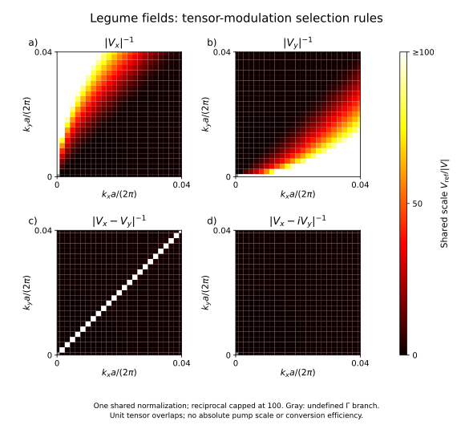
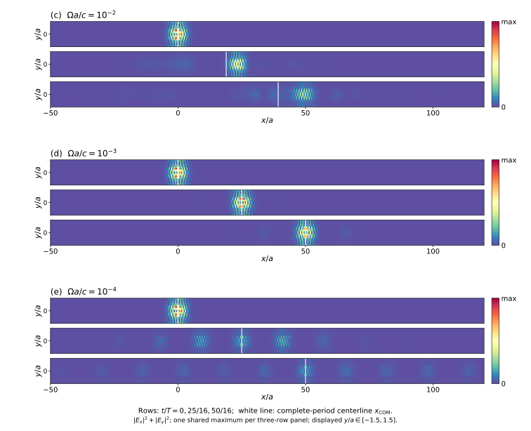

# 案例总览

这里汇集工具箱已经完成的文献计算、协议迁移和独立基准。七篇主要光子学文献分别连接到具体图号、实际求解路线与结果；解析周期共振器作为额外方法参照。每个案例都有结构化清单，可从 [research.yaml](../../research.yaml) 访问。

## 文献中的光子学问题

| 案例与面板 | 实际完成的工作 | 物理范围与继续研究的部分 | 清单 |
| --- | --- | --- | --- |
| [LPR Fig.3 周期阵列](../../sptc_toolbox/results/paper_refresh_20261016/lpr/report.md) | Legume重新求场、多模电质量投影、频移曲线及环状/双瓣场；平方律指数1.999821，材料微扰与场积分相符 | 频移系数比论文读图值小约16–18倍；目标模式来源与E/D投影差异随结果记录 | [case](../../cases/lpr-periodic-array/case.yaml) |
| [Science Advances Fig.4](../../sptc_toolbox/results/paper_refresh_20261016/science_adv/report.md) | 49点原生路径、近Gamma局部加密、强调制锁频增长及共同辐射/记忆对照 | 动态34/49点位于当前通道范围，强调制22点锁频；固定论文泵的弱隙、全路径增长与原Ge色散仍有差异；Fig.4C待计算 | [case](../../cases/science-advances-fig4/case.yaml) |
| [Nature Photonics Fig.4](../../toolbox_experiments/nphoton_2024_01563/results/figure4/README.md) | 193点Meep静态响应，真实时变分裂/增长与共振增强；[d/g的193×501 T-matrix图](../../toolbox_experiments/nphoton_2024_01563/results/figure4/smin_trial/README.md)；[Lorentz损耗对照](../../toolbox_experiments/nphoton_2024_01563/results/figure4/lorentz_loss_analysis/report.md) | 面板按实际方法标注；j完整放大带宽及Fig.5待完成，材料解释带来中心频率差异 | [case](../../cases/nature-photonics-fig4/case.yaml) |
| [Minkov–Fan 2018 Fig.9(c–e)](../../sptc_toolbox/results/sptc_baselines/minkov2018_legume/report.md) | 224个原始k点、W1真实场行波投影、三驱动/三时刻场图；中速拖曳、慢速展宽和快速滞后 | 导模范围；快速位移和空间宽度保留敏感性；[连续Bloch及远尾结果](../../sptc_toolbox/results/targeted_resolution/w1/report.md)接续原图 | [case](../../cases/minkov2018-traveling/case.yaml) |
| [Garg 2022 Fig.4(a–e)](../../sptc_toolbox/results/sptc_baselines/garg_2022_full_figure/README.md) | 597频率点完整R/T/A及偶极幅比/相位，88个时间谐波与多极截断记录 | 独立球T-matrix；静态/中调制机制有支持，强调制高频空间敏感性和原图差异保留 | [case](../../cases/garg2022-array/case.yaml) |
| [Jin 2025 官方补充图5](../../cases/jin2025-tensor/CASE.md) | 624个k点真实Legume AlGaAs场，四种偏振的轴向/对角零线与圆偏振移除零线 | 当前采用无色散标量静态材料，空间截止下耦合幅度约4.1%变化；研究对象为张量选择规则 | [case](../../cases/jin2025-tensor/case.yaml) |
| [Jin 2025 Fig.4与补充图7](../../sptc_toolbox/results/sptc_baselines/jin2025/report.md) | 作者模态与C(P)输入下的转换峰、Rabi劈裂、1.5/6ps脉冲及独立ODE对照 | 辅助两模动态；短脉冲峰位/高度和输入来源差异保留 | [case](../../cases/jin2025-modal-dynamics/case.yaml) |
| [Zhang 2018 介质薄膜协议迁移](../../sptc_toolbox/results/zhang2018_disorder_baseline_20261019/report.md) | 64×8编码、64个Bloch扇区、最高512静态模式；独立超胞矩阵差0.27%，同带宽Floquet/ODE差7.4e−7 | 静态周期介质上的随机调制；八模/扇区相邻转移轨迹变化11.7%，原定5%目标尚未达到 | [case](../../cases/zhang2018-dielectric-migration/case.yaml) |
| [Zhang 2018 原金属与远场对照](../../sptc_toolbox/results/zhang2018_original_alignment_20261019/report.md) | 全八阶理想远场峰差≤0.02744dB；COMSOL原尺寸两态单元、三档网格与解析grounded-slab检查 | 原平台静态散射和慢调制编码；源电容歧义、完整动态阵列及显示坐标仍记录在案 | [case](../../cases/zhang2018-metal-reference/case.yaml) |

## 两个直观的结果

**偏振改变耦合零线。** 下图来自实际AlGaAs薄膜场的张量积分；轴向偏振、实相位组合和圆偏振具有不同的节点结构。

**行波推动W1波导中的波包。** 下图为原始224点Legume场生成的三驱动速度计算图，对应已有文献对照。后续[连续Bloch坐标及宽度研究](../../sptc_toolbox/results/convergence/w1/report.md)保留了这一版本，并单独给出改进结果。

## 独立基准与通用能力

| 基准 | 实际结果及可复用内容 | 使用范围 | 清单 |
| --- | --- | --- | --- |
| [均匀PTC](../../ptc_fig4/results/homogeneous_quick/validation_report.json) | 静态极限、正负频率、Mathieu弱调制、谐波截断与独立周期积分 | 均匀介质Maxwell方法验证 | [case](../../cases/homogeneous-ptc/case.yaml) |
| [解析导模薄膜](../../sptc_toolbox/results/reference_infrastructure/report.md) | Legume与解析色散最大频率差2.2843e−14 fa/c，共同场度量与空间细化 | 无损束缚导模空间基础设施 | [case](../../cases/analytic-guided-slab/case.yaml) |
| [共同通道与频变浴](../../sptc_toolbox/results/frequency_radiation/report.md) | 线宽重建、亮暗态、±k映射、有限谱窗因果浴和材料/行波联合演化 | 原生弱辐射输入及声明的频窗与闭合 | [case](../../cases/common-channel-radiation/case.yaml) |
| [ModePackage、ADE与QNM](../../sptc_toolbox/docs/integrated_backend.md) | 真实包读回、多Lorentz/Drude原始方程积分、左右模态、解析/围道留数 | 已给定有限空间算符及独立出射薄膜 | [case](../../cases/integrated-modal-material/case.yaml) |
| [开放色散薄膜](../../sptc_toolbox/results/floquet_slab/report.md) | Fresnel、121点散射、半泵相敏功率、复频极点与散射留数；所选侧带N4→N6差5.86e−13 | 空气两侧均匀薄膜、法向入射 | [case](../../cases/open-dispersive-slab/case.yaml) |
| [2017周期共振器](../../sptc_toolbox/results/sptc_baselines/periodic_resonator_2017/report.md) | Fig.3/5a的侧带与波形，Bessel复幅差<7e−16、原始ODE侧带差约6.3e−12 | 正载频包络CMT的解析方法参照 | [case](../../cases/periodic-resonator/case.yaml) |
| [固定随机幅相](../../sptc_toolbox/results/modulation_disorder_20261019/report.md) | 同步/交替/随机/独立时间阶空间图案；全超胞积分差约1.6e−10，Floquet/ODE差约3.7e−9 | 2×2重复驱动与标量材料；空间转移轨迹约一成敏感性 | [case](../../cases/periodic-modulation-disorder/case.yaml) |
| [完整有限Floquet散射](../../sptc_toolbox/results/full_floquet_20261017/report.md) | 95条静态响应、17实源、±2边带、20×10复S及所有输入列内部场，可离线复算 | Legume场种子+Meep静态Green，Gamma/r32/x入射；空间网格敏感性约10%–15% | [case](../../cases/full-floquet-scattering/case.yaml) |
| [直接时变Meep](../../sptc_toolbox/results/direct_meep_comparison_20261018/report.md) | 一级复出射差0.0561%/0.0522%，末两窗变化<0.72%，达到预声明1%目标；保存实际耗时 | 同网格弱同步调制；二级原始复幅差6%–8%另存 | [case](../../cases/direct-meep-sidebands/case.yaml) |
| [相干激励、脉冲与Green](../../sptc_toolbox/results/forced_excitation_20261016/report.md) | 双侧相干输入、有限脉冲、半泵功率、暗态求解及均匀Maxwell Green控制 | 实际Gamma零阶端口，明确背景和辐射模型 | [case](../../cases/forced-green-response/case.yaml) |
| [W1分层收敛](../../sptc_toolbox/results/convergence/w1/report.md) | 空间/模态/时间/K网格/联合检查、连续Bloch修复与远尾处理 | 保持物理模型固定，沿用各次预声明容差与历史记录 | [case](../../cases/w1-convergence/case.yaml) |

## 如何复用这些结果

从感兴趣的报告开始，查看几何、材料、驱动、观测量和实际入口。`case.yaml`把报告、代码与验证记录连在一起；计算命令和步骤保留在原报告中。核心Legume案例、Meep、球阵列与COMSOL采用相应环境，方便按需要安装。

清单整理沿用已有计算记录。每次新运行可以选择独立输出目录，保留输入配置与软件版本，再按当前物理问题比较结果。已有报告中的数值与容差保持原样，方便理解不同阶段的进展。

[Fang–Wang 2019 与 Vial–Craster 2025](../LITERATURE-CANDIDATES.md)目前是已完成来源核查的后续候选，单列于候选池。更完整的阶段性资料见[研究归档](../../sptc_toolbox/README.md)。
