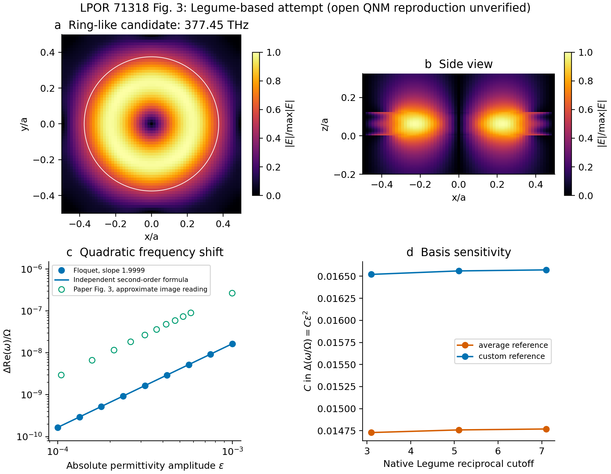

# LPOR 71318：基于 Legume 的周期超表面 Floquet 尝试

论文：[Revealing the Resonant Physics of Open Photonic Time Crystals](https://doi.org/10.1002/lpor.71318)，正式版 Fig. 3(a,b)。

本目录是 **Legume / Floquet–Maxwell 工具箱的文献验证案例**，不代表后续研究方向。
直接复用 Legume 的空间本征模式、介电矩阵和场，在其上扩展时间谐波。
目前得到与论文相似的环状候选模式和弱调制平方频移，频移系数仍约差 16 倍。
文献趋势对照与工具箱内部数值正确性分别验收。
[工具箱验证范围](../TOOLBOX_VALIDATION.md) · [算例报告](reproduction_report.md)。



## 本地运行

从整个工作区根目录执行，使用已配置的虚拟环境：

```powershell
$env:OPENBLAS_NUM_THREADS='2'
$env:OMP_NUM_THREADS='2'
.\.venv\Scripts\python.exe lpor_71318\scripts\static_legume_probe.py --reference custom --gmax 7.1 --vertical-modes 8
.\.venv\Scripts\python.exe lpor_71318\scripts\run_fig3_attempt.py
.\.venv\Scripts\python.exe -m pytest lpor_71318\tests -q
```

`legume_basis.py` 只调用原生空间接口；`field_projection.py` 将原生 D 场和圆柱 Fourier
系数投影到时间依赖的逆介电矩阵；`modal_floquet.py` 复用此前通过独立均匀 PTC
基准的 `ptc_fig4.floquet_maxwell`。材料调制为 `16 + amplitude*sin(Omega*t)`，没有 DC。

文献与来源存于 `literature/`；机器结果位于 `results/fig3_attempt/summary.json`，
谱线数据位于 `weak_modulation.csv`。`results/modal_completeness/` 保存更高模态截断检查。
本地 `gme_native.pkl` 仅作为同版本运行缓存；独立复算请从几何配置开始，不读取不可信 pickle。

旧 Science Advances 项目保留在相邻 `ptc_fig4/`，本次未继续修改其空间求解路线。
后续交付采用本地脚本与结果图；已有 Colab 文件保留作历史产物，不再维护或要求使用。
