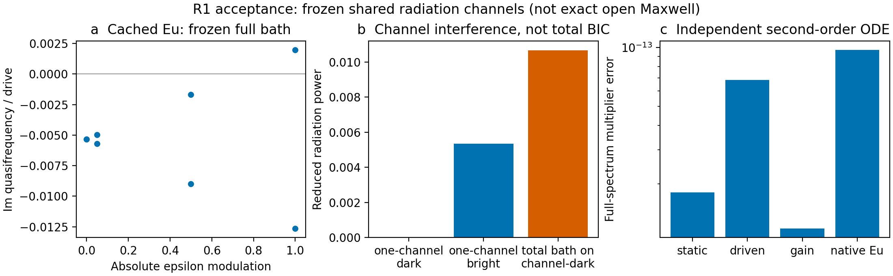

# Legume 上层的开放 Floquet 扩展

本目录完善的是我们自己的 **静态数据适配、时变耦合与Floquet后端**。
Legume继续负责几何、静态模式、场及原生辐射导出，库本体未修改。

**2026-10-19：替换未对齐基准的候选核查（历史材料 `literature/alternative_dielectric_baselines_20261019/README.md`；见[发行说明](../docs/RELEASE.md)）。**
Zhang2018尚未通过完整原文物理对照，理想阵列因子一致不替代实际静态/动态验证。
新核Fang–Wang2019的真实介质三Bloch波调制（原生Legume PWE适用的二维体模型），
以及Vial–Craster2025的开放Floquet-QNM薄板（正式全文、作者pytmod代码已取得）。
两者分别覆盖空间调制与开放极点/散射；本轮仅筛选，没有新复现结果，也不填补
二维开放薄膜固定随机驱动的直接同型文献缺口。

**2026-10-19：[Zhang2018 原金属/PIN平台与原文远场对齐](results/zhang2018_original_alignment_20261019/report.md)。**
按SI3原理想反射模型重算全部八阶，峰值与原标注差≤0.02744dB；保存未决显示
坐标约定。另用COMSOL6.4实际求SI9尺寸周期金属单元，原文28pF与单列0.028pF
控制在10GHz得到约0.31°/203.4°的两态相位差，厂商电容量级已独立核对。
三档网格与解析grounded-slab控制（细档复反射差2.82e−6）支持端口和电路实现；
实际复反射接入原随机码，保留载频均匀项及非零阶对比度。这是额外原平台对照，
未把源输入歧义认定为已确认勘误，也未认证完整动态阵列或解决Legume模态窗口限制。

**2026-10-19：[Zhang2018 固定空间随机时序的实际测试](results/zhang2018_disorder_baseline_20261019/report.md)。**
原文64×8码的反射幅相与SI原图并排；完整编码迁移到实际Legume周期介质薄膜，
64个Bloch扇区、最高512静态模式，保留48格非零DC。独立2×2超胞调制矩阵差
0.27%，同带宽Floquet/ODE乘子差7.4e−7；原阶梯波残差约9.45e−5。
发现保留模态窗口的实际限制：每k两模→四模→六模→恢复低模至八模，转移轨迹
相邻敏感性29.1%/25.8%/11.7%，尚未达5%。这是文献协议迁移及材料算符验证，
没有宣称原金属阵列或完整开放无序散射复现；DC-only控制与实际场身份均保留。

**2026-10-19：[Jin 2025 官方补充图 5 的实际 Legume 对照](results/jin2025_legume_tensor_20261019/report.md)。**
按穿孔 AlGaAs 薄膜计算 624 个 k 点，真实场导出非对角介电张量耦合，复现两条轴向
零线、实相位组合的对角零线与圆偏振移除零线。空间截止下幅值约 4.1% 敏感性，
节点结论保持；实际三模输入的 Floquet/独立时间积分乘子差约 3.9e−11。
含论文原图并排对照、材料敏感性和共同场度量身份检查。
这是张量/相位控制基准，不是随机调制或完整开放拓扑验证。
[通用张量接口](docs/tensor_modulation_usage.md)复用原有动态后端。

**2026-10-19：[周期静态结构上的调制无序](results/modulation_disorder_20261019/report.md)。**
新增独立空间/时间Fourier调制输入与各晶胞固定随机幅相；实际Legume四个k扇区
场投影接入既有动态后端，静态几何保持完全周期。2×2重复驱动图案已运行同步、
交替、随机相位、随机幅相和独立p1/p2空间图案。全超胞实空间积分对照约1.6e−10；
代表性有限模型Floquet/时间积分乘子差约3.7e−9。提高至最大约24%介电调制幅度时
需要更多时间边带，仍仅为有限模型验证。空间截止下转移轨迹约一成敏感性保留，
辐射为明确trial的冻结共同通道近似，未冒称新随机驱动的直接Meep或完整开放散射。
[用法](docs/modulation_disorder_usage.md)与精确随机编码和baseline范围（历史材料 `literature/general_spatiotemporal_20261019/focused_baselines.md`；见[发行说明](../docs/RELEASE.md)）已保存。

**2026-10-19：[同网格直接时变 Meep 对照与实际耗时](results/direct_meep_comparison_20261018/report.md)。**
保持 r32 原生平滑材料、固定载频和调制，直接在 Meep 中更新介电常数并演化场。
两档材料更新时间、零调制和独立晚窗对照完成；细档一级复出射与现有 Floquet 差
0.0561%／0.0522%，末两窗变化0.715%／0.639%，均达到预先1%目标。原始二级仍有
约6%–8%复幅差，辅助零调制差分定位共同启动暂态，但不替代原始收敛判定。
直接双扇区各约21–25分钟（并行运行）；已有库的完整单输入求解约27秒，冷加载合计约31秒。
首次建库与复用分开计时，少数新工况可优先直接Meep，可复用参数扫描保留Floquet；
这不消除空间敏感性或认证任意泵浦稳定性。另附既有论文逐面板来源核查。

**2026-10-18：[完整 Floquet 空间网格对照](results/floquet_spatial_20261018/report.md)。**
完成同物理设置的 r32/r40 完整 M2 散射，并用实际静态场的一级 x→x 互易参考检查 r48；
r48 不代表完整 M2。一级功率在 r32→r40 变化约 8.96%／12.88%，r40→r48 变化约
10.66%／15.22%（分母为细网格），尚未达到预声明 5% 目标且不单调。复振幅与尾部时间敏感性
分别报告，静态场和材料诊断保留失谐、离散界面及对称性候选，不拟合归因或推收敛阶。
这是 Legume 场种子＋Meep 静态 Green 混合验证；固定 Courant 下 dt 随网格共同变化。

**2026-10-17：[平滑材料的完整有限Floquet数据集](results/full_floquet_20261017/report.md)。**
实际95条静态频率响应、17个实源坐标与±2边带，给出20×10复散射矩阵及全部入射列的
内部谐波场。材料由真实周期参数的16相位原生算子取得，包含DC及±1…±4。原始数据与
经时窗／Maxwell残差检查选用的长尾处理并存；两次CW失败不作为成功参考。
载频一阶侧带约1.19e−4／1.22e−4，二阶约1.80e−9／2.23e−9；M1→M2一阶复幅变化约0.003%。
数据包可移动并离线重算，完整范围限于Γ点、r32、五频、x入射子空间；保留原空间敏感性。

**2026-10-17：[固定驱动空间敏感性的界面修复](results/spatial_repair_20261017/report.md)。**
定位无平滑Yee界面造成的离散厚度跳变与约11个半线宽的共振移动，恢复Meep原生亚像素
材料算子，并接通完整交错张量的bulk介电导数、稀疏材料作用和原生owner／ghost坐标。
新的参考流程默认使用平滑材料及相容调制极化；无平滑算例保留为离散闭环控制。
实际Legume场与静态材料极化的投影接口已验证；固定驱动的完整电流r32→r40功率变化
降至约−8.18%／−11.46%，相干出射仍有约13%的复振幅差，尚非完全空间收敛。
它不是纯Legume完整散射，也不把有限网格的内部一致性当作绝对效率收敛。

**2026-10-17：[一致的材料—源—Green—Floquet闭环](results/consistent_green_20261017/report.md)。**
在同一标量原生Yee算符内接通材料导数、精确源提升、稳态Green响应和解析离散端口，
三个物理频率都使用完整静态输入／出射。实际材料正负微扰与完整极化电流的出射差约0.031%，
新增独立离散Maxwell测试验证输出边带频率因子。此为Legume场种子＋Meep静态响应的混合验证；
新r24/r32无亚像素平均模型与历史r32张量模型明确分开。当前NativeGreen已按原协议重算，
对新r32完整参考功率差约48%／17%；新增广模型对同一参考复幅差约1e−7，但新标量模型的
r24→r32绝对功率变化显著，固定驱动空间收敛仍待处理，不能以内部一致性冒充精确效率。
原严格迭代未达成的记录保留；使用有界试算并由独立物理对照判断当前观测量可靠性。

**2026-10-17：[奇偶背景增广、原生源功配对与稳态控制](results/discrete_green_20261017/report.md)。**
新增可复用 `enrich_field_basis`，实际加入静态奇背景后，单侧弱侧带复振幅差由约19%–20%
降至0.93%／0.73%。这是混合静态 Green 验证；反相激励仍差约6%–7%，不推广为全端口精度。
原生 Yee 总源配对将同一场的互易残差由3.07%降至约1e−15；独立频域控制将弱模板的
源功／出射差收敛至约0.22%。另定位默认亚像素材料的镜像偏差，实际原生对称边界控制
恢复了奇偶规则；新离散算符的数据未混入旧Green。连续电流规范的已知源时相也已单独修正。
仍需将一致的源／材料投影与稳态样本合成动态适配，不能宣称完整开放散射已完成。

**上一轮：[真实二维图案静态 Green 输入与背景增广](results/patterned_green_20261016/report.md)。**
新增有限源空间的静态响应接口，并实际计算三频、两种极化模板的完整场与出射。
这是 Legume 原生场＋静态背景残差＋Meep 静态响应的混合验证。同相源空间残差由
8.505%降至0.07588%；弱侧带复振幅与完整电流参考相差约1.5%–1.7%。单侧入射仍有
约19%–20%的复振幅差，源功／出射能流一致性尚未关闭，不能推广成纯Legume完整散射。
另作独立静态参考的等待时间与PML对照，详见报告及[接口用法](docs/projected_green_usage.md)。

**2026-10-16：[统一静态Green响应与Floquet受迫散射](results/green_response_20261016/report.md)。**
每个边带的静态A/B/C/D与显式调制核统一组装，保留跨模态调制并同时消元四项。
独立均匀Maxwell Green参照随空间加密收敛，实际Legume双模、多频相干源及完整
状态重建已通过。新的native适配仍保留冻结辐射／均匀背景近似；没有据此宣称
任意二维图案的完整静态Green已获得。完整回归1010项通过。

**2026-10-16：[受迫散射与源激励完善](results/forced_excitation_20261016/report.md)。**
实际Legume薄膜已运行双侧相干源、逐边带输出和因果有限脉冲；修复短脉冲积分漏采，
接通半泵实源相敏功率及同模型稳定性解释，并提供精确不可激发／不可观测暗态的显式
相容散射求解。完整回归969项通过。端口仍是Gamma对称零阶双端口，几何平均背景、
任意角多衍射级和完整频变外散射范围未被这轮接口验证自动解决。

**2026-10-16：[两篇论文的新计算与正式原图并排对照](results/paper_refresh_20261016/report.md)。**
这次重新求解LPR和Science Advances的原生空间模式与场，并应用多模窗口、
共同频率辐射及Science局部频变记忆控制；不同于此前旧缓存／旧模型的接口回归。
LPR平方律与场形保留，频移系数仍差约16–18倍；Science固定论文泵频仍未得到
完整动量隙，另列按静态共振规则选泵的局部机制对照。主图保持论文可核实的
坐标和颜色，未计算面板、模型失效点及材料假设明确保留。

使用与开发以物理问题为先：按带隙、失谐、线宽、增长率或传播时间确定所需数值精度。
专项检查未达严格阈值不等于机制错误；机制有相应控制和观测量证据支持时继续做研究，
保留定量敏感性说明。参见[按物理目标安排验证](docs/convergence_workflow.md)。

最新按物理用途重新审查（历史材料 `literature/physics_acceptability/README.md`；见[发行说明](../docs/RELEASE.md)）已核对现行主路径、
原始方法文献及实际观测量，新增15次原生辐射抽查、Science泵损余量和W1主峰／远尾诊断。
区分经验门槛拒绝、真实通道开启、机制证据与定量敏感性；没有据此改动历史容差或求解器。

**当前主线：真实时间调制 SPTC 基准（历史材料 `literature/sptc_baselines/README.md`；见[发行说明](../docs/RELEASE.md)）。**
主候选覆盖开放色散球阵列、单胞内三相调制及有限 AlGaAs 张量调制薄板。
文献候选、实际复现和独立数值验证分别记录；静态/方法候选池保留为辅助参考。
[本轮实际结果](results/sptc_baselines/README.md)包括 Garg 阵列局部复现与未关闭的强调制差异，
以及解析周期共振器的独立 Bessel/时域对照。

**实际 Legume 动态主基准：[Minkov–Fan 2018 Fig. 9(c–e)](results/sptc_baselines/minkov2018_legume/report.md)。**
已由原生 W1 薄膜静态场计算连续行波调制重叠，完成有限正负频 Maxwell 演化、
一周期 Floquet 算符和真实场图重建。主结果支持快驱动滞后、中驱动拖曳、慢驱动展宽；
空间截断对宽度仍有影响，导模模型不认证强辐射 QNM。

[独立固定 k 求解](results/sptc_baselines/local_k/report.md)已实现：
`solve_slab_local` 无需预先通过跨 k 跟踪，明确标记 `cross_k_identity=not_assessed`；
保留局部简并簇、Fourier、独立时间积分和辐射模型范围检查。
同一固定驱动下的实际薄板算例有 8 个局部模型通过、5 个联合双模模型因冻结浴频宽拒绝。
独立单模成功不能替代被拒绝的耦合双模计算。

最新主回归为 **1042 项通过**（工具箱851＋历史求解器191）。
另有此前 WSL Meep 模态拟合 **12 项通过**，见
工具箱测试记录（历史材料 `results/full_floquet_20261017/regression.xml`；见[发行说明](../docs/RELEASE.md)）、
历史求解器测试记录（历史材料 `results/full_floquet_20261017/regression_legacy.xml`；见[发行说明](../docs/RELEASE.md)）与
Meep 测试记录（历史材料 `results/sptc_baselines/meep_fit_regression.xml`；见[发行说明](../docs/RELEASE.md)）。
下文保留历史阶段的测试计数及适用范围。

**[远尾、长期转移与动态侧带定向处理](results/targeted_resolution/report.md)**：W1原RMS的
主要周期折回已定位，保持原初态和完整尾部后得到约10.3046a；实际完整有限静态空间上的
Floquet态降阶保留42周期逐扇区轨迹至约3e-5误差。更细Meep参考使动态侧带差从约2倍降至
14%–17%；新增静态散射场互易一级转换接口与独立极化电流法对照。空间范围和绝对效率
仍有明确近似，见[新接口用法](docs/targeted_resolution_usage.md)及原文来源。

**[材料、行波与辐射联合接入](results/connected_physics/report.md)** 已完成：实际区域ADE
与频率相关浴共用同一Maxwell坐标，实际行波跨动量耦合与分扇区记忆浴联合演化。
空间截止提高至g9.1后，最后相邻加密的放大峰值和宽度变化约2%，中心仍约0.11带宽。
物理背景＋原生端口的静态复S误差约2.49%；动态弱侧带已有独立全波对照，绝对效率仍差约2–2.5倍且参考自身网格敏感。
接口和范围见[本轮用法](docs/connected_physics_usage.md)，不把已有机制支持写成任意结构的精确散射。

**[剩余项的实际处理](results/remaining_limits/report.md)**：memory主入口已支持实际±k
及跨衍射阈值积分；行波动量窗口已比较到10个唯一扇区，并接非零共同辐射的Markov动态；
实际图案区域Lorentz/Drude ADE已接通。空间/垂直族使用同一驱动网格比较，保留峰值与
共振位置的真实敏感性。静态物理R/T已由Meep取得，但动态模态端口连接尝试未通过。
W1 RMS和长时行波模态敏感性仍保留，见[新增接口](docs/remaining_limits_usage.md)。

**[实际二维薄膜接口接入](results/physics_pipeline/report.md)** 已完成：局部入口支持
strict/trial/实际边带评估，以及显式有限窗memory辐射后端；动态模态扩窗按所需观测量停止。
同一圆孔／椭圆孔结构已运行实际试算、更新频变谱和20周期扩窗控制。
另新增通用二维行波材料投影及明确的物理场坐标／E-H相位转换。
频变模型的窄阈值对谱窗敏感；行波实例仍为原生零辐射导模，有限动量窗影响具体转移量。
参见[本地使用入口](docs/physics_pipeline_usage.md)。

**[四项基础设施实现与验证](results/four_foundations/report.md)**：新增独立轴预算加密、
完整Bloch子空间输运、模态窗自动富集及Schur反馈、无展宽连续谱分支与边带自能。
实际使用W1、LPR和Science的Legume数据，另外修复简并子空间身份误判和出射支实轴延拓问题。
空间序列仍未达既定精度；42模外窗耗尽；衍射阈值奇点、谱尾及严格QNM映射仍未关闭。
参见[接口与物理范围](docs/four_foundations.md)，不将有限模型成功升级为完整开放二维SPTC认证。

**[分层收敛工作流](docs/convergence_workflow.md)** 已实现，W1 已实际运行空间、模态、
时间、K 网格和联合检查，见 [实际结果](results/convergence/w1/report.md)。
检查发现有限 G 基底在动量直接折回时不保持物理场连续；新连续 Bloch 坐标选项已接入，
旧结果保留为失败/敏感性证据。逐项通过和模型表示限制分别报告。

投影与开放连续谱的文献依据（历史材料 `literature/projection_foundations/README.md`；见[发行说明](../docs/RELEASE.md)）将这些问题放入
Galerkin、Bloch sewing、子空间窗口及 Feshbach/Schur 消元框架；列出可借鉴方法和适用边界。
该文献核验为本轮实现提供依据；指定有限谱窗的自能现已实现，完整Maxwell辐射自能仍未认证。

[Jin 2025 辅助检查](results/sptc_baselines/jin2025/report.md)已对照主文 Fig. 4 和 SI Fig. 7(a)：
采用公开测量模态与作者 C(P) 标定，独立重算开放两模频率转换和有限脉冲响应。
`transient.py` 提供通用显式 H/B/C/D 瞬态接口，区分谱比与时间积分通量。
该结果使用作者模态输入，不算 AlGaAs 张量薄膜的 Legume 复现或拓扑认证。

**2026-10-15：[二维图案薄膜与多区域调制接入](docs/pc_slab_pipeline.md)。**
支持多层Circle/Ellipse/Poly、层背景及整层材料投影、单胞区域相位协议、
真实晶格/模态身份检查及E/H/D Floquet场重建。实际40点薄膜路径保留失败
状态；609项回归通过，不将部分路径成功升级为全BZ开放谱认证。

**2026-10-14 新增：[统一ModePackage、QNM、色散与散射接口](docs/integrated_backend.md)。**
已运行真实Legume包导出/读回、多Lorentz/Drude独立验证、广义左右模态及导数留数、
完整有限状态空间散射，以及物理时变色散薄膜的散射与局部复频极点。
下文的R1/R2说明保留其Legume适配范围；新增通用模块不自动消除这些空间限制。

当前物理结构的动态求解仍采用弱辐射、窄频段、冻结共同通道的多模近似（R1）。
另已增加共同正实频辐射适配（R2a）及因果记忆控制模型，二者还没有合成完整
频率依赖开放Maxwell/QNM求解器。后续三类调制和边带辐射按独立阶段扩展。

| 文件 | 已实现能力 |
|---|---|
| `radiation.py` | 调用原生`compute_rad`，按物理通道对齐，检查单位和线宽重建，生成保留复相位的完整共同通道阻尼矩阵。 |
| `open_system.py` | 将既有材料投影K(t)与完整Γ连接；求解正负频率Floquet谱，检查泵浦、辐射和能量增长平衡。 |
| `frequency_radiation.py` | 固定静态模式，在共同正实频率重新评价原生辐射态/通道/DOS；含on-shell复耦合回归、源码版本与阈值保护。 |
| `causal_memory.py` | 有显式辅助状态的被动因果记忆控制模型，验证自能解析性和完整Floquet谱；参数不是由Legume线宽拟合。 |
| `tracking.py` | 基于物理场投影器的简并簇/目标子空间追踪，端点只验收不强制闭合，失败身份不继续认证。 |
| `reference_runner.py` | 将真实多层几何与Legume数值参考层分开，精确检查物理结构不变并记录原生基底来源。 |
| `spatial_fields.py` | 不同gmax采用倒格矢并集和相同z求积导出原生H场，禁止交集截取抬高模式重叠。 |
| `basis_stability.py` | 诊断高权重参考导模进入/退出，分开验收原目标身份、局部连续性与同k频率/场加密。 |
| `scripts/validate_open_backend.py` | 解析亮暗态、非对易被动系统、独立二阶时间积分、实际Legume缓存Eu模式与时间截断验收。 |
| `docs/validation_report.md` | 实际运行结果和适用范围。 |

第一轮开放扩展回归165项通过，基准保护后200项；本轮实频辐射、因果控制与
跟踪扩展后268项；本轮负频谱映射与有限窗口因果连接后为 **315项通过**
（`results/signed_causal_pytest.xml`）。通用参考基底与场坐标层完成后，最新完整回归为
**401项通过**（`results/basis_stability_pytest.xml`），另有解析薄膜独立数值对照。
实际Eu双重态接入时发现了简并Floquet副本会发生
基底旋转的筛选问题，已在通用后端修复：比较左右子空间，保留物理重数，
不再依赖单个本征矢恰好对应。对应随机基底旋转回归和失败记录均保存。

## 本地运行

从工作区根目录：

```powershell
$env:OPENBLAS_NUM_THREADS='2'
$env:OMP_NUM_THREADS='2'
.\.venv\Scripts\python.exe -m pytest ptc_fig4\tests lpor_71318\tests sptc_toolbox\tests -q --disable-warnings
.\.venv\Scripts\python.exe sptc_toolbox\scripts\validate_open_backend.py
```

默认验证使用本工作区生成的可信Legume缓存，不新求解空间本征问题；
`--synthetic-only`可只运行解析/有限模型测试。不读取来源不明的pickle。

## 接入现有模型

```python
from sptc_toolbox.radiation import NativeRadiationData
from sptc_toolbox.open_system import FrozenOpenSystem, solve_open_floquet
from sptc_toolbox.native_bridge import NativeCylinderSubspace

# 联合提取并校验几何、k、模态顺序与相位，防止简并模态的错误拼接。
subspace = NativeCylinderSubspace.from_legume(gme, [3, 4], kind=0)
model = subspace.open_model(Omega_a_over_c, amplitude=0.1)
spectrum = solve_open_floquet(model, n_harmonics=7)
indices = spectrum.physical_modes()
```

非简并模的原生通道在不同自身频率评价，默认拒绝作为精确共同浴拼接；
只有显式启用窄带近似并通过频宽、通道阈值和弱损耗条件时才允许。
合法复场相位保留；变化空间基底时材料与辐射须一起变换。

目前能在各个正实频率识别新开的辐射通道，但尚未将它们纳入完整的复频Floquet自能。
真实辐射的反应性自能、负频出射映射、调制引起的系统—浴耦合、
QNM留数归一化和空间行波协议仍未完成。原生通道到Γ的弱损耗误差以及静态极点偏差均有记录，
没有通过额外Γ²补偿或拟合修改把近似包装成精确。

[验证报告](docs/validation_report.md) · 范围与方程（历史材料 `docs/implementation_scope.md`；见[发行说明](../docs/RELEASE.md)）

## 频率分辨辐射与因果控制

[本轮进展及边界](docs/r2_progress.md)记录共同实频回归、实际Science/LPR边带复核、
同频共同浴重算和跨BZ失败诊断。可重复运行：

```powershell
.\.venv\Scripts\python.exe sptc_toolbox\scripts\validate_frequency_radiation.py
.\.venv\Scripts\python.exe sptc_toolbox\scripts\compare_common_frequency_bath.py
.\.venv\Scripts\python.exe sptc_toolbox\scripts\recheck_sideband_radiation.py
.\.venv\Scripts\python.exe sptc_toolbox\scripts\validate_causal_memory.py
```

[真实共同实频辐射](results/frequency_radiation/report.md) ·
[同频浴的实际Floquet对照](results/common_frequency_bath/report.md) ·
[正频边带后验检查](results/sideband_radiation/report.md) ·
[因果控制](results/causal_memory/report.md) ·
[最终空间追踪诊断](results/spatial_tracking/final/report.md)

## 负频映射与因果谱连接

[最新进展](docs/signed_causal_progress.md)：`reality.py`用实际±k模场建立实轴
负频通道谱/功率映射；`spectral_bath.py`和`memory_pencil.py`提供明确有限频窗下
的被动因果实现与等价Schur–Floquet问题。它们尚未唯一确定真实辐射自能。

新增Science问题点的80模输出与积分对照发现参考导模跨截止引起基底改变；
一个退出的导模分量曾有约22%目标权重。这是静态适配/截断需要继续处理的证据，
不是简单的Floquet符号错误。

[原生±k映射](results/native_reality/report.md) ·
[正负边带功率](results/signed_sidebands/report.md) ·
[原生谱因果连接试验](results/native_spectral_completion/report.md) ·
[静态子空间原因诊断](docs/spatial_window_review.md)

## 通用参考基底稳定性

[接口与使用说明](docs/general_basis_stability.md) 将物理结构、数值参考层、公共场度量
和验收规则分开。不同参考层的系数标签不被当作相同物理基函数，未通过的配置
不会因为“最平滑”而自动入选。新规则也修复了接收子空间维数不足时，compact SVD
遗漏丢失方向、可能误报完整捕获的问题。

有解析解的均匀薄膜正例独立运行：

```powershell
.\.venv\Scripts\python.exe sptc_toolbox\scripts\validate_reference_infrastructure.py
```

该正例与边界匹配色散的最大频率差为约 `2.3e-14 f*a/c`，并通过实际空间基底加密
和物理场重叠检查。其范围是无损导模，并不认证开放QNM或任意图案结构的完备性。
论文几何只作为通用接口的压力测试；原论文基准缓存保留。

## 两篇文献的回归基准

正文及SI已重新核查，来源与缺项见 [参数审计](baselines/source_audit.md)。
修复后分别运行 [LPR基准](results/baselines/lpr/summary.json) 和
[Science Advances基准](results/baselines/science_adv/summary.json)。
结果与适用范围见 [基准总报告](baselines/README.md)。本轮不宣称两篇均已定量复现。

```powershell
.\.venv\Scripts\python.exe sptc_toolbox\scripts\run_baselines.py
```

`native_bridge.py`将材料与辐射绑定到同一原生基底；`diagnostics.py`检查目标
Floquet分支的边带是否跨衍射阈值、落到负频率或离开冻结浴评价频段。
这些检查暴露尚未验证的范围，不会自动补上缺失的频率依赖辐射。


