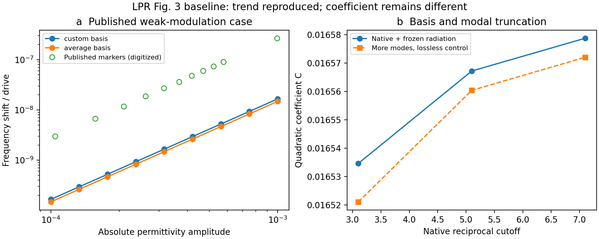
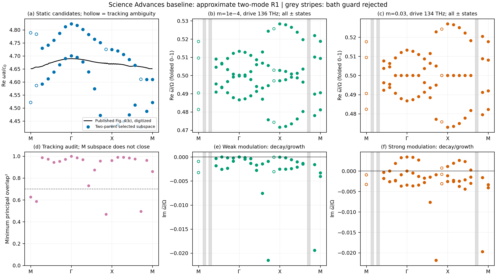

# 两篇文献回归基准与本轮修复

2026-10-14。两篇文献用于验证研究工具箱，不作为后续课题方向。
本轮实际完成自有后端保护修复、正式正文/SI再核查，以及修复后的两项基准尝试。
安装的Legume库本体未修改，已有论文、原始结果和Meep对照全部保留。

## 本轮修复

1. **材料与辐射必须来自同一模态坐标。** 仅检查相同频率不能识别简并模式的
   相位或基底旋转错误。新增`NativeCylinderSubspace`联合提取，并用几何、k、
   导模布局、介电参考、模态顺序和复本征矢生成标识。两边标识不同即拒绝接入。
   同一通道的列置换仍合法；只旋转辐射、不旋转材料则会报错。
2. **严格验证空间投影输入。** 模态索引2.9曾可能被截断成2，布尔/负索引也可能
   改变所求问题。现在在转换前验证非空、整数、范围和唯一性；同步检查介电参数
   与积分阶数。几何标识使用精确数值，避免Legume显示字符串的舍入隐藏变化。
3. **暴露冻结辐射近似的边带边界。** 对所选物理分支逐个谐波记录实际频率、
   模型功率、权重、频段偏移、新开放通道及Rayleigh阈值。负频率通道、暗态零输出
   和微小谱尾都有独立测试；该诊断没有假装计算了缺失的频率依赖出射自能。

包括旧测试与新增35项保护回归，**200项全部通过**，机器记录为
`../results/baseline_pytest.xml`。开放Eu数据及解析能量/谱验收也已重新通过。

## LPR：正式 Fig. 3 周期超表面

采用正文给出的r=150 nm、h=50 nm、周期400 nm、ε=16、Ω=10¹⁴ s⁻¹、
绝对幅度正弦调制，无DC。方晶格/Γ/空气及柱内均匀调制是仍需明确保留的假设。
本轮分别运行三个custom空间截断和一个average参考，采用联合接口接入原生辐射；
目标为已有场形及对称性证据支持的最低A2g环状候选。

最高custom档得到静态f=377.4476 THz，平方律拟合指数 **2.00008**，
二阶系数 **C=0.0165787**。增加同对称性模式的无损对照为C≈0.0165720，
说明本次小幅变化并未消除和论文图读数约0.272的 **16.4倍** 差异。
原生Γ候选的辐射在数值上为零，不能据此宣布完整开放模式已定量复现。
相邻空间参考的差异仍记录，未通过调幅、移频或任意损耗拟合曲线。

此次公开资料再核查明确：LPR正文使用`ε(t)=εu+ϵ sinΩt`，Fig.5另将百分比写作
`100ϵ/ε1`。没有把Fig.3横轴相对化的来源依据。SI未补出绿色模式的唯一Bloch设置
或复频率数据，因此仍不能确认本候选与作者模式完全相同。



[机器结果](../results/baselines/lpr/summary.json)保留每个幅度的原始全谱、左右矢量、
时间积分对照、谐波截断、基底标识与侧带覆盖。结论为**趋势通过，定量对应未通过**。

## Science Advances：正式 Fig. 4 圆柱阵列

采用r=1030 nm、a=3296 nm、h=r/.703，保留先前所声明的常数ε=16近似。
作者实际使用Ge色散损耗；SI没有列出ε∞和振子参数，不能将常数16标为原作者材料。
保留论文的DC+cos调制：小幅m=10⁻⁴/136 THz，大幅m=.03/134 THz。

本轮沿M–Γ–X–M运行多档k网格，追踪Γ处两条A2g母模构成的物理H场子空间，
构造**完整模态间材料耦合和非对角辐射耦合**，不再分别计算两个独立标量振子。
Γ处gmax5.1的频率约68.0402/69.8198 THz，强调制出现局部增长，
最大Im(ω)/Ω≈0.00343；弱调制暂未复现论文所示的窄动量隙。

22点路径中19点通过当前R1使用条件，3点因通道集合改变或辐射过强被明确拒绝；
未用插值、只保留对角损耗或放宽条件来补齐。模式跟踪在M附近仍有歧义，
路径起终选择的子空间尚未闭合，**不能把这组离散谱叫作已复现的完整能带**。
额外Γ附近加密点有稳定子空间重叠，强调制局部增长存在，弱调制未出现净增长。

模态数、空间/垂向截断、时间谐波及独立积分都有局部对照。当前冻结辐射模型
对部分动态侧带仍有新通道或频段覆盖不足；这使结果适用于明确近似的局部趋势，
不足以给出完整BZ动量带隙或精确放大阈值。

[Science机器结果](../results/baselines/science_adv/summary.json) ·
[Science详细报告](../results/baselines/science_adv/report.md)



## 主动查SI的记录

[来源审计](source_audit.md)及[机器参数](source_parameters.json)记录了正式正文和SI
的页码、公式、哈希及本轮公开代码/补遗检索。关键页已渲染核对，Wiley懒加载
数学公式重新读取。材料引用也已检查，未联系作者。

Science的几何、DC、136/134 THz与截断已确认；Ge振子参数仍缺失。
LPR的绝对幅度与Ω定义已确认；精确目标模式、Bloch设置和metasurface专属截断
仍未找到。没有将其他结构的SI参数或外部`Floquet-modulation`仓库当成两篇作者数据。

## 运行及后续优先项

```powershell
$env:OPENBLAS_NUM_THREADS='2'
$env:OMP_NUM_THREADS='2'
.\.venv\Scripts\python.exe sptc_toolbox\scripts\run_baselines.py
```

LPR入口复用可信原生缓存并重算时变投影；Science入口检查缓存配置并运行
原生静态求解/多模Floquet。单独运行可加`--case lpr`或`--case science`。
Science近Γ、四模与截断细节由其报告给出独立命令。

下一项最直接的改进是共同评价频率的辐射适配及边带自能，使目前被条件拒绝的点
有受验证的计算路线；随后是跨BZ更稳健的子空间跟踪和真正结构的动态独立验证。
单胞相位与行波调制仍在最终目标内，但尚未在本轮两项同步调制基准中实现。

本轮没有发现能够解释LPR系数差的代码因子错误，也没有证据把两篇的数值差异归咎
于作者计算错误。通过的模块测试、近似的物理范围及文献对应程度分别记录。
