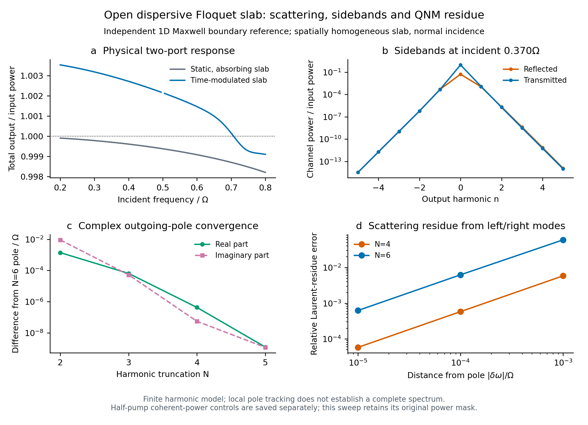

# 统一模态包、QNM、材料色散与散射接口

这轮将此前讨论的路线实现为本地Python模块，并保留Legume作为主空间底座。
新增能力不再只是一份架构建议；真实Legume缓存、色散辅助场、开放薄膜和作者
矩阵对照均已运行。第三方库未修改，没有创建Colab，也没有覆盖旧论文算例。

本轮完整回归为**545项通过**，结果在`results/integrated_backend/regression.xml`。
测试数量描述实际运行范围，不是一般几何或全部模式的正确性证明。

## 已交付的接口

| 模块 | 内容 | 已验收范围 |
|---|---|---|
| `mode_package.py` | 可保存/读回的标准ModePackage，基底类型、损耗归属、单位、场与来源 | 真实Legume圆柱投影/辐射包；给定广义开放算符包 |
| `modal_adapter.py` | 左右基底投影、时变质量矩阵、驱动单位转换、端口联接 | 完整有限基底；算子Fourier与状态谐波截断分开检查 |
| `qnm.py` | 广义左右模态、半单简并子空间归一化、严格导数留数、背景明确的极点展开 | 给定有限线性算符和局部解析非线性简单极点；EP/未分辨情况拒绝 |
| `dispersive.py` | 多Lorentz/Drude振子、材料吸收、背景介电率/振子强度调制、D/B/P/J全状态 | 给定空间curl与材料矩阵的有限Maxwell–ADE模型 |
| `scattering.py` | 入射、输出、背景及其时间谐波共同组装的Floquet散射矩阵 | 给定且规范明确的有限状态空间模型；不从Q猜端口 |
| `slab_reference.py` | 开放色散薄膜的解析边界、Fresnel和局部极点参考 | 法向入射、空气两侧、均匀薄膜 |
| `floquet_slab.py` | 同时包含材料记忆、真实出射边界和周期调制的双端口散射基准 | 同上空间结构的有限时间谐波模型，可在复频计算本征条件 |

`sptc_toolbox`顶层导出主接口；导入不启动几何求解。独立薄膜基准从自身模块导入，
不成为Legume的默认替代后端。

## Legume主流程

```python
from sptc_toolbox import ModePackage
from sptc_toolbox.open_system import solve_open_floquet

package = ModePackage.from_legume(gme, [3, 4], kind=0, z_order=24)
package.save("modes.npz")
restored = ModePackage.load("modes.npz")
model = restored.open_model(drive_omega_a_over_c, amplitude=0.1)
spectrum = solve_open_floquet(model, n_harmonics=5)
```

当前Legume材料投影仍明确限于既有单层圆柱接口。包内保留原生规范；内部基底
加辐射与已经包含损耗的QNM算符是不同representation，禁止重复加损耗。
模式数组、字段和嵌套metadata受保护；开放H/M内容必须匹配basis_id。
格式为NPZ+JSON，读取不需要pickle。已有可信Legume缓存只在本轮导出脚本中使用。

导出实际Eu双模后，读回的开放算符误差为0；完整四态Floquet乘子与独立
二阶动力学比较误差约1.2×10^-12。原两篇论文经新包重算：LPR四组配置与
Science全部22点的已声明有限模型结果保持一致，包括3个适用范围拒绝点。
这验证接口兼容性，不升级原论文复现或空间身份的结论。

## QNM度量及色散

给定线性化开放算符A(z)=H−zM，`generalized_modes`求左右模并检查完整
`L† M R=I`、左右残差和条件数。简并子空间使用完整Gram归一化；缺陷或
数值未分辨基底明确拒绝，不生成虚假的独立模式。

对解析非线性A(z)，`simple_pole_residue`使用

`Res[A(z)^−1] = r l† / (l† A'(z_p) r)`。

它重新检查左右零空间、简单极点条件及导数解析性，不仅相信输入标志。
场能量范数不能代替该导数。静态解析开放薄膜的三处极点及围道留数均通过
独立比较；一般结构是否具有正确出射算符仍由其空间适配负责。

`DispersiveMaxwell`保留每个材料振子的P/J。多振子及非对易材料矩阵、Drude
零态、耗散和泵浦功率均有验证；完整动态谱与独立原始ADE积分的误差约
1.7×10^-11。它没有将瞬时epsilon(omega,t)当成材料记忆，也不把Legume的
Hermitian模式直接宣称为复杂色散QNM。

`ModalPencilModel`明确求解的是`i M(t) dx/dt=H(t)x`。如果物理方程写成
`i d[M(t)x]/dt=H(t)x`，相应的M导数项必须由本构适配给出，接口不会猜测。
目前支持已提供的算符Fourier分量；并未完成任意几何的自动色散材料投影。

## 外部散射与物理验证

通用接口显式接收H/B/C/D：

`i x'=H(t)x+B(t)s_in`，`s_out=D(t)s_in+C(t)x`。

求解包含背景路径和所有保留的输出边带，不将每模Q当作端口振幅。开放通道、
参考面和功率/光子通量规范需要明确提供；未知或闭合通道不会自动报告为零功率。
原始矩阵奇异时不偷偷用伪逆抹去极点。小残差只验证线性方程，泵浦系统的
因果稳态还需要稳定性检查。

薄膜在半泵频率处存在正负频分量重合，普通模平方求和会丢掉相位敏感性。
`real_field_power`按明确的实场重建定义逐端口合并正负频率，再求时间平均功率；
与独立实场时间采样一致。其测试中，仅将入射相位旋转pi/2就使输出/输入比从
约1.02942变为0.975893，这一差异被正确保留。原`power`接口仍拒绝未经相干处理
的碰撞，避免两个不同的功率定义静默混用。

`frozen_model_ports`提供可检验能量平衡的抽象端口完成，其指定背景为−I。
这让实际Legume有限模型能走通完整受迫响应，但**不是原结构的精确反射/透射**。
缺失的真实端口背景没有被拟合或虚构。

为验证真实外部边界，本轮另实现时变色散薄膜：内部Floquet材料卷积按输出
侧带频率评价Lorentz分母，空间传播由Maxwell矩阵指数给出；两端E/H连续条件
直接决定所有反射与透射振幅。静态结果与独立Fresnel一致，材料吸收和
正负边带均保留。N4→N6时选定三条输出边带差约5.9×10^-13。

该物理薄膜还真正求出了局部**复频Floquet极点**，在N5→N6时复频变化
约1.7×10^-9，公共输出通道上的散射留数变化约3.7×10^-9。留数与直接散射
在接近极点时的Laurent极限一致。N1没有保留目标母模所在的+2谐波，得到的
另一个根明确标为不同截断根，没有混入目标收敛序列。

这些结果在一个可控开放Maxwell结构上连接了色散、Floquet、复频归一化和
外部散射。它们不等于任意周期光子晶体的全部复频模态已经求全，也不证明
所有泵浦参数都稳定。



## 作者项目对照与可复跑证据

参考仓库原始代码保持不变。本轮用此前MATLAB真实执行保存的合成输入，
从E/J双线性重叠重新组装并通过ModePackage投影，矩阵差约6.1×10^-19，
谱差约4.7×10^-15。这是与未修改上游Fmatrix的代码层对照；完整MAN/COMSOL
作者结构仍没有运行，不能把合成控制升级为实际作者算例。

```powershell
.\.venv\Scripts\python.exe sptc_toolbox/scripts/validate_qnm.py
.\.venv\Scripts\python.exe sptc_toolbox/scripts/validate_dispersive.py
.\.venv\Scripts\python.exe sptc_toolbox/scripts/validate_floquet_slab.py
.\.venv\Scripts\python.exe sptc_toolbox/scripts/validate_floquet_slab_qnm.py
.\.venv\Scripts\python.exe sptc_toolbox/scripts/validate_integrated_backend.py
.\.venv\Scripts\python.exe sptc_toolbox/scripts/validate_package_baselines.py
```

来源与原始结果：`results/qnm/`、`results/dispersive/`、`results/floquet_slab/`、
`results/floquet_slab_qnm/`、`results/integrated_backend/`。每层记录具体模型、
失败条件、来源和哈希。下一步的真实难点已集中到任意几何的严格QNM/材料/端口
适配、复杂结构空间基底稳定性和全谱覆盖，通用线性代数及薄膜物理链路已经可运行。
