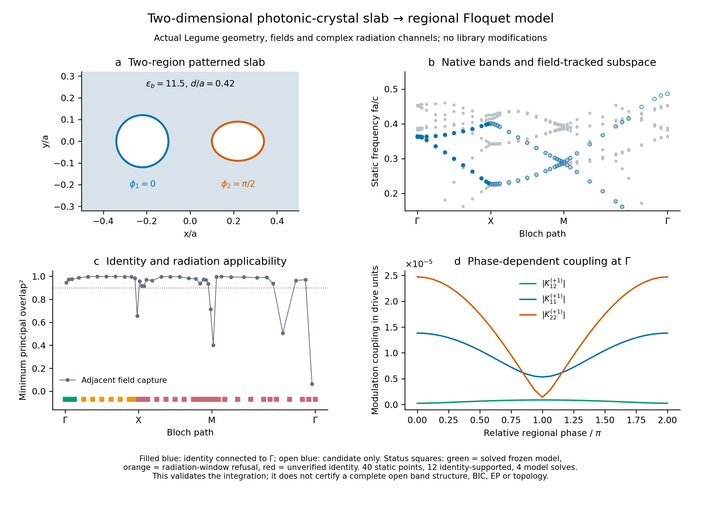

# 二维周期薄膜：区域调制、开放Floquet与物理场接口

2026-10-15。本轮把统一工具箱实际接入面内二维周期、上下开放的图案薄膜。
空间求解仍使用Legume原生几何、导模基底、场和复辐射通道；不改安装库。
**609项回归通过**。这验证新增接口和有限模型，尚不意味着复杂薄膜整个BZ的
目标能带、严格QNM、拓扑不变量或所有开放模式都已通过验收。

## 新增的可复用能力

1. **多层、多形状与区域材料投影。** `SlabRegion`可以选Circle、Ellipse、
   Poly及其原生派生形状，或层背景、整层。每层先组装所有调制区域的完整
   介电矩阵，再整体求逆。有限幅值时不把独立区域的一阶导数简单相加。
   原生几何重叠无法可靠认证、包层调制、复数/非正瞬时介电率会明确拒绝。
2. **多时间谐波、DC与单胞相位图案。** `RegionModulation`定义有序区域的
   Fourier分量及解析时间导数，保留区域之间的相位。每个晶胞重复的图案
   可接入单k模型；跨晶胞相位推进使用明确的k_out=k_in+p*q选择规则。
   缺少跨k空间投影时，行波协议不会被当作同步调制求解。
3. **通用薄膜ModePackage。** `from_legume_slab`联合保存投影、原生通道及
   可选的共同实频辐射样本，校验真实晶格、Bloch坐标、模式顺序和基底身份。
   投影数组带内容指纹；旧v1多区域缓存需重新导出。旧单圆柱包保持兼容。
4. **Bloch流程及拒绝原因。** `solve_slab_bloch`接受显式物理场身份结果，
   固定全路径泵频，分别验收空间身份、共同通道频窗、算子Fourier采样和
   Floquet截断；不会因某个检查失败而静默退回无损模型。
5. **E/H/D时空场重建。** `reconstruct_from_spectrum`保留复频增长及完整
   谐波复振幅，静态极限逐值回到原生Legume场。模式系数必须提供相符的
   `spectrum_basis_id`，材料界面处要求显式选择哪一侧。范围是固定原生
   基底中的场重建，尚非动态全波出射场或QNM留数归一化。

## 已修正的通用错误与验证

原中心圆柱的对称性掩盖了Fourier指标问题：Legume介电矩阵采用
`FT(G_column−G_row)`。移位圆孔和椭圆孔的直接原生对照发现了相反方向的不一致，
现已按原生约定修正。中心圆柱与旧结果仍一致。

单层圆孔/椭圆孔和不对称多层多边形模型共10个区域的直接Legume微扰，
频率导数最大相对差约2.4×10^-8；微扰前后目标物理H重叠平方最低
0.9999999755。有限幅值多区域矩阵与独立原生完整基底重建后的投影相对差
约2.3×10^-15和2.7×10^-15。解析均匀薄膜、非单位单胞面积、背景分区、
非交换区域矩阵、z积分细化及相位协变均有独立检查。

审查同时修复了几种会污染后续现象研究的输入错误：用另一个晶格把真正的
行波误标为单k；修改投影或波矢后保留旧基底身份；遗漏高阶调制谐波却因状态
残差小而通过。接口现在分别拒绝这些情况，并将独立时间积分误差超限标为
时间收敛失败。

## 实际二维薄膜验收

几何为方晶格，介质背景epsilon=11.5、厚度d/a=.42，圆孔中心(-.22,0)、
r/a=.12，椭圆孔中心(.22,0)、rx/a=.12、ry/a=.09。两孔静态epsilon=1，
作为明确的数学材料调制基准，在各孔内加入绝对幅度.08的余弦变化，
相对相位pi/2。此处不宣称空气本身可实现该实验调制。

原25点Γ–X–M–Γ路径使用gmax2.1、四个导模族和12个输出模式。以Γ的
两模物理H子空间作种子，粗网格第一条边未通过。只对完整场窗口能够承载目标、
且没有高权重导模退出的边补中点；两轮后实际求解40点，所有原25点频率逐位不变。

- **12个点**具备从Γ种子延续的模式身份；其余点不强行连带或闭环。
- 其中**4个点**同时满足当前冻结共同辐射的频窗条件，完成开放有限模型Floquet求解。
- 后续8个身份支持点因模态频率跨度超出该辐射近似窗口而拒绝，未放宽窗口贴图。
- 五处实际空间细化中四处通过本次频率/场门槛，M点未通过；这些局部通过不
  外推为全路径收敛。两轮细化后仍有待分辨混合与模式窗口不足的边。
- Γ点相对相位0、pi/2、pi下均检查完整四态与独立周期积分，误差约7×10^-12；
  共同时间平移仅改变Floquet规范，乘子差约1.4×10^-14。
- 区域积分z12→z24的重叠矩阵相对差约4.4×10^-15。



图中灰色是全部静态候选，实心蓝色是从种子支持的子空间，空心蓝色仍是候选。
下方颜色标记分别记录已计算的冻结模型、辐射频窗拒绝和空间身份未通过。
相位扫描展示的是投影耦合如何变化，不把很小的正虚部直接命名为已验证物理增益。

## 使用入口

```python
import numpy as np
from sptc_toolbox import ModePackage, SlabRegion, RegionModulation
from sptc_toolbox.open_system import solve_open_floquet

regions = [SlabRegion(0, 0, name="region_a"),
           SlabRegion(0, 1, name="region_b")]
package = ModePackage.from_legume_slab(
    gme, modes, regions, kind=0, common_frequency=omega_reference_a_over_c)
modulation = RegionModulation.sinusoidal(
    [.08, .08], phases=[0, np.pi/2],
    region_labels=("region_a", "region_b"),
    lattice_basis=np.array([gme.phc.lattice.a1, gme.phc.lattice.a2]))
model = package.slab_model(Omega_a_over_c, modulation, radiation="common")
spectrum = solve_open_floquet(model, n_harmonics=5)
```

直接调用核心时仍须进行Fourier/时间/谐波收敛；`solve_slab_bloch`提供这些
检查及适用性状态的集成入口。保存的静态包不包含空间求解器本体，场重建时
需要同一原生GME及其验证过的基底。

复跑脚本：`validate_slab_projection.py`、`validate_pc_slab_pipeline.py`、
`refine_pc_slab_path.py`、`validate_refined_pc_slab.py`。结果与失败状态分别保存，
不会用新网格覆盖粗网格证据。原LPR四组与Science22点基准也通过新公共入口
重算，原3个拒绝点及未解释差异保持不变。

本轮最终细化缓存为`results/pc_slab_pipeline/refined_path_current/`，早期
`refined_path/`保留为历史版本。重新运行细化时必须指定新的输出目录，脚本
拒绝覆盖已有完成记录。例如：

```powershell
.\.venv\Scripts\python.exe sptc_toolbox/scripts/refine_pc_slab_path.py --output sptc_toolbox/results/pc_slab_pipeline/refined_path_current
```

## 后续现象迁移依赖哪些能力

| 目标现象 | 本轮提供的基础 | 下一项关键验收 |
|---|---|---|
| 带折叠、模态杂化、调制选模 | 多区域耦合、相位协议、完整正负频谱和场重建 | 同一模式随k/参数的身份及空间/模态截断 |
| BIC与辐射干涉 | 原生复通道、共同频率评价、相干功率 | 边带新增通道与辐射自能，不把冻结浴暗态当严格BIC |
| EP和非厄米简并 | 左右模态、子空间、留数/条件数及拒绝门 | 参数路径中的缺陷性、真实开放误差与高阶极点处理 |
| Berry/Wilson/拓扑与边界态 | 物理场共同度量、基底记录及明确的Bloch协议 | 完整BZ、周期规范、孤立子空间、非厄米/频散度量以及边界验证 |
| 行波SPTC | 明确的动量转移与协议 | 真实跨k空间重叠、闭合动量扇区及边带出射条件 |

这些目标均保留在最终范围内。本轮具体完成材料/相位/场与薄膜数据接入，
不会提前输出尚无合格全BZ基底的拓扑数，也不会仅靠曲线相似认证BIC或EP。
