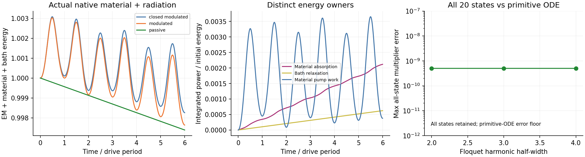

# Native material and radiation memory in one Maxwell state

Status: MATERIAL_ADE_AND_NATIVE_FREQUENCY_RADIATION_CONNECTED. Actual Circle/Ellipse Legume geometry at k=(.41,.19) with independently solved -k.

The physical-region Lorentz susceptibility and frequency-dependent native radiation bath now share (d,h,P,J,r) coordinates. Radiation couples to h; it is not an extra damping attached to polarization/current or a copied diagonal Q.

Equations: d'=-iWh; h'=-iWe-Lr; P'=J; J'=f Lmat†e-KP-GJ; r'=-(eta+i nu)r+L†h.

The total finite-model energy obeys dU/dtau = material pump power - material absorption - bath relaxation. The bath exchange can reverse sign transiently; its positive relaxation loss is not mislabeled instantaneous physical far-field flux.

No-material similarity to the existing second-order memory model: 3.15e-16. Local energy-identity error: 6.37e-10.
All 20 Floquet states, including the material and bath states, match independent primitive ODE multipliers to 5.02e-10.
At fixed physical window/broadening, order 3 -> 6 changes the tracked positive photon pole by 1.44e-05 c/a. This is recorded quadrature sensitivity, not complete spatial/window convergence.

The no-bath limit is exactly the existing material ADE; the no-material limit maps d=Wq,h=iv,r_new=i r_old. Unit tests and the actual native example exercise both limits.

Scope: the bath is sampled from the bare epsilon_inf geometry and held stationary. Material-induced changes in external radiation coupling remain outside this reduced approximation. Missing continuum tails, port background and a full dispersive QNM metric are not supplied. This connection supports simultaneous material absorption/modulation and frequency-dependent radiation studies without certifying arbitrary strong material changes.

Reproduce: `.venv/Scripts/python.exe sptc_toolbox/scripts/validate_dispersive_open.py`.
