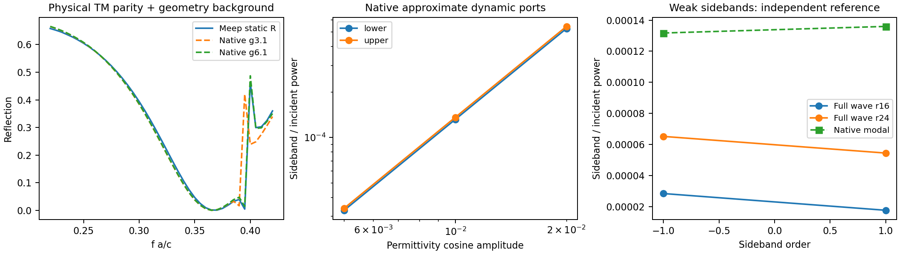

# 从静态物理S推进到原生动态端口近似

同一圆孔／椭圆孔薄膜，Gamma点、法向x偏振、上下空气。保留实际Legume的模式频率、场导出的区域耦合及原生共同频率辐射振幅；背景取几何面积平均介电率10.6687346的均匀薄膜，不拟合论文、不移动原生极点。

原生TM辐射振幅以横向磁场定义，上下传播方向转换到同一切向电场端口需要相对负号。新接口显式完成这一转换，并检查原生模式的上下端口奇偶性与所选对称背景相容。
对应约化模型在无调制时幺正且互易；调制时满足输入功率、输出功率与泵功的平衡。能量一致性是接口检查，不等于任意结构的端口精度证明。

## 静态改善

与已测Meep复S相比，g3.1原生单模近似的相对复矩阵误差约14.5%，g6.1约2.49%；g6.1最大单元素复振幅差约0.0526。
此前用粗基底固定极点加自由余项的拟合失败仍保留。本次改变了物理背景、端口约定和空间精度，不能把全部改善归于某一个因素，也不把total S重复作为背景。

## 动态有限模型已经实际求解

采用同一介质背景区域的绝对介电余弦调制，载频f a/c=.398，驱动f a/c=.01。

| 调制幅度 | −1侧带输出／输入功率 | +1侧带输出／输入功率 |
|---:|---:|---:|
| .005 | 3.29398e-5 | 3.39994e-5 |
| .01 | 1.31739e-4 | 1.35979e-4 |
| .02 | 5.26641e-4 | 5.43613e-4 |

小幅度平方标度成立。所选工作点的内部模型稳定；独立受迫ODE末态相对误差2.67e-9，谐波3→4输出幅度变化约2.80e-15，周期泵功＋输入−输出约7.1e-15。
该结果是完整正负频二阶有限模型的复单频输入列；对于退化参量条件下的实激励，还需要共轭输入的相干组合，不直接相加重复通道功率。

## 独立弱调制Maxwell侧带参考

使用实际全波carrier场，在真实调制区域施加一阶极化电流J_l=−iomega_l δε_l E_carrier，分别求上下侧带输出。这是第一阶Born参考，没有载波耗尽、重复转换或非线性饱和。
方法先在均匀薄膜中与独立精确Floquet边界解核验：网格16的两侧带功率误差约3.4%／3.8%；网格24降至约0.016%／0.76%。

实际图案结构，保持相同载频、驱动和幅度.01：

| 方法 | −1侧带 | +1侧带 |
|---|---:|---:|
| 全波一阶，网格16 | 2.83726e-5 | 1.76023e-5 |
| 全波一阶，网格24 | 6.51588e-5 | 5.44333e-5 |
| 原生g6.1单模端口近似 | 1.31739e-4 | 1.35979e-4 |

原生近似对网格24参考的比值约2.02／2.50。**两种方法都给出频率转换，但目前绝对效率仍有差异，且全波参考自身对网格明显敏感。**网格24的carrier功率和为1.0142，也显示有限等待时间／离散误差未完全消失。因此不能据这个对照认定哪一方已经精确，更不能只因静态S吻合就宣布动态效率已验证。

这份模态端口近似只通过选中模式表示调制；直接背景／连续谱的调制响应未完整加入。除此之外，原生空间截止、共振失谐、Meep的界面网格与carrier场插值都可能影响量值，目前没有证据将差异唯一归因给其中一项。图和数据不做经验修正。

CW迭代在部分图案结构求解时出现NaN或长时间无结果，已记录在`cw_attempts.json`；随后用同步E/H的时域稳态Green响应。这里的失败是具体数值求解尝试失败，不是物理不存在。

## 可用范围

`NativeSlabPortModel`提供有物理端口约定的可检验近似，适合探索弱调制边带、相位和参数趋势。当前仅支持上下对称、Gamma、零阶两端口，保留显著侧带跨高阶衍射阈值的范围提示。尚不是任意开放结构的QNM留数或已收敛绝对转换效率。

数据：`summary.json`、`static_modal.npz`、`modal_dynamic.npz`及各`weak_*`子目录；运行`validate_slab_ports.py`与WSL的`meep_weak_sideband.py`可重现。
