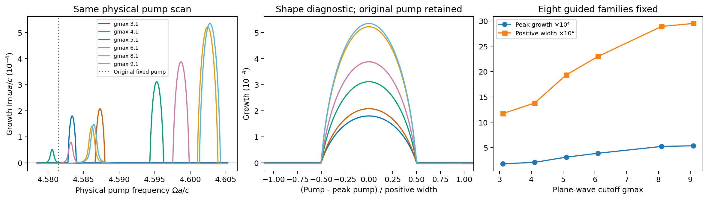

# 本轮完善：把材料、行波和辐射放进同一物理模型

2026-10-15。继续沿用原生Legume静态模式、场及通道，完成材料记忆与辐射记忆、行波材料与频率相关辐射两项联合接入。另对窄放大峰提高实际空间分辨率，并推进物理端口。原有限模型、旧失败与论文对照均保留，没有调参拟合论文。

## 已完成的两项联合后端

| 联合模型 | 实际数据与验证 | 适用范围 |
|---|---|---|
| 材料ADE + 频率相关辐射 | 实际偏心圆孔／椭圆孔薄膜，独立±k场，Lorentz振子调制、跨阈值谱浴；20个状态完整Floquet与原始ODE乘子差5.02e-10 | 裸epsilon_inf模态和通道上的有限投影；没有重新计算强色散改变后的外通道 |
| 二维行波 + 频率相关辐射 | 原实际结构3扇区×4模，实际±k共轭映射、每扇区完整共同Gram、阈值积分；积分24→48点最大权重差1.10e-8 | 代表性有限窗口的早期动态；不替代之前10扇区长时间模态敏感性检查 |

材料联合模型使用(d,h,P,J,r)，辐射耦合到h，材料吸收只作用于J。无材料时严格映射回原二阶memory系统，无浴时回到ADE。泵功、材料吸收、浴松弛损耗分开计账；没有重复叠加native Q。

行波联合模型的材料矩阵负责跨动量耦合，静态浴在不等价动量扇区之间分离。频率相关相对冻结近似的最大扇区权重变化为0.001691；扩大谱窗变化2.10e-5，展宽减半变化7.09e-5。无泵辐射初态损失约8.269%能量，总能量单调下降。
物理时间ct/a与Floquet的tau=Omega*t有专门转换，独立传播矩阵相似关系检查误差4.95e-13，避免把物理时间矩阵直接送入默认2pi周期求解器。

[材料／辐射报告](material_radiation/report.md) · [材料／辐射图](material_radiation/material_radiation.png) · [行波／辐射报告](traveling/report.md) · [行波／辐射图](traveling/traveling_memory.png)

## 放大峰空间分辨率：从几十个百分点降到约2%的相邻敏感性

固定八个导模族、同一物理几何和调制，实际计算gmax=3.1、4.1、5.1、6.1、8.1、9.1。最高原生矩阵2074维，保守工作内存约0.84GB；所有目标以实际H子空间确认身份，未按频率顺序盲选。

最后g8.1→9.1的结果：

| 观测量 | 相邻加密变化 |
|---|---:|
| 峰值物理增长 | +2.423% |
| 正增长区宽度 | +2.008% |
| 峰中心 | +0.00032249 c/a，约最终带宽的10.94% |

g9.1下峰值增长5.35059e-4 c/a，正增长宽度0.00294826 c/a，峰驱动4.602758732 c/a。原固定驱动点仍为衰减，单独保留。相邻稳定性支持峰形与机制研究，不能把相同的数值精度赋给极窄定驱动阈值。

两孔分别施加±0.002材料扰动并重新求完整原生空间算符，得到的对角／非对角导数矩阵与场积分相差不超过2.75e-6；峰点独立原始ODE乘子差约6.30e-12，N4→N5变化约1.69e-15。这支持耦合实现本身正确，前面较大的变化主要是指定有限空间结果的敏感性，不能据论文曲线判断代码有误。

[详细数值与范围](spatial/report.md) · [原始数据](spatial/summary.json)

## 物理端口：完成一个可检验近似，动态精度独立评价

新增`NativeSlabPortModel`使用原生共同频率通道、实际区域调制和显式均匀薄膜背景。背景介电率取几何面积平均10.6687346，没有用Meep或论文拟合；没有把测得total S再当背景重复叠加。
原生TM上下通道以横向H振幅定义，变成同一切向E端口时上侧需要相对符号。这个符号来自传播方向与Maxwell E/H关系，TE原生已包含的相位不重复施加。接口检查对称端口奇偶性，拒绝把任意非对称辐射耦合接到对称背景。

同一实际结构的静态复S相对误差从g3.1的约14.5%降至g6.1的约2.49%，参照为之前Meep实测复S，未移动原生极点。该有限无损模型的静态幺正与互易误差均在数值精度内。
动态入口已经输出±1及全部保留边带功率，并通过独立受迫ODE、谐波加密和泵功预算。它是有物理背景和端口约定的近似模型，**静态吻合仍不能代替动态物理验证**。

为此新增独立弱调制全波参考：先求原结构carrier场，再以真实区域中的极化电流J_l=−iomega_l δε_l E_carrier求侧带。它是Maxwell一阶Born控制，不是任意强调制FDTD。均匀薄膜另有精确Floquet边界解作独立校验；图案结构与原生端口的实际比值保存于端口报告。
Meep的部分CW迭代出现NaN或长时间未完成，失败尝试已保存，随后采用有明确稳态等待时间的全波时域Green响应；未把失败值纳入物理输出。

实际幅度.01的原生近似侧带功率为1.3174e-4／1.3598e-4；全波网格24为6.5159e-5／5.4433e-5，相差约2.02／2.50倍。全波网格16的结果还明显不同，说明独立参考也尚有空间敏感性。均匀薄膜控制在网格24的侧带功率与精确解相差约0.016%／0.76%。当前支持频率转换机制及可用接口，不把绝对效率差异归因于任一方已证错误。

[端口详细报告](ports/report.md) · [端口数据与独立对照](ports/summary.json) · [端口图](ports/port_connection.png) · [CW失败记录](ports/cw_attempts.json)

## 仍需区分的边界

本轮完成了前两种“模块尚未联动”的具体缺口；模型仍采用固定参考空间模式、静态浴耦合、有限谱窗和展宽。不是任意强色散／强开放QNM的完整方法。
长时间逐扇区转移与W1原始RMS问题保留此前结论：本轮没有更换初态或删除远尾来宣称它们收敛。窄放大峰的中心精度也没有被峰值约2%的相邻变化代替。
实际动态端口适用范围以独立侧带对照为准；静态unitary、能量账闭合或代数模型稳定都不能单独证明真实转换效率。

完整回归896项通过，原LPR四组、Science22点的有限模型结果和3处历史拒绝保持。
[统一使用入口](../../docs/connected_physics_usage.md) · 完整回归（历史材料 `regression.xml`；见[发行说明](../../../docs/RELEASE.md)） · [论文基线回归](paper_regression/summary.json) · [源码／结果清单](validation_manifest.json)
