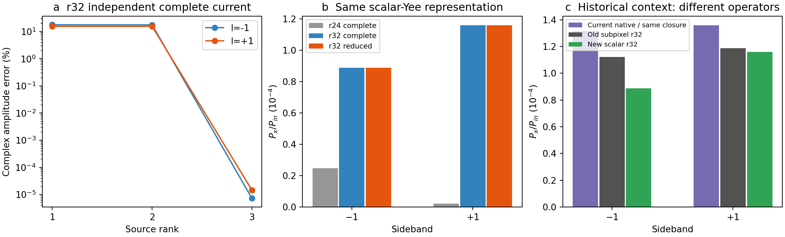

# r32同物理条件的弱转换与空间敏感性

这里重新计算相同几何、材料、载频、调制、单侧激励和功率观测量。使用新的原生标量Yee材料表示，空间分辨率32；材料平均设置仍与历史subpixel参考不同。仅计算真实载频场、侧频模板响应和独立完整极化源，不虚构缺失的侧频入射数据，也不宣称有限Floquet或谐波收敛。

| 边带 | 新r24完整源功率 | 新r32完整源功率 | 新r32增广功率 | r32复幅差 | r24→r32功率变化 |
|---:|---:|---:|---:|---:|---:|
| -1 | 2.4761708e-05 | 8.8800414e-05 | 8.880041e-05 | 7.2603e-06% | +258.62% |
| +1 | 2.0552338e-06 | 0.00011588583 | 0.00011588583 | 1.4522e-05% | +5538.6% |

使用源包 `basis_yexact.npz`，源Gram及实际完整场覆盖记录在JSON。主模型只选用返回成功的响应；原Krylov失败尝试保留。若Q1使用实际几何具有的Y镜像扇区，更新后的源身份与真实注入逐列核对，Q0/Q2仅在数值逐项不变时复用。完整载频场和完整Born源保持原始输出，因而会直接检验源投影对出射的影响。

| 边带 | 转置互易残差 | 源功—端口矩阵残差 | 单模板最大功残差 | 完整源参考容差 |
|---:|---:|---:|---:|---:|
| -1 | 5.29e-07 | 1.56e-06 | 7.06e-06 | 1e-06 |
| +1 | 5.94e-07 | 2.02e-06 | 0.000129 | 1e-06 |

## 原历史对照的本轮复测

| 边带 | 原r32参考 | 当前NativeGreen同原近似重算 | 新noavg r32完整源 | 新r32增广模型 | 当前Native对新参考功率差 |
|---:|---:|---:|---:|---:|---:|
| -1 | 0.00011220728 | 0.00013173926 | 8.8800414e-05 | 8.880041e-05 | +48.354% |
| +1 | 0.00011877672 | 0.00013597865 | 0.00011588583 | 0.00011588583 | +17.338% |

源空间的一致性与固定驱动下空间离散敏感性是两件不同的事。当前两网格之间的差异据实际数据保留，不靠调整材料或频率消除。原单模／冻结辐射／均匀背景闭合已用当前NativeGreen实际重算，结果与历史相同；混合Green闭环不能冒称该近似已自动完善。[原式重算](../native_retest/summary.json)。

当前Native与新参考之间的差异同时涉及静态闭合近似和不同材料界面离散；在新空间表示尚未证明对该固定驱动收敛前，不将其归因于Floquet实现、Legume错误或论文错误。

[完整数值及源哈希](summary.json)
