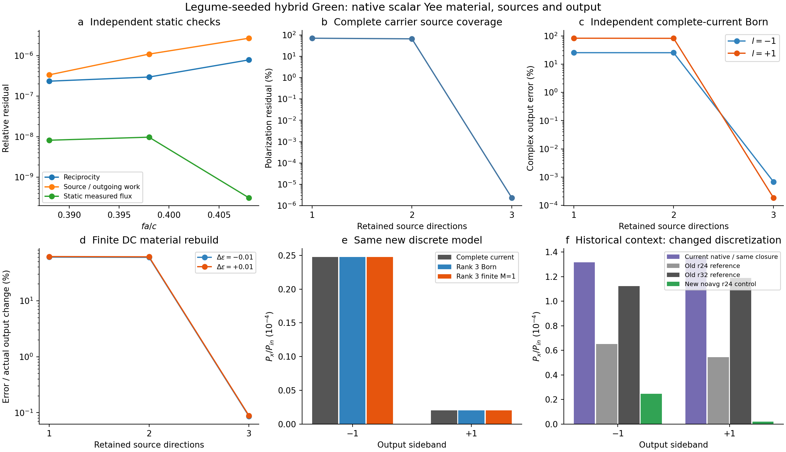

# 同一离散 Maxwell 模型中的材料—源—Green—Floquet 闭环

本轮按已确认的方案，把静态源、材料变化、内部投影与出射放在同一个空间和时间离散模型中，再检查独立物理参照。Legume 提供实际本征场种子；Meep 提供完整静态响应。因此这是 **Legume 种子与静态背景增广的混合验证**，不是纯 Legume 完整散射，也没有修改安装的空间求解器。

物理结构仍为周期1的圆孔／椭圆孔薄膜，ε=11.5、厚0.42，Γ、底侧x偏振入射、端口z=±0.7，载频fa/c=0.398，调制频率0.01、介电余弦幅度0.01。没有为对齐共振移动频率、改变材料或拟合幅相。

## 本轮与历史计算的关系

本轮先以 r24 完成闭环，再作 r32 弱转换对齐；均采用 `eps_averaging=False` 的标量原生 Yee 材料，替代本轮数据中的亚像素张量表示。**这是相同物理几何下的新数值算符，旧张量模型的场和响应不能混入。** 它让每个原生分量位置的材料参数变化与调制极化可以直接对应；亚像素张量导数需要跨分量 stencil，仍为另一项能力。

历史14%–17%是旧 Legume 单模端口闭合与旧 Meep r32 时域一级转换参考之间的功率差。本轮不把它当作新版已确认误差，也不以新的r24混合结果替换它。[历史复测契约](historical_baseline.md)记录了精确物理设置、数值表示、旧数据来源和端到端比较条件。

本轮已用当前 `NativeGreenModel` 对原来的单模、冻结辐射、均匀背景近似重新计算，保持原物理输入与Legume原生静态场。下／上侧带功率为1.3173925782551×10⁻⁴和1.3597865334428×10⁻⁴，与旧模型相对差约10⁻¹³；边带3→4结果稳定。新的统一组装没有自动补全该空间近似，不能把它与新的完整静态响应混为一谈。[当前原生路线重测](native_retest/summary.json)。

旧r32参考来自时间推进；旧文件中名为 `solve_cw_return` 的字段并不意味着使用了CW求解器。因此上一轮发现的CW返回场适配问题，不是旧14%–17%差异的已知原因。

## 一致的物理映射

频率标签始终为物理角频率 ω_l=ω+lΩ。Yee时间差分中使用

\[
\kappa_l=2\sin(\omega_l\Delta t/2)/\Delta t.
\]

模板驱动为 J_l=−iκ_l Q，静态响应 F_l 已含 κ_l²G_Y；同一原生坐标下 Q†W_YQ=I，R_l=Q†W_YF_l，M_p=Q†W_YδεY,pQ。Floquet 求解使用原来的统一投影后端，调制块不再重复乘频率因子。

源回调在实际分量位置取值，首次零初场Maxwell更新测出并校正源体积权重，避免中心场插值与源提升不伴随。出射由两个原生电场平面分解正反向波，传播常数和功率权重采用解析Yee色散；没有把出射功率按测得源功重新缩放。

静态样本均为原生频域稳态求解，使用此前通过源码推导与独立一维时间推进验证的返回场适配。原生镜像边界仅用于真实镜面对称几何的相应激励扇区；上下单侧输入由两个扇区相干组合。不同物理频率都具有实际输入场、静态散射、模板响应及模板出射。

新增 `YEE_CURRENT_CONVENTION`、`yee_frequency` 和样本时间步长／材料算符标识；禁止混合不同离散模型。异位三个分量只接受逐分量对角材料扰动，没有把中心局部张量搬到交错网格。[接口用法](../../docs/projected_green_usage.md)、[方法审查](theory.md)。

## 材料与源的独立检查

初始化同一结构的 εbulk±0.01，直接读取原生逆介电算符并还原每个分量的材料值。材料导数与0/1离散区域掩膜最大差2.13×10⁻¹⁴，二阶差为0，非对角本构系数为0，材料镜像残差为0。随后对非均匀复源验证实际更新产生的总电流，与声明源形状相对差8.12×10⁻¹⁷。

这些证据成立于明确的标量原生离散表示；它们不证明平滑张量材料的导数已实现，也不证明r24对连续几何已空间收敛。实际系数、源权重、坐标和哈希见[初始化记录](native/init_summary.json)。

## 实际静态基底

第一列取实际 Legume 模式场在新原生网格上的采样，另由新模型完整偶／奇载频场构造静态背景。这里没有使用历史Meep响应或动态目标拟合。实／虚残差分解显示，偶扇区第二奇异值相对约6×10⁻⁸，奇扇区约3×10⁻⁸，低于事先声明的1e−6源方向阈值，因此保留三列：Legume种子、偶背景残差、奇背景。

保留三列后，载频材料极化的相对表示残差约2.35×10⁻⁸。小的Gram舍入偏差通过同一个矩阵同时变换Q、F和T，没有只改场基底后沿用不对应的源响应。更高阶反馈仍可能产生新源方向，所以载频源覆盖不能代替DC与动态反馈检查。[基底记录](native/basis_summary.json)。

## 独立算子验证及实际对照

新增一维原生Yee开边界参照，直接从离散Maxwell组装三对角Helmholtz算符，用解析出射晶格波消去外部。测试分别检查：静态源功／互易／幺正，有限DC材料变化的直接重算，以及直接空间三边带方程。故意错误的连续ω²因子或输入边带κ²都能被此控制区分；不是把同一投影公式写两遍作自检。

三维实际计算使用独立的完整极化电流侧带和 εbulk±0.01 静态重算，分别检验源空间遗漏及材料反馈。完整数据、图和逐项敏感性见[三维闭环分析](analysis/report.md)。这些检查的对象分别是已声明有限源空间、实际静态材料响应及弱转换；不能自动扩展为强泵稳定性或所有边带收敛。

实际三列模型的主要结果如下，百分比均明确对应比较对象：

| 独立检查 | 结果 |
|---|---:|
| 完整极化电流与投影后端，下侧带复振幅差 | 0.000684% |
| 完整极化电流与投影后端，上侧带复振幅差 | 0.000186% |
| εbulk±0.01中心差分对完整单位极化电流的复出射差 | 0.0310% |
| 有限DC−／DC+反馈，相对真实散射变化的误差 | 0.0866%／0.0886% |
| 三频有限Floquet的动态极化源空间残差 | 0.1805% |

源空间残差不是输出误差上界。重复转换相对同秩Born的复振幅变化为0.03194%／0.01514%；这符合本例弱驱动下的有限模型结果，不是强调制或边带截断收敛证明。独立材料重算和完整电流响应提供了空间／材料映射的额外证据，不能仅用LS与ABCD的代数一致性代替。

完整三频样本的 R 转置互易相对残差为2.34×10⁻⁷至7.85×10⁻⁷，源功矩阵与出射功率矩阵相对差为3.35×10⁻⁷至2.69×10⁻⁶。入射通道仍有约1.3×10⁻⁵的空源校准／边界反射残差；使用实际测得输入功率，静态能流平衡差不超过9.7×10⁻⁹。没有强制输出幺正化。

其中偶背景 Q1 的原10⁻⁸迭代要求并非全部达到：一个到达迭代上限，两个在持续停滞后中断。原要求、状态与日志保留。后续事先声明的10⁻⁶有界试算全部成功，使用同一个原始源，没有反向修改旧阈值。.388的原源严格尝试与成功有界试算，注入源完全相同，内部场差9.34×10⁻⁶、出射复振幅差2.95×10⁻⁶。严格尝试未收敛，因此它只提供独立数值敏感性，不能当作真值；主判断仍来自源功、完整电流及材料重算。

另外的Y镜像源控制未混入主数据集。它对.408源的改变约8.86×10⁻⁸，出射差3.71×10⁻⁶；不能仅从这个同时改变源和边界的对照认定慢收敛的唯一原因。无需为本轮弱转换观测量强求所有内部场机器精度，但仍保留未通过的原数值要求。

## r32 实际对齐与历史差异的新版结果

r32不是复用旧r24数组：Meep先导出真实新网格，再从原Legume模式直接Fourier重采。源体积权重、离散材料导数、完整载频场和侧带极化响应全部重算。它仍使用本轮声明的标量Yee表示，与历史亚像素张量参考不同；物理几何、介电参数、固定载频、调制与单侧功率观测量保持一致。

本次r32只求弱转换所需的载频输入和两个侧频响应，不伪造缺失的侧频入射场，也不宣称r32完整Floquet谱或谐波收敛。

| 侧带 | 当前NativeGreen，保持原近似 | 历史r32张量参考 | 新r32标量完整电流 | 新r32增广模型对完整电流的复幅差 |
|---:|---:|---:|---:|---:|
| −1 | 1.31739258×10⁻⁴ | 1.12207281×10⁻⁴ | 8.88004137×10⁻⁵ | 7.26×10⁻⁸ |
| +1 | 1.35978653×10⁻⁴ | 1.18776720×10⁻⁴ | 1.15885833×10⁻⁴ | 1.45×10⁻⁷ |

所有功率是上下x通道总出射相对名义单位底侧入射；实际入射的小偏差及按测得入射归一的值另存JSON。原生单模闭合对新参考的功率差为 **+48.35%／+17.34%**，对旧r32参考则仍为+17.41%／+14.48%。这次已经实际重算当前原生组装及新的完整响应；结果不支持“组装更新已自动消除原空间闭合误差”的说法。

但新参考本身尚未空间收敛：同一标量Yee表示从r24到r32，两个完整源侧带功率分别变为 **3.586倍／56.386倍**。物理输入固定，没有调整共振或材料去消除它。该证据表明固定驱动绝对转换强度对空间表示高度敏感；不能根据当前两个网格推断连续几何的精确效率，也不能把新旧参考差全归咎于原生模型或论文。

与此同时，r32同一离散算符内的增广结果与完整电流对照仍吻合，源功矩阵残差约1.6×10⁻⁶／2.0×10⁻⁶。弱Q1上侧的单列源功残差较大，为1.29×10⁻⁴，已单独保留。**有限源空间闭环的一致性与连续几何的空间收敛是不同结论。**

r32原L20迭代曾数值崩溃，L10有界求解完成载频；原Q1下侧达到迭代上限仍失败。利用已验证的真实Y镜面对称，仅清理Q1中9.67×10⁻⁷的数值错误扇区，再重新求该源响应；新基底另存，Q0/Q2逐数保留。原源与新源出射差约1.7×10⁻⁶／7.4×10⁻⁶，完整电流源保持原载频场，由独立结果检验这种源空间处理的影响。未把旧失败改写为成功，也未对响应矩阵做事后对称化。

详见[r32实算报告](analysis_r32/report.md)及[全部原始响应](native_r32/run_manifest.json)。在固定频率效率研究中，接下来真正需要优先判断的是静态空间表示对共振和驱动场的敏感性；已经通过的离散投影与材料映射无需因为不同网格功率差大而重复发明。

## 可复查范围

- 工具箱842项、历史求解器191项回归通过，合计1033。新增4项为独立Yee物理控制；测试数量不表示整个开放系统已完成验证。
- 两篇论文仍作历史有限模型接口回归：4组LPR、22个Science点、保留3个原有拒绝。本轮没有重画两篇论文或改变其历史结论。
- 新模型目前采样三个实频，有限三边带计算不能证明谐波收敛、负频重叠或全系统因果稳定性。
- 新r24／r32标量混合模型不是历史r32张量参考的替代；当前原生路线重测保留原单模闭合，不等于完整图案静态背景已经由纯Legume给出。历史差异已有新版实际对照，但完整空间收敛未完成。
- 亚像素张量导数、任意非对称／多衍射级通道，以及连续几何的空间收敛，需针对所研究现象另作验证。

源码、原始成功／失败控制、图、测试记录和参考数据哈希见[归档清单](validation_manifest.json)。
