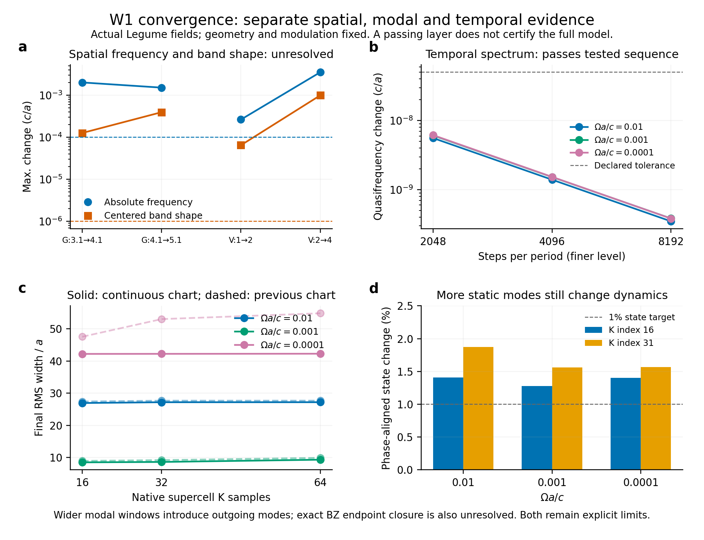

# 分层收敛流程：实际运行结果与动量坐标修复

2026-10-15。通用收敛核心已经实现，并在真实 Legume W1 薄膜数据上运行了空间、保留模态、时间、K 网格和联合检查。检查还发现并修复了一个具体问题：**有限平面波基底下，直接把原始动量折回第一布里渊区会造成物理场不连续**。旧数据完整保留，新连续动量坐标数据单独保存。



图 PDF（历史材料 `convergence_overview.pdf`；见[发行说明](../../../../docs/RELEASE.md)） · [机器判定](assessment.json) · [本次精度目标](policy.json) · [通用接口说明](../../../docs/convergence_workflow.md)

## 当前判定

| 检查层 | 实际完成 | 结论 |
|---|---|---|
| 平面波截止 | 4 个相同 q，gmax=3.1/4.1/5.1 | 模式身份稳定；频率与带形未达到本次目标 |
| 垂直导模族 | 相同 q，索引 [0]→[0,3]→[0,3,4,7] | 继续增加导模仍改变带形，尚未收敛 |
| 保留静态模态 | 两个 K 的实际场，7→42 个同对称导模 | 原模型一周期状态仍变化约1.3%–1.9%；更宽窗口含辐射及缓存上界缺失，保留明确拒绝 |
| 时间步长 | 原/修复后模型，3 个 K、3 个驱动，1024/2048/4096/8192 步 | 最后两个相邻加密对照达到所声明的有限模型精度目标 |
| 时间边带 | 相同实际场导出的完整正负频模型，N=3/5/7/9 | N=3 不足而拒绝；N=5/7/9 达标，并与周期传播独立对照 |
| K 网格 | 原/修复后模型分别实际重算16/32/64点 | 原模型宽度不稳定；修复后的质心和宽度通过本次序列目标 |
| 联合加密 | 原模型 gmax3.1/2048步→4.1/4096步，112个同q物理场身份检查 | 时间加密没有消除原空间敏感性；仅一对联合对照，不是三层序列 |

“通过”只表示所给模型、参数、层级和观测量达到了 `policy.json` 的精度目标，不是无限维、全参数或完整开放 QNM 认证。修复后的空间加密、完整模态扩窗和外层折叠扇区闭合仍需继续；不能把原模型的量化误差直接当成新模型误差。

本次声明目标包括：质心变化≤0.25a、宽度变化≤1a、静态角频变化≤1e-4 c/a、去共同偏移的带形变化≤1e-6 c/a、同基底周期算符逐元素变化≤5e-4、准频集合变化≤5e-8 c/a。它们是本研究的精度合同，不是所有结构通用的固定阈值。原生场身份通过公共 H 场度量另行检查。

## 修复了什么

物理 Bloch 场包含 exp[i(G+q)x]。把 q 改为 q−2pi/a 时，需要同步处理 Fourier 支撑 G；无限基底下这只是坐标重标记，但固定有限 G 集合并不自动保持等价。

实际原生计算确认：在相同物理动量 q=pi+epsilon 与 −pi+epsilon，频率可以很接近，物理场却有差异。epsilon=1e-4 时，完整 z 度量的 H 差约 **1.81%**，中面 E 差约 **5.76%**。这不是任意本征矢整体相位，因为比较已对齐相位并保留完整物理 Fourier 支撑。

新路线将连续 q 直接传给 Legume，保持统一的数值动量坐标。跨 pi 的间隔 epsilon 从1e-3减到1e-4时，H差 **0.002048→0.0002048**、E差 **0.002151→0.0002151**，随实际间隔缩小，不再保留原先有限跳变。安装的 Legume 没有修改。

通用 `bloch_coordinates.py` 提供连续动量构造，以及按完整 **G+q 并集**比较 Bloch 等价场的接口；缺失 Fourier 权重保留，不通过取交集美化重叠。W1 新入口默认使用 `extended` 坐标，`wrapped` 作为历史诊断仍可显式选择。新旧缓存合同会检查坐标选择，不能混用。

对原初态，实际跳变量独立预测的1/x²强度尾系数约2.016e-5，与64点数据约2.15e-5接近，没有拟合。该证据支持初态小尾巴与坐标截断的关联；并不证明慢驱动所有展宽差异都来自这一项。

## 修复前后的实际 K 加密

三档均重新使用 Legume 计算原生场，再积分同一物理调制并传播；没有插值作者曲线或拟合耦合。

| K 点数 | 原 wrapped 坐标：慢驱动末态宽度/a | 连续 extended 坐标：慢驱动末态宽度/a |
|---:|---:|---:|
| 16 | 47.541 | 42.204 |
| 32 | 53.026 | 42.224 |
| 64 | 54.831 | 42.262 |

修复后64点的快、中、慢驱动末态质心约 **39.173a、49.980a、49.988a**；宽度约 **27.192a、9.323a、42.262a**。快驱动与论文的滞后量差异仍保留。网格精度目标达成不代表物理空间基底和模态数已经完备。

修复后论文场图对照（历史材料 `sampling/g3.1_k64_extended/figure9cde_paper_vs_legume_steps2048_fullcom.png`；见[发行说明](../../../../docs/RELEASE.md)） · [连续坐标局部原生证据](sampling/extended_chart_local/summary.json) · [完整 Fourier 支撑检查](sampling/extended_chart_local/generic_chart_validation.json)

## 空间和模态检查没有被“修复成功”掩盖

空间加密在4个完全相同q点进行。gmax4.1→5.1的H重叠平方最低0.999862，但频率仍变化1.516e-3 c/a、去共同偏移的带形变化3.948e-4 c/a。增加垂直导模 [0,3]→[0,3,4,7]，频率变化3.520e-3、带形变化9.932e-4 c/a。**同一个模式已经辨认出来，并不意味着其小尺度色散已经准确。**详见 [空间报告](spatial/report.md)。

原数据的7→42模对照保留原初态并加入实际场导出的全部允许耦合，相位对齐后状态变化约1.28%–1.87%；时间加密误差最多2.70e-5。最低目标模共同频移约1.34e-5 c/a，两K之间的差分频移约1.13e-7 c/a。共同相位积累不被误称为波包形状误差。完整[1.3,2.1]频窗包含辐射模式，部分q的32本征对缓存还缺上界保护，故当前导模模型明确拒绝该完整窗口。详见 [模态报告](modal/report.md)。

另外，有限7折叠扇区在超胞布里渊区两端只有6个扇区共享，原模型的精确端点场仍有小差异。连续坐标修复内部原始BZ跳变，不自动补齐最外侧扇区。这项表示限制继续保留；扩大空间/模态范围进入开放辐射时，需要正确的通道适配，不能置零损耗来获得收敛通过。

## 时间与 Floquet 的独立检查

周期传播比较完整复数算符及匹配后的 Floquet 乘子，分别报告准频相位误差与增长率误差。时间谐波计算采用相同真实 Legume E 场导出的 M(t)，通过 `photon_generator` 保留正负频率，再调用既有 Fourier-Floquet 后端。

N=3在三个代表K点只能得到5/14、6/14、5/14个可接受状态，因此明确拒绝。N≥5得到完整14态；N=5/7/9构成独立通过序列，原N=3失败仍保留。与8192步周期传播的准频最大差约1e-10 c/a量级。这个交叉验证只覆盖Omega=0.01；较慢驱动未运行非常大的时间边带矩阵，不伪称已覆盖。

算符 Fourier 系数另检查128→256采样及非网格时间重建。M(t)只含0、±1并不代表M(t)^−1也只有这三项；实际算法没有这样截断。

## 通用工具箱交付

- `convergence.py`：不可变计算快照、物理/模型范围合同、声明加密轴、显式绝对与参考尺度容差、逐观测量比较，以及三层/两个连续对照判定。未评价、未收敛和表示限制分别保存。
- `bloch_coordinates.py`：连续动量坐标与完整物理波矢支撑上的场比较，独立于本论文。
- 缓存检查：几何、导模族、动量坐标、数组布局、内容哈希及辐射有限性检查。没有旧导出哈希的实际缓存，先从经哈希验证的原生对象重导出全部场核对，再建立绑定；不把“事后记哈希”当成输入检查。
- W1 配套脚本：独立空间、模态、时间、网格、联合检查及机器汇总；旧数据均保留。
- 新核心及全部相关回归 **749 项通过**，见 测试记录（历史材料 `regression.xml`；见[发行说明](../../../../docs/RELEASE.md)）。测试通过不替代本报告中的物理收敛判定。

可复运行入口：

```powershell
$env:OPENBLAS_NUM_THREADS='1'
$env:OMP_NUM_THREADS='1'
.venv/Scripts/python.exe -m sptc_toolbox.scripts.converge_w1_spatial
.venv/Scripts/python.exe -m sptc_toolbox.scripts.audit_w1_modal_window
.venv/Scripts/python.exe -m sptc_toolbox.scripts.run_w1_convergence_sampling --nk 64 --momentum-chart extended
.venv/Scripts/python.exe -m sptc_toolbox.scripts.converge_w1_temporal --native-directory sptc_toolbox/results/convergence/w1/sampling/g3.1_k32_extended --output sptc_toolbox/results/convergence/w1/temporal_extended --momentum-chart extended
.venv/Scripts/python.exe -m sptc_toolbox.scripts.build_w1_convergence_report
.venv/Scripts/python.exe -m sptc_toolbox.scripts.plot_w1_convergence
```

更换结构时复用通用快照/比较层，替换原生几何、模态选择和观测量适配；不把 W1 的数值阈值、选带窗口或近导模假设写成其他结构的默认答案。
