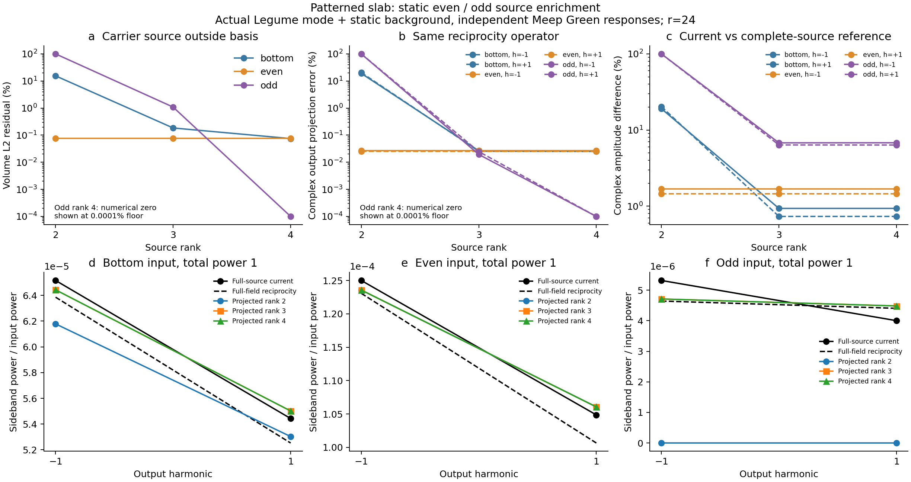

# 静态奇偶源空间补全：单侧入射的缺失分量

**这是 Legume 模场＋静态背景增广＋Meep 静态 Green 响应的混合实验。** 原始 Legume Q0 与偶背景 Q1 逐数不变；新增两列仅来自未调制载频的反对称场。没有动态目标拟合、幅相校准、响应对称化或被动性投影。

源空间使用体积 L2 度量，并非 QNM 归一化。实/虚 odd 残差的奇异值为 0.82388109, 0.0089789409；第二列相对第一列为 1.0898%。保留两列以避免删除 odd 场的小相位形状。

| 基底秩 | 单侧源残差 | 同相双侧源残差 | 反相双侧源残差 |
|---:|---:|---:|---:|
| 2 | 15.476% | 0.0758761% | 100% |
| 3 | 0.18456% | 0.0758761% | 1.08977% |
| 4 | 0.074962% | 0.0758761% | 1.5528e-12% |

rank 4 将单侧源残差从 15.476% 降至 0.074962%，反相源在该采样度量中被完整表示。同相残差不变，证明新增列补的是此前遗漏的实际反对称背景。这个残差不是散射误差上界。

所有激励总输入功率为 1。载频 fa/c=0.398，调制频率 0.01，δε 余弦幅度 0.01；单位胞、材料、端口位置和 r=24 网格保持不变。上下入射由实际 z 镜面对称生成，Ez 在反射时变号。even/odd 的完整电流参考由已有 bottom 电流结果的线性镜像叠加构造，并非新增独立双侧运行。

## 先区分源空间遗漏和静态求解差异

| 激励 | 边带 | rank 2 同算子投影差 | rank 3 同算子投影差 | rank 4 同算子投影差 |
|---|---:|---:|---:|---:|
| bottom | -1 | 19.069% | 0.026537% | 0.026278% |
| bottom | +1 | 20.481% | 0.025483% | 0.024973% |
| even | -1 | 0.026769% | 0.026769% | 0.026769% |
| even | +1 | 0.025514% | 0.025514% | 0.025514% |
| odd | -1 | 100% | 0.01941% | 8.3288e-13% |
| odd | +1 | 100% | 0.024778% | 9.5054e-13% |

上表完整场和投影场使用相同互易输出算子，专门测量有限源空间遗漏。下面的直接电流对照还包含时间等待、源注入和场采样、界面平滑与体积分离散差异，不能将这些差异统称 Floquet 错误。

通用 `enrich_field_basis` 另外以同一静态候选独立构建增广基底，保留旧列逐数，返回源线性变换；与本实验已运行列的子空间重构差为 2.32e-14，源变换重构差为 6.15e-16。因此本轮的源补全过程已对应可复用接口，无需重算或改写历史模板。

## 独立电流源弱转换

| 激励 | 边带 | 完整源功率 | rank 4 功率 | rank 2 复振幅差 | rank 4 复振幅差 | rank 4 功率差 |
|---|---:|---:|---:|---:|---:|---:|
| bottom | -1 | 6.515878e-05 | 6.443196e-05 | 19.049% | 0.93206% | -1.1155% |
| bottom | +1 | 5.443332e-05 | 5.501951e-05 | 20.314% | 0.73166% | +1.0769% |
| even | -1 | 0.000125 | 0.0001235702 | 1.6751% | 1.6751% | -1.1438% |
| even | +1 | 0.0001048635 | 0.0001060619 | 1.4471% | 1.4471% | +1.1429% |
| odd | -1 | 5.317549e-06 | 4.712587e-06 | 100% | 6.7921% | -11.377% |
| odd | +1 | 4.003178e-06 | 4.48457e-06 | 100% | 6.3445% | +12.025% |

## 有限三频重复转换与静态审计

| 秩 | LS–ABCD 差 | bottom 动态源残差 | bottom t900→1200 侧带变化 | bottom 重复转换相对 Born 变化 |
|---:|---:|---:|---:|---:|
| 2 | 3.07e-16 | 15.48% | 0.8699% | 0.01055% |
| 3 | 5.69e-16 | 0.1849% | 0.8528% | 0.01035% |
| 4 | 4.99e-16 | 0.07573% | 0.8528% | 0.01035% |

| 静态频率 | 各源端口互易振幅差 Q0/Q1/Q2/Q3 | R 转置互易差 | 源功—能流残差 |
|---:|---|---:|---:|
| 0.388 | 3.41% / 17.1% / 2.67% / 51.6% | 3.05% | 19.7% |
| 0.398 | 5.64% / 26.3% / 3.75% / 350% | 2.89% | 3.12% |
| 0.408 | 4.35% / 12.2% / 2.82% / 43.9% | 2.69% | 17.4% |

另检验实际 z 镜像的端口选择规则：even 列的上下出射应相同，odd 列应反号。实测偏差如下，未强行投影到奇偶对称；弱 odd 通道参考又由旧 bottom 电流镜像构造，因此此项不能忽略。

| 频率 | Q0/Q1/Q2/Q3 端口奇偶偏差 | R 奇偶块偏差 |
|---:|---|---:|
| 0.388 | 2.76% / 4.47% / 0.26% / 21.7% | 1.05% |
| 0.398 | 2.66% / 2.27% / 2.01% / 124% | 1.11% |
| 0.408 | 2.52% / 0.718% / 0.219% / 16.7% | 1.16% |

场本体也检验而非只看端口：

| 频率 | 未掩膜内场 Q0/Q1/Q2/Q3 奇偶残差 |
|---:|---|
| 0.388 | 0.855% / 1.08% / 3.96% / 12.3% |
| 0.398 | 0.892% / 0.884% / 16.2% / 56.5% |
| 0.408 | 0.951% / 0.986% / 2.06% / 6.81% |

上述残差为 ‖E−pME‖/‖E‖，M 包含空间 z 反射及 Ez 变号；错误奇偶扇区的范数占比是它的一半。独立的第一步 Maxwell 更新提取真实总源，在 native Yee 坐标验证四列注入仍满足奇偶规则（见 ../yee/parity_source_probe/source_lift.npz）。因此这组证据排除源 lift 打破奇偶，并表明不只是远场端口读出，不能靠响应对称化遮盖。

独立检查同一 Meep 静态离散算符发现，native 分量坐标处的 ε⁻¹ 张量镜像残差为 **0.422877%**，主要在 xx/yy 分量，zz 镜像一致。这是材料离散算符实际破坏目标镜像的直接证据，发生在 Floquet 运算之前；它使由 bottom 出射镜像构造的 even/odd 参考受到表示限制。该证据尚未单独量化它对每个场/端口差值的全部贡献；不把来源未完全分离的差异算作 Floquet 缺陷。详见 [离散材料镜像检查](../yee/material_mirror/summary.json)。

### 原生镜像边界的最小因果控制

仅对 fa/c=0.398 的 Q3 新做一次 `mp.Mirror(Z, phase=-1)` Maxwell 求解，物理几何、r24、源插值/掩膜、PML、启动包络和900/1200采样时间保持一致。这是求解器原生奇对称边界下的新离散算符；没有对已有场或散射结果事后对称化，且这些新样本没有插入旧 Green 数据集。

| 时间 | 新原始场奇偶残差 | 新端口奇偶残差 | 新旧原始场差 | 新旧复端口差 |
|---:|---:|---:|---:|---:|
| 900 | 3.15e-15 | 0 | 28.366% | 63.034% |
| 1200 | 3.64e-15 | 0 | 28.31% | 62.933% |

旧 t1200 Q3 的原始场奇偶残差为56.506%，新边界将其恢复到浮点误差；旧端口奇偶偏差124.269%也消失。结合材料张量与真实源 lift 检查，这确认静态离散表示会造成实际响应污染，并且原生对称边界能在该对称扇区恢复选择规则。这不说明旧结果的每个误差都已归因，也不是整个rank4散射模型已换成一致的新参考；这里只做单频单列因果控制。新控制的原始场从t900到1200仍变化0.3141%，不将奇偶恢复当作时间收敛证明。原生镜像只能用于物理几何与激励具有相应对称性的情况；一般调制可以耦合不同扇区，不能因此删除它们。见[独立控制原始结果](native_mirror_control/summary.json)。

原 Q0/Q1 六组响应只在旧/新插值样本、支持域、权重、每列 SHA、旧 basis 文件 SHA、实际频率、网格和等待时间全部核对后复用。原文件与原 basis_id 保持不变；新数据集明确记录每列来源，并未重标记旧缓存冒充新模拟。

## 适用范围

仅三个实频样本与 M=1 有限链路；没有时间谐波收敛、强泵稳定性或绝对动态效率认证。原静态平面波场仍为 t900；模板 t900→1200 的对照不会证明平面波输入场也收敛。极化源采用尖锐材料掩膜，未替换为 Meep 亚像素张量的材料导数；源注入与中心场投影尚未建立严格离散伴随。这些条件与 root 的 native Yee/source-work 检查分开，不能通过增加 source rank 消除。

- [机器可读结果](summary.json)
- [基底来源与逐列哈希](basis/summary.json)
