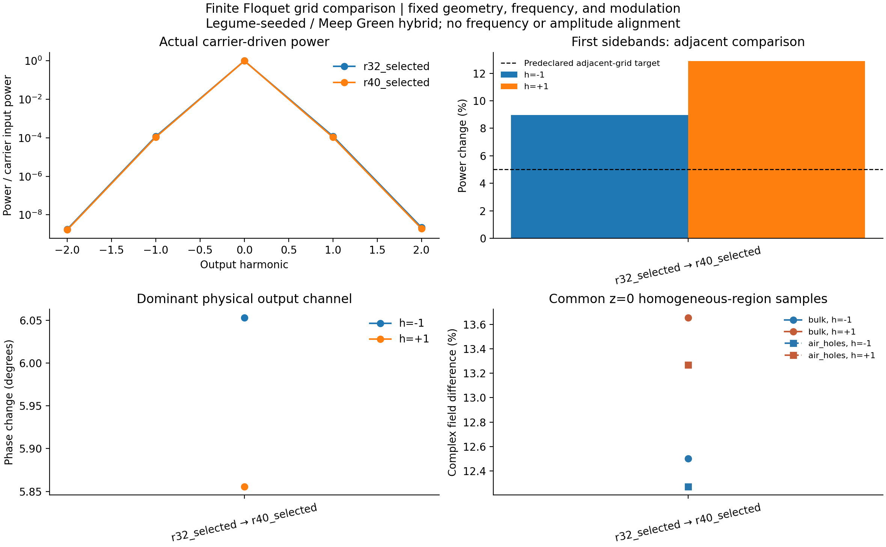

# 完整有限 Floquet 的原生网格对照

同一几何、固定载频 0.398、调制频率 0.01、介电调制余弦幅度 0.01，保留 ±2 边带。以下功率均为底侧 x 偏振单位载频输入后，四个出射端口之和。没有平移共振频率或重标输出幅相。

| 数据 | 分辨率 | 源坐标数 | −2 功率 | −1 功率 | 载频功率 | +1 功率 | +2 功率 |
|---|---:|---:|---:|---:|---:|---:|---:|
| r32_selected | 32 | 17 | 1.797743e-09 | 0.0001191247 | 0.999759 | 0.0001217536 | 2.230578e-09 |
| r40_selected | 40 | 17 | 1.674248e-09 | 0.0001093311 | 0.9997827 | 0.0001078609 | 1.946442e-09 |

预声明判据：相邻网格的一级边带总功率变化不超过 5%。分母采用较细网格结果；这是可观测量的相邻变化目标，不是连续极限误差上界。

| 对照 | 边带 | 功率变化 | 复出射变化 | 主端口相位变化 |
|---|---:|---:|---:|---:|
| r32_selected → r40_selected | -2 | 7.376% | 12.4% | 6.405° (top x) |
| r32_selected → r40_selected | -1 | 8.958% | 12.67% | 6.053° (top x) |
| r32_selected → r40_selected | +0 | 0.002363% | 16.71% | 6.752° (bottom x) |
| r32_selected → r40_selected | +1 | 12.88% | 13.7% | 5.856° (bottom x) |
| r32_selected → r40_selected | +2 | 14.6% | 14.25% | 6.883° (top x) |

r32_selected → r40_selected：尚未达到一级功率的相邻变化目标。

内部场比较在同一 64×64、z=0 的固定采样面上进行。空气孔内部保留 48 点，均匀 bulk 内部保留 3238 点，离 xy 介质界面至少 0.065a；另逐分量核验插值角点不跨界面。每个电场分量使用自身原生 Yee 坐标，xy 周期延拓，Ez 的 z=0 值仅在同一均匀材料内部插值。

场误差保留单位入射规范下的复振幅和相位；归一化重叠只是额外的形状指标。该结果不代表界面附近或全体三维场收敛。完整数值及每个文件的哈希见 summary.json，共同采样场见 common_field_samples.npz。

固定 Courant 下，dt 随网格一起变化，因此这里量化原生 Yee 加密的联合敏感性。时间窗、尾部处理及源空间表示误差需另行检查；仅两个网格不能判断渐近收敛阶，本报告没有做 Richardson 外推。
