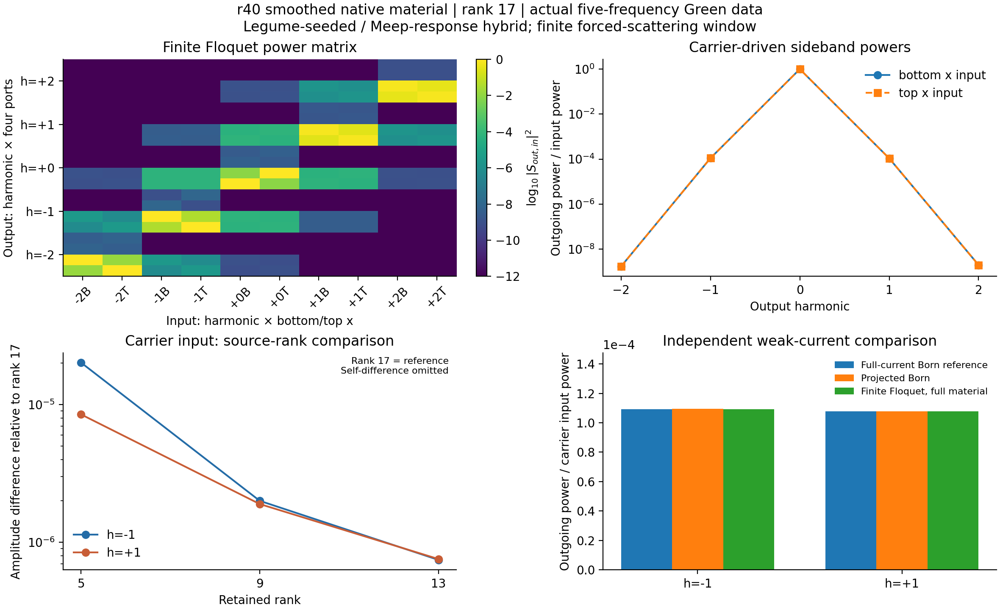
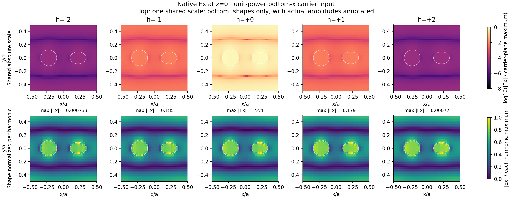

# 完整有限 Floquet 数据集：原生平滑材料与一致极化接口

本轮实际计算 r40、同一二维图案薄膜的 Γ 点（k=0）、固定载波 fa/c=0.398、调制频率 0.01、介电常数余弦振幅 0.01。使用实际 Legume 场种子和静态背景增广，静态 Green 响应由 Meep 在 0.378、0.388、0.398、0.408、0.418 五个真实频率采样。它是 **Legume＋Meep 混合数据集**，不代表整个布里渊区的能带。

保留 17 个实数 parity 源坐标和 ±2 边带；全部五频率的上下 x 偏振入射，映射到上下 x/y 四输出端口，得到 **20×10 复数散射矩阵**。同时保存全部保留频率与入射列的内部电场、源系数、R/T/b、材料矩阵及可用的 A/B/C/D。

当前使用原始有限时间窗响应，未启用尾部完成；稳态性须依据本数据的时间窗比较判断，不能只由采样完成来确定。

空间图使用真实原生 z=0 面的 Ex 分量。上排共享绝对相对色标，下排仅比较各边带形状、并标注单位入射功率下的实际最大场幅；不能把下排同亮度解释为同场强。

| 侧带 | 独立完整电流功率 | 投影 Born 功率 | 有限 Floquet 功率 | Floquet/参考复振幅差 |
|---|---:|---:|---:|---:|
| -1 | 0.0001093296 | 0.0001093496 | 0.0001093331 | 0.049% |
| +1 | 0.0001077942 | 0.000107855 | 0.0001078393 | 0.02142% |

上表参考来自同 r40 原生张量完整极化电流，未用来拟合本轮 Green 响应。Born 与有限 Floquet 的差异包含重复转换；该小振幅下不应以 Born 为严格有限调制真值。

## 控制与截断

- 零调制完整静态块恢复误差：0。
- 调制时间原点改变的相位协变误差：1.69e-16。
- 保存后重新加载再计算的载波散射误差：0。
- 当前 Γ 点、全局实余弦调制的加权转换互易残差（剔除静态对角块）：3.27e-06。
- 逐秩和逐边带比较使用相同材料、场网格、端口与物理驱动；具体数值见 summary.json。

| 侧带 | M1→M2 复振幅变化（载波入射） |
|---|---:|
| -1 | 0.003206% |
| +0 | 1.295e-06% |
| +1 | 0.003491% |

加权互易检查使用 T_l,x=iκ_l b_lᵀ/4 与实余弦材料的转置对称性，比较 S_lm/κ_l 和 (S_ml/κ_m)ᵀ，并保留各转换块的绝对误差；没有强制对称化数据。它不泛化为任意行波或空间相位调制的互易定律。动态总功则另外比较真实表示的极化电流做功与出入射通量，不强制 S†S=I。

**“完整”指本次声明的有限窗口与基底。** 载波 M1/M2 检查不能证明最外侧输入频率列对 ±3 以上边带已收敛；正实频受迫散射数据也不提供全复频极点、动态稳定性、拓扑或完整 QNM 认证。不同原生空间网格之间的敏感性须单独比较，不能用一个空间网格内的低 LS 残差抵消。

材料由 εbulk=11.5+0.01cos(Ωt) 的 16 个相位分别初始化 Meep 平滑离散介电图，并取相对未调制图的 Fourier 极化算子，包含 DC 与 ±1…±4。这保留了平滑材料图对真实 bulk 参数的非线性；只含导数 ε′=-K⁻¹K′K⁻¹ 的结果单独保存为对照。8→16 相位检查和半幅 0.005 的独立材料初始化均保留。内部源残差不是出射误差上界。

离线材料数据实际包含振幅 0.01 与 0.005，可任意改变整体调制相位。其他振幅须重新初始化对应的材料相位图（无需重跑这些静态 Green 响应），不能把所有 Fourier 阶统一线性缩放。静态频率只有明确保存的五个样本；改变载频或调制频率时，未采样的频率会被拒绝。

## 可重用文件

- static_green_dataset.npz（历史材料 `static_green_dataset.npz`；见[发行说明](../../../../../docs/RELEASE.md)）：五频率选用的静态响应、场坐标及投影块；具体响应处理方式见上文，原始窗口数据另行保留。
- floquet_M2.npz（历史材料 `floquet_M2.npz`；见[发行说明](../../../../../docs/RELEASE.md)）：20×10 S、完整采样区域的内部电场与源系数。
- K_base.npz、K_derivative.npz，以及 material_fourier/ 与其中 half_amplitude/：同一空间网格的材料算子与实际周期相位图，可离线重复已保存幅度与任意调制相位计算。
- [summary.json](summary.json)：逐频互易/源功/端口诊断、源与边带截断、幅度缩放、等待时间、原始来源哈希。

本地重新加载接口：`sptc_toolbox.scripts.analyze_full_floquet_dataset.load_portable(analysis目录)`；返回 `(dataset, material)`，无需再次运行 Meep。
