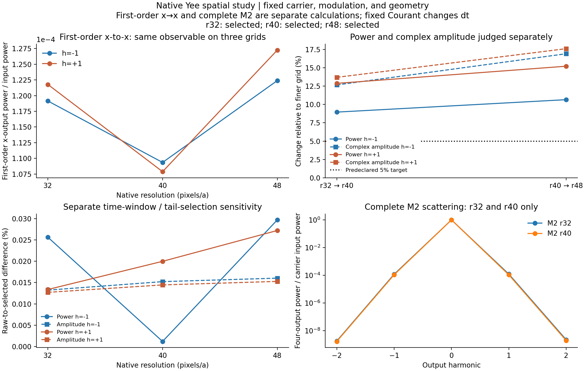

# 开放 SPTC 的空间网格收敛检查

最后一对网格尚未同时达到一级 x→x 功率与复振幅的 5% 相邻变化目标。当前结果量化了固定驱动下的网格敏感性；这不等于转换机制或工具箱不可用。

**本轮分别计算两类数据：完整 M=2 Floquet 的 r32/r40 对照，以及相同定义的一级 x→x 转换 r32/r40/r48 对照。r48 的一级参考不能当作 r48 完整 Floquet。**

模型为原二维圆孔/椭圆孔薄膜，固定 Γ 点、载频 fa/c=0.398、调制频率 0.01、bulk ε(t)=11.5+0.01cos(Ωt)。完整动态路线是 Legume 场种子＋Meep 静态 Green 混合；一级控制通过真实静态入射场和原生材料导数的无共轭互易积分得到，没有对文献或细网格结果拟合。

## 相同定义的一级 x→x 结果

只汇总底侧 x 载频单位入射产生的上下 x 出射，不把没有采样的 y 通道记作零。各行采用的数据处理方式如下。

| 网格 | dt | 使用数据 | −1 功率 | +1 功率 |
|---|---:|---|---:|---:|
| r32 | 0.015625 | selected | 0.00011914494 | 0.00012177343 |
| r40 | 0.0125 | selected | 0.00010934805 | 0.00010787698 |
| r48 | 0.010416667 | selected | 0.00012239136 | 0.00012724713 |

预声明功率与复振幅相邻变化目标均为 **5%**，两项分别判断，分母均取较细网格。达到目标只表示该可观测量的相邻变化足够小，不是连续极限误差认证。

| 相邻网格 | 边带 | 功率变化 | 功率目标 | 复振幅变化 | 复幅目标 |
|---|---:|---:|---|---:|---|
| r32→r40 | -1 | 8.959% | 未达到 | 12.67% | 未达到 |
| r32→r40 | +1 | 12.88% | 未达到 | 13.7% | 未达到 |
| r40→r48 | -1 | 10.66% | 未达到 | 16.93% | 未达到 |
| r40→r48 | +1 | 15.22% | 未达到 | 17.62% | 未达到 |

## 时间窗和尾部处理敏感性

以下是同网格 raw→selected 的变化，分母为 selected。它与空间网格差异分开记录；不是网格误差。

| 网格 | 边带 | 功率变化 | 复振幅变化 |
|---|---:|---:|---:|
| r32 | -1 | 0.02564% | 0.01323% |
| r32 | +1 | 0.01337% | 0.01271% |
| r40 | -1 | 0.001185% | 0.01522% |
| r40 | +1 | 0.01999% | 0.01445% |
| r48 | -1 | 0.0297% | 0.01604% |
| r48 | +1 | 0.02722% | 0.01528% |

## 完整 M=2 Floquet 结果

以下包含重复边带转换、载频变化及二级边带，功率汇总上下 x/y 四输出。这一表不能与上面的一级 x→x 表混为同一计算。

| 网格 | 源坐标数 | −2 功率 | −1 功率 | 载频功率 | +1 功率 | +2 功率 |
|---|---:|---:|---:|---:|---:|---:|
| r32 | 17 | 1.7977433e-09 | 0.00011912474 | 0.99975903 | 0.00012175359 | 2.230578e-09 |
| r40 | 17 | 1.6742475e-09 | 0.00010933111 | 0.99978266 | 0.00010786088 | 1.9464418e-09 |

完整 M2 的一级边带也按同一 5% 目标分别评价功率与复振幅，分母为细网格：

| 网格对照 | 边带 | 功率变化 | 功率目标 | 复振幅变化 | 复幅目标 |
|---|---:|---:|---|---:|---|
| r32→r40 | -1 | 8.958% | 未达到 | 12.67% | 未达到 |
| r32→r40 | +1 | 12.88% | 未达到 | 13.7% | 未达到 |

完整 M2 的同定义 x 通道与一级控制的差异另存于 study_summary.json 的 M2_vs_first_order_x；它包括有限调制和反馈效应。完整 M2 的 r32/r40 复振幅、相位和安全内部区域场比较见 [完整网格对照报告](comparison/report.md)。

## 误差来源与验证范围

[静态场与失谐诊断](static_grid_diagnostic.md)比较实际载频和侧频场，保留单位入射复振幅及形状重叠。[原生材料网格诊断](material_grid_diagnostic.md)比较材料积分、界面剖面及 Y 反射缺陷。它们支持判断可能的误差来源，但没有把效率差全部拟合归因到某一项。

r40 响应验证声明（历史材料 `r40/tail_validation.json`；见[发行说明](../../../docs/RELEASE.md)）限定于本次 rank17、五频、±2 弱受迫响应：共同的同网格两极点时间算子作用于全部偶 sector，奇 sector 保留原始数据，并保存时间窗与 Maxwell 残差；没有独立 CW 认证。

[r48 响应验证声明](r48/tail_validation.json)只支持本次弱一级 x→x 对照：偶入射通过同网格两极点和第四时间窗检查，奇入射的简单尾部模型未通过而保留实际晚窗。它不补齐 r48 的模板 Green 数据，也不构成 r48 完整 M2。

## 适用范围

固定 Courant 下 dt 随空间网格共同改变，因此这里检查原生 Yee 加密的联合离散敏感性，尚未独立隔离时间步误差。没有用三个数据点拟合收敛阶，也没有做 Richardson 外推。当前对照限定在该固定驱动、弱调制、有限窗口和输入输出定义；不宣称全部波矢、强驱动或开放复本征谱都已收敛。

[数据完整性与来源清单](study_manifest.json)记录实际使用目录、缺失项与哈希；[数值汇总](study_summary.json)保留全部指标。completed 仅表示本次声明的数据已齐备，不表示所有收敛目标都通过。
