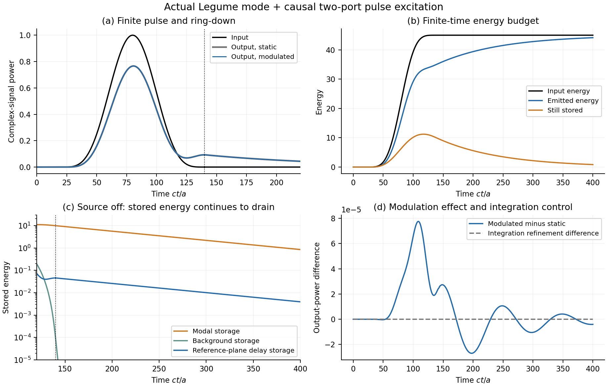
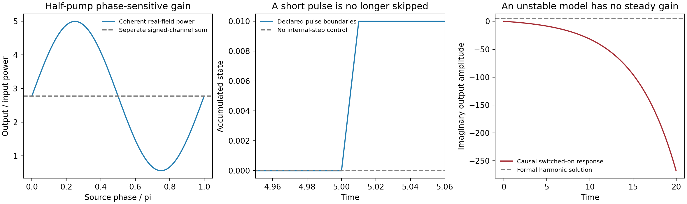

# 受迫散射与激励：源、相干性、脉冲和暗态已接通

2026-10-16。本轮围绕真实会影响使用的受迫问题完善接口。Legume空间底座和已有物理结构保留；没有用论文或Meep结果拟合端口振幅／相位。新代码既有实际图案薄膜计算，也有独立解析和直接时间积分控制。

## 当前可以直接做什么

- 指定从上方、下方或双侧以任意相对复相位照射，求同一有限模型的内部受迫坐标和逐频率／逐端口输出。
- 在半泵条件下正确合并同一物理频率的正负频输出，得到相位敏感增益；不把它们的模平方分开相加。
- 区分可达到的稳定连续波响应和不稳定系统的形式频域解；后者使用有限时间激励来回答实际增长问题。
- 输入有限脉冲，包含背景多反射与参考面传播延迟，跟踪源关闭后的泄漏、泵功和剩余储能。
- 对恰好处于入射频率、又不被激发／不影响输出的暗态，返回有限可观测散射，同时说明内部态非唯一。

## 实际 Legume 薄膜：源的相位改变模式和侧带激励

相干源选择（历史材料 `native/native_source_selection.png`；见[发行说明](../../../docs/RELEASE.md)）

使用已有gmax6.1、八垂直导模族的实际圆孔／椭圆孔薄膜，重新计算mode5的介质区域投影和原生辐射。载频fa/c=.398，调制频率.01，绝对介电常数余弦幅度.01；在相同总入射功率下：

| 源 | 内部坐标权重／单侧源 | −1边带输出功率／入射 | +1边带输出功率／入射 |
|---|---:|---:|---:|
| 单侧 | 1 | 1.31739×10⁻⁴ | 1.35979×10⁻⁴ |
| 同相双侧 | 2 | 2.63479×10⁻⁴ | 2.71957×10⁻⁴ |
| 反相双侧 | 数值近零 | 数值近零 | 数值近零 |

反相源未激发所选模式，但仍有直接背景散射，不能说器件完全没有输出。49点源相位扫描与该模态的1+cosφ选择规则相符，误差约4.46×10⁻¹³。独立单周期评估为稳定；N3→4目标功率最大绝对变化1.32×10⁻¹⁴。内部q/v坐标权重不标为光子数。

[实际源验证](native/report.md) · [数据](native/summary.json)

## 有限脉冲：到观察时间末端的能量仍可能没有完全离开



同一图案薄膜，从下方输入t=20..140的sin²脉冲，观察至400ct/a，比较无调制、调制.01和时间步长减半。均匀参考背景通过完整因果Fresnel回波实现，未把单载频S背景套到宽带脉冲。

调制组输入能量45，到t400输出44.153856，累计泵功约+0.002360，仍储存约0.848504，即输入的1.88556%。这部分储能同时包含独立模态能量、均匀背景行波储能和参考面间在途能量，账目没有用输入减输出反定义成自动相等。

步长.22→.11后，复输出轨迹变化4.19×10⁻⁸，累计输出能量变化2.67×10⁻⁷；精细积分的能量平衡相对残差3.31×10⁻¹¹。调制相对静态的复输出变化约0.762%，明显超过本次积分误差，但不由此宣称完整结构的绝对散射精度。有限窗输出比例约98.12%，不能将未释放能量误认成吸收或最终转换损失。

[脉冲完整报告](pulse/report.md) · [参数与能量记录](pulse/summary.json)

## 独立反例检查：修复的不是多保留几位小数



1. **漏脉冲**：源仅在[5,5.01]非零，原积分器可能跨过整个脉冲，即使输出点很密，末态仍为0。显式开关分段后得到解析末态0.01。任意源的时间尺度无法自动猜测，新native脉冲接口要求有限max_step并支持明确开关。
2. **相敏功率**：稳定单模控制在半泵处，旧signed列功率和约2.77778；实源相位π/4得到约4.999995，3π/4得到约0.555568。新接口先相干组合后平方，与独立实时间受迫ODE一致。
3. **假稳态**：不稳定模型H=.2i有形式解S=5i，但零初态开启后t20输出约−267.99i，不趋近形式解。新native源入口将稳定性与输出解释接通，不为这种情况报告可达到的稳态效率。
4. **暗态奇异**：亮模＋中性暗模控制在暗模频率处，旧入口一律报奇异；显式相容策略得到S=.6−.8i、功率1。源／输出与左右零空间不相容、或Jordan型奇点时仍拒绝。内部态的自由暗分量不由散射自动确定。

这些是解析有限模型控制，不能冒充真实二维空间结果；实际空间验证在前两节。

## 现在仍有哪些重要问题

| 剩余物理问题 | 本轮之后的实际状态 |
|---|---|
| 完整图案背景与模态输入／输出的复相位、留数 | 仍采用几何平均均匀背景＋原生模态近似；功率账闭合不足以唯一确定真实内部场。不能把测得total S再当背景叠加同一共振，也不能拟合Meep振幅来掩盖差异 |
| 斜入射、上下不对称、双偏振、多衍射级 | 原生辐射信息可复用，但当前物理端口仍限Γ对称空气单偏振零阶；本轮源接口没有声称这些配置已验证 |
| 逐边带频变辐射与输入／输出统一 | 记忆浴已有本征／自由动态路线，尚未与全部外部端口组成通用物理散射模型。单独替换输出C(ω_l)、内部保持旧Γ会破坏损耗—输出一致性，不能用此捷径 |
| 绝对转换效率 | 旧同结构native与Meep32的差异14–17%仍保留，Meep自身r24→32也变化明显；此次没有新的全波精度证据，不宣称误差已消除 |

实际研究中，当前接口可以用于正入射窄频段的模式选择、弱转换、源关断和有限脉冲响应。若研究角分辨远场、上下不对称器件、多个传播衍射级或窄阈值绝对效率，才需要相应物理端口扩展；不能把这些限制一概当成已有机制不可研究。

## 验证与复运行

本轮完整回归969项通过（此前919项，新增50项），含解析Fresnel、直接时间积分、短脉冲分段、相敏增益、暗态非正规左右零空间、Jordan例外和原有论文模块。结果图均已目视检查。测试记录（历史材料 `regression.xml`；见[发行说明](../../../docs/RELEASE.md)）。

本地运行示例：

```powershell
$env:OPENBLAS_NUM_THREADS='1'
$env:OMP_NUM_THREADS='1'
.venv/Scripts/python.exe -m sptc_toolbox.scripts.validate_native_excitation
.venv/Scripts/python.exe -m sptc_toolbox.scripts.validate_native_pulse
.venv/Scripts/python.exe -m sptc_toolbox.scripts.validate_excitation_controls
```

[新接口用法](../../docs/forced_excitation_usage.md) · 设计与模型范围（历史材料 `../../docs/forced_excitation_design.md`；见[发行说明](../../../docs/RELEASE.md)） · [文件与验证清单](validation_manifest.json)
