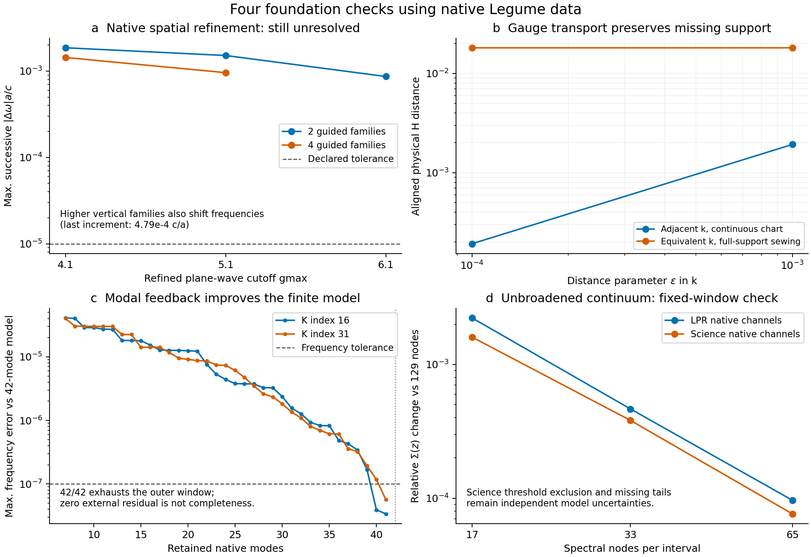

# 四项基础问题：本轮实现与实际验证

2026-10-15。本轮沿用 Legume 静态基础设施，实际扩展了空间加密控制、Bloch 整簇输运、模态窗富集／Schur 反馈、连续谱自能接口。
没有修改已安装 Legume，没有调整物理材料来拟合论文曲线，也没有覆盖此前失败或未收敛结果。
**四项都获得了可执行工具和验证证据；完整二维开放非厄米 SPTC 仍未被认证。**

后续使用解释：下面的“未达标准”针对本轮专项数值检查，不等同于机制错误或工具箱不可用。
例如8.66e-4 c/a的频率变化应与当前带隙、失谐、线宽及传播时间比较，不能仅凭超过1e-5
就否定物理结果。各基线应以目标观测量和相关控制决定是否需要继续加密；本报告没有据此
更改历史数据或判定。参见[物理目标与验证范围](../../docs/convergence_workflow.md)。

上图是基础设施检查，不是新的论文图复现。输入来自此前实际 Legume W1、LPR 和 Science 基线。

| 问题 | 本轮实现／实际结果 | 仍未关闭的边界 |
|---|---|---|
| 空间截止与垂直基底 | 独立轴、预算与停止状态控制；W1 两个固定 q 实际提高 gmax 至6.1，垂直族至6个，并检查4族下的平面波加密 | 最后频移仍为约8.66e-4、4.79e-4、9.59e-4 c/a，未达到既定1e-5标准 |
| Bloch 坐标与子空间 | 正度量白化、完整简并簇SVD输运、算符及通道协变、完整 G+k 并集sewing、保留非零holonomy | 等价坐标的原生场仍相差约0.01814；每侧约1.15e-4权重处于独占 Fourier 支撑，相位变换不能补齐 |
| 模态窗与补空间反馈 | 内外窗口／完整簇／逐扇区保护、外残差驱动富集、广义线性与二次Schur及导数 | 两点都需用满42模才达到严格外残差标准；没有剩余独立测试空间，不等于完整Maxwell收敛 |
| 开放连续谱 | 无人为展宽的分段解析矩阵积分、明确的retarded/outgoing分支、逐边带自能和调制系统—浴耦合 | 阈值奇点、谱尾、严格QNM度量和真实动态辐射映射仍未完成；有限谱窗不能唯一确定真实频移 |

## 空间误差有了独立证据

固定 W1 几何与材料，在 q=2.2、pi 两点由局域场和镜像特征选择目标，随后用完整 Fourier 并集中的 H 场确认同一物理模式。
跨加密最小 H 重叠平方约0.999544，说明目标身份保持；频率变化却仍超过容差。
平面波 cutoff 和垂直导模族不能互相替代。四导模族下再次加密平面波，仍出现独立修正。
程序保留 `NOT_CONVERGED` 与 `SCHEDULE_EXHAUSTED`，没有把预算／调度结束标记为成功。
本轮额外验证 p=0 的调制质量重叠，尚不能据此认证全部非对角动态耦合。

实际记录：[空间检查](spatial/report.md)、[输入与停止状态](spatial/summary.json)。

## 坐标修正与空间补全被区分开

连续 k 图中，将相邻点间距参数由1e-3减到1e-4，H场距离由0.00192567降为0.000192567，符合局部连续行为。
等价 k 的完整sewing却仍保留约0.01814差异，暴露有限G集合不具备严格倒格矢移位不变性。
新输运层不会用交集归一化提高重叠，也不会为闭环光滑而强制Wilson矩阵为单位矩阵。
合成退简并簇的非幺正规范控制误差约3e-15；非零Wilson相位约pi/2被保留。该控制不是实际薄膜拓扑计算。

实际记录：[Bloch检查](bloch/report.md)、[完整证据](bloch/summary.json)。

## 有限模态窗可自动诊断和富集

W1原7模与42导模窗相比，最大目标频率偏差约4.10e-5 c/a，即使最低物理场重叠平方仍有0.99963。
按补空间resolvent加权残差逐簇加入模式，在两个点分别到40／41模时频率偏差达到1e-7；严格外残差要求仍使外窗耗尽。
保留7个主坐标而用Schur项消去其余35模，非线性本征频率与直接42模解相差不超过6.66e-16。
这证明消元与所选有限模型一致，不证明42模本身完备。
原更大[1.3,2.1]窗口的开放模式／上界保护拒绝仍保留。
收尾审计还修复了严格简并簇的身份误判：相同二重子空间旋转45度时，逐向量重叠平方可只有0.5；现在用整簇物理Gram主角度验收，并按无序频率集合比较。修复后重跑两个W1点，以上结果保持。

实际记录：[模态检查](modal/report.md)、[每轮富集与外窗耗尽标志](modal/summary.json)。

## 连续谱层已摆脱人为展宽，但真实开放补全尚有输入缺口

利用两篇基线实际导出的共同实频复通道，构造指定有限正频窗口的矩阵耗散谱，再做解析Cauchy积分。
对这种指定谱，解析核具有连续分支切割、上半平面被动性和显式出射延拓；没有在复频率上使用非解析的 C(z)C(z)†。
与已有展宽积分浴相比，这一层不需要额外展宽参数，也不将每个积分节点变成一个假浴极点。

129节点时，LPR原生on-shell耗散的最大插值偏差为1.98e-5，Science为9.52e-6。
Science两个模式跨过实际衍射阈值，通道数4→12；在指定复频探针处，非对角自能约占矩阵范数的11.2%。
这不能仅靠两个独立Q值表达。LPR的Eu对在此基底接近对角，与其对称性相容。
两组实例的逐边带矩阵已保存，静态浴在不同边带分别取对应频率。

阈值附近目前明确挖除窄条带。Science挖除半宽从0.01变到0.001时，自能相对变化约4.36%；从0.001变到0.0001仍约0.284%。
这些变化独立于同一挖除宽度下的插值收敛，说明阈值处理尚不能被数值网格收敛代替。
正频弱辐射归一化、窗口外未知谱尾和反应性频移仍属于物理近似。
本轮没有生成严格QNM场，也没有认证完整开放散射或全负频参数放大问题。

通用系统—浴调制接口包含所有耦合可达的中间浴谐波。独立显式浴Schur控制误差约1.93e-16；若错误把中间浴谐波裁到内部窗口，控制误差达0.01236。
测试还发现并修复了一个出射分支实轴边界错误：现在沿固定穿越区间保持解析延拓，不会随频率实部移动偷偷切回默认分支。

实际记录：[辐射检查](radiation/report.md)、[原生谱与窗口敏感性](radiation/summary.json)。

## 如何使用与继续验收

[接口说明](../../docs/four_foundations.md)给出坐标、单位、公式与可重复运行命令。
文献原文核验（历史材料 `../../literature/projection_foundations/README.md`；见[发行说明](../../../docs/RELEASE.md)）给出方法来源及其适用范围。
最终完整回归 **806项通过**，涵盖原749项和本轮57项；见完整回归（历史材料 `regression.xml`；见[发行说明](../../../docs/RELEASE.md)）。
另保留Nature基线单独回归（历史材料 `nphoton_regression.xml`；见[发行说明](../../../docs/RELEASE.md)）、简并修复前的53项新增测试（历史材料 `new_tests.xml`；见[发行说明](../../../docs/RELEASE.md)）及最终18项模态测试（历史材料 `modal/tests.xml`；见[发行说明](../../../docs/RELEASE.md)）。
最终源码、输入与结果哈希及覆盖范围见[验证清单](validation_manifest.json)。测试通过只证明相应控制成立，不替代上文未关闭的物理收敛门槛。

下一轮最有价值的实验证据是：在已修复坐标图下，以更大独立模态空间检查全调制周期；对衍射阈值建立与原生通道DOS一致的奇点积分；再将同一物理子空间的动态自能与独立开放参考对照。
不能把单个函数测试通过、一个瞬时谱一致或一张趋势图相似升级为这些能力已经完成。
