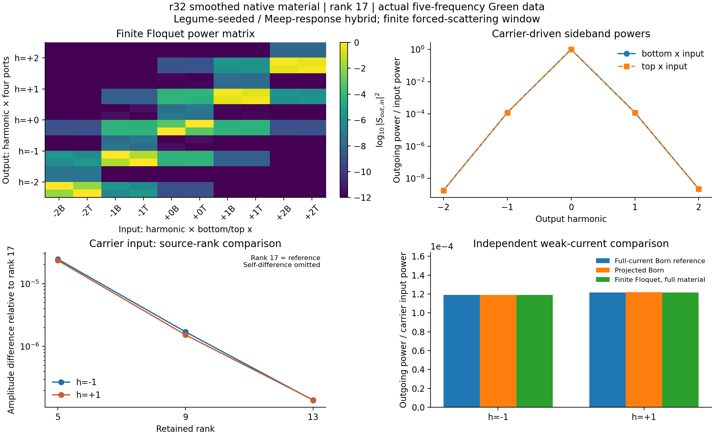
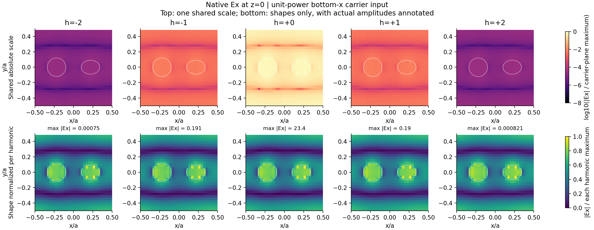

# 平滑材料的完整有限 Floquet 数据集

本轮将上一轮仅计算一级完整电流转换的平滑路线，推进为实际静态响应驱动的有限模态Floquet数据集。物理几何、εbulk=11.5、载频fa/c=.398、调制频率.01、介电余弦幅度.01和端口z=±.7保持不变。Legume提供实际模场种子，Meep提供独立静态Green响应，仍明确属于混合路线。

## 完整的范围

在r32原生亚像素材料、Z镜像扇区、完整Y方向下，实际采样五个物理频率：.378、.388、.398、.408、.418，即m=−2…+2。每个频率包含完整入射场E0、静态散射S0、每个源方向的内部极化响应F及出射T。动态组装保留同一有限窗口内的所有反馈路径。

输入为每个边带的下侧／上侧x偏振，输出为每个边带的下／上x和下／上y四通道。因此完整有限散射矩阵为 **20×10**。这里“完整”指上述频率窗、源空间及x入射子空间，不包含尚未求解的y入射列、无限边带或任意复频QNM极点。

原始静态数据、材料Fourier矩阵、完整S、内部系数、谐波场和加载器分开保存。无调制、边带窗、源秩、时间窗、材料相位采样及独立Born参考分别提供不同验证，不能相互替代。

最终保留17个实源坐标、五个边带，对应85维内部受迫方程。已完成19个空间源的实际宽带传播，每个取五个频率，合计95条静态频率响应；三个累计时间窗共57个原始NPZ／285条频率—时间记录。不是把同一单频结果复制成多个边带。

## 实际结果与数据文件

单位底侧x偏振载频入射下，上下全部x/y出射功率相加：

| 输出边带m | fa/c | 出射功率／入射功率 |
|---:|---:|---:|
| −2 | 0.378 | 1.79774329×10⁻⁹ |
| −1 | 0.388 | 1.19124739×10⁻⁴ |
| 0 | 0.398 | 0.999759034 |
| +1 | 0.408 | 1.21753591×10⁻⁴ |
| +2 | 0.418 | 2.23057804×10⁻⁹ |

M1→M2使载频输入的−1／+1复出射分别变化0.00314%／0.00355%。幅度减半后，一阶功率比约0.25003、二阶约0.062508，与弱转换的一次／二次振幅规律相符。真实周期材料与线性导数近似对二阶复出射的差约0.0176%／0.0518%，已通过实际算子输入计算，没有因材料系数小而直接忽略。

全10个输入列的加权动态极化源残差最大约0.0513%，载频输入约0.00519%；它是源密度诊断，不是散射误差上界。保留调制源做功后，有限模型的出入射能量账残差不超过约3.92×10⁻⁸个单位输入功率，没有强制Floquet矩阵幺正。直接LS与ABCD解相差2.32×10⁻¹⁵，零调制静态块精确恢复，重新加载数据后再计算得到相同载频响应。

与上一轮同r32完整极化电流Born参考，一阶复振幅差为约0.0251%／0.0385%。Born不是严格有限调制真值，所以这一对照与重复转换、材料周期项、源秩和边带截断检查分别保留。[全部控制数值](analysis/summary.json)。

场图采用原生z=0平面的Ex分量，上排共享绝对相对色标，下排只比较形状并标注实际最大幅度。不会把交错网格三个分量未经插值拼成虚假的共点矢量场。

- 数据包ZIP（历史材料 `floquet_dataset.zip`；见[发行说明](../../../docs/RELEASE.md)）：选用的静态数据、Floquet结果、周期材料和离线说明。
- 静态Green数据（历史材料 `analysis/static_green_dataset.npz`；见[发行说明](../../../docs/RELEASE.md)）：Q、原生坐标、E0/F/S0/T、R/b、材料Fourier块及ABCD。
- 完整Floquet结果（历史材料 `analysis/floquet_M2.npz`；见[发行说明](../../../docs/RELEASE.md)）：20×10复S、全部入射列的内部电场、系数及输入输出标签。
- [加载说明](analysis/README.md)：可移动数据目录，用本工具箱和NumPy/SciPy重新组装，无需再运行Meep。
- [原始未去尾的数据版](analysis_raw/report.md)：原窗口、原始Floquet结果及所有失败控制独立保留。

## 实际多频采样与源空间

宽带Gaussian源在同一静态Maxwell传播中对五个频率分别计算原生DFT，不做频率插值。原生交错坐标和端口数组边界由实际Meep DFT块定义；独立逐点时间积分验证了内部和端口读出。实际电流谱使用Yee半步时刻，与目标J=−iκ(ω)Q规范一致，其中κ=2sin(ωΔt/2)/Δt。

一次真实r32完整极化源的多频响应，随等待从t500至t2000与独立单频驱动结果趋于一致。t2000两侧带复出射差约0.047%／0.029%，没有最佳相位或幅度对齐。较粗DFT累计时间步也与同一轨迹逐步DFT作了对照，其误差小于当前等待时间敏感性；每列实际累计步长分别记录，旧细步结果不被改写。

初始九列由实际Legume场、未调制载频偶／奇场及材料极化生成。五频真实入射数据随后发现：载频源表示很好，但外频偶入射的材料源残差可达四至六成。因此在原九列逐数不变的基础上，以晚窗五频静态场和材料作用做奇偶分块残差增广，实际补算八列新源。

最终17列在所有声明静态频率／物理及奇偶入射下，完整材料Fourier源RMS残差最大约9.71×10⁻⁴，达到预先声明的1e−3目标；下／上单侧输入最大约6.26×10⁻⁴。这个残差不是动态散射误差上界，也不证明反馈产生的新场方向必然被完整表示。原九列及相应实际响应全部保留，基底增广没有动态目标拟合。

## 真实周期材料而非仅一阶导数

平滑后的离散本构关系εeff=K⁻¹随bulk ε变化，通常不是严格线性。只使用ε′cos会遗漏与二次转换同阶的DC及±2材料项。因此实际对εbulk(φ)=11.5+.01cosφ做16相位原生初始化，获得Kφ，再以稳定稀疏作用

\[
\Delta\epsilon(\phi)E=-K_\phi^{-1}(K_\phi-K_0)K_0^{-1}E
\]

计算p=−4…4的材料Fourier算子，覆盖M=2内任意两边带间的差频。相位求积8→16和独立半幅.005材料周期均实际计算；原始K和离线加载器保存于[材料数据](material_fourier/report.md)。这些项来自离散平滑材料映射，不能称为新增本征光学χ²或材料色散。

`ProjectedModulationSum` 将不同Fourier材料算子放入同一源度量下组合，静态极化响应已含输出频率因子，调制矩阵不再重复乘κ²。DC材料变化相对同一个K0定义，没有同时计入静态Green和调制两次。只用一阶材料导数的结果另作对照。

## 长寿命静态响应的处理

完整采样揭示了仅检查载频Born时不明显的弱泄漏静态模式：其频率约0.38922797−i5.63×10⁻⁶，振幅衰减时间约2.8×10⁴。t2000的矩形累计DFT因此仍包含较强自由振荡。该尾部与实际Legume模式4的空间场重叠约0.984，但这不是严格QNM归一化、连续结构Q值或BIC认证。

两个不重叠后期窗口得到一致的静态极点和空间形状；另一个较快极点来自此前独立Gaussian脉冲。对整个偶扇区采用同一个线性时间外推，而不是单独修改几列R或强制矩阵对称化。E、D、出射、入射及原生端口场同步处理；入射样本先恢复其原始DFT规范，完成相同操作后再归一化。奇扇区保留原始晚窗响应。

原始全部19个空间源的五频数据、单极点候选、统一处理候选和选样记录分开保存。独立完整极化源的前后两组三窗输出一致到约10⁻⁷，所有95条响应通过原生材料关系及离散Maxwell内域残差检查；最大残差约为源项尺度的0.14%，或算子项范数尺度的7.6×10⁻⁵。这些是实际测得的敏感性，不是事后宣称达到预先未声明的严格精度。

两次同源CW控制均未达到其声明收敛要求，失败场和日志保留，**没有把它们当作稳态真值**。选用响应被接受用于本次有限弱受迫计算，依据时间留出检验、独立完整源控制、Maxwell方程残差和实际Floquet输出敏感性；不意味着每个弱模板的源功都达到同样相对精度，或所有内部高寿命模式已被严格认证。

全17列下，原始晚窗与选用响应得到的20×10散射矩阵相对差约4.80×10⁻⁵。载频入射的±1复出射差约0.0166%／0.0126%，±2约0.0662%／0.0272%。局部弱源功残差另存绝对值与相对值，避免将一个很小分母的百分比直接当成最终效率误差。详细证据见[方法审查](review.md)、[Maxwell残差记录](review_maxwell_residual.json)、[选样记录](sampling_selection.json)与[原始数据版](analysis_raw/report.md)。

## 如何理解验证范围

五频完整静态样本和有限M2组装不是因果稳定性认证。外缘入射边带可能向窗口外转换，故M1→M2比较首先检查载频输入的目标侧带，不能自动认证所有边缘列的无限边带极限。

同样，r32的内部小残差不能消除上轮r32/r40平滑完整电流参考中约8%–11%的绝对功率空间敏感性。源秩与空间网格是不同数值轴。数据集用于在固定、可追溯的空间模型中分析Floquet散射；精确效率、窄阈值、辐射抵消及拓扑需相应额外验证。

数据和逐项数值见[完整分析](analysis/report.md)，加载方法和结果图也在该目录。源码、原始响应、对照与测试哈希见[归档清单](validation_manifest.json)。
