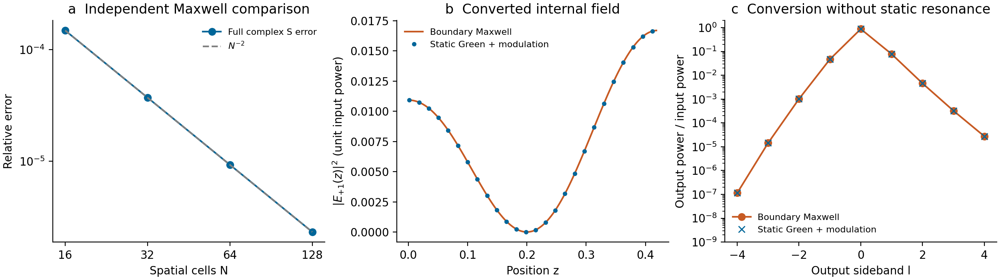

# 统一静态响应与Floquet散射：本轮实现结果

2026-10-16。继续内部、输入、输出及背景从同一个声明模型组合；进一步缩减模态时四项共同消元。Legume库本体未修改。

## 实质增加了什么

1. **逐实际频率的静态响应接入。** 新`StaticGreenSystem`提供同源A/B/C/D，`ModulationKernel`携带明确的Maxwell或材料频率因子。每个边带在ω+lΩ评价，支持同时多个相干输入频率。
2. **先调制、后整体消元。** 新`solve_green_floquet`保留跨保留／消去空间的全部调制路径，同时得到有效内部算符、源、输出和直接项；重建全状态并核对原方程。
3. **真实Legume适配。** 新`NativeGreenModel`从明确的无泵参考和实际调制模型生成统一链；保留非线性介电反演产生的DC均值变化、各频率背景和参考面相位，不把这些分别手工调参。
4. **独立Maxwell Green参照。** 用解析均匀薄膜的出射Green构造场与端口，验证包括非共振背景转换的整个链路。

## 1. 独立Maxwell：误差确实来自空间积分，而不是缺项



均匀空气／薄膜／空气结构，使用解析静态出射Green的体积分；对照采用原有完整Floquet边界解，两者不共享动态空间求解。

| 空间单元数 | 完整复S相对误差 |
|---:|---:|
| 16 | 1.49×10⁻⁴ |
| 32 | 3.72×10⁻⁵ |
| 64 | 9.31×10⁻⁶ |
| 128 | 2.33×10⁻⁶ |

每次空间加密误差约减为四分之一；128格的全部内部边带场误差2.89×10⁻⁶。通用固定ABCD与直接Lippmann–Schwinger体积分的场／输出相差2.66×10⁻¹⁴／3.46×10⁻¹⁴，说明接口和符号一致。时间谐波加密最后停在空间误差平台，两种截断已分开。

另一项有意义的控制：静态ε=1、没有静态腔共振的有限调制区，得到非载波输出功率比0.12959696，独立边界参考0.12959705。静态背景也参与调制转换；如果只保留某个静态共振模而完全省略背景路径，会错误预测零。

这是1D独立物理验证，不替代最终二维Legume空间底座。[完整均匀参考报告](uniform/report.md) · [数据](uniform/summary.json)

## 2. 实际Legume：全部四项消元后能保留源相位与转换

实际原生双模与完整消元（历史材料 `native/native_green_comparison.png`；见[发行说明](../../../docs/RELEASE.md)）

复用真实gmax6.1、八导模族的圆孔／椭圆孔薄膜数据，重新导出两个模态[5,12]的场投影与共同辐射。静态fa/c约.397954和.517078；它们具有相容的TM端口和完整场镜面对称性，按物理身份选取，没有按损耗筛选。

新协议仅调制圆孔区域，绝对介电幅度.05，驱动为两模差频约.119125 c/a。这个协议是明确的数学材料控制，不暗示空气可实现该调制，也不是旧.01介质背景算例的参数重标。静态输入／输出仍使用原模型的显式均匀参考背景和冻结共同辐射。

| 检查 | 结果 |
|---|---:|
| 完整44维谐波系统与保留22维后重建的复S差 | 1.36×10⁻¹³ |
| 全部内部状态重建误差 | 2.34×10⁻¹³ |
| 新链与既有单载频入口的复幅差 | 1.63×10⁻¹³ |
| 第二输入频率与其独立旧入口对照最大幅差 | 5.76×10⁻¹⁴ |
| 双频输入的独立原始受迫ODE周期误差 | 3.63×10⁻¹¹ |
| N3→N4目标输出复幅最大变化 | 1.11×10⁻¹³ |

该有限模型的独立单周期最大增长率为−5.54×10⁻⁴（τ单位），有稳定响应。两输入频率的输出路径在相同频率相干汇合，改变相对相位会改变目标输出。完整与缩减曲线重合，不是只比较谱点或总功率。

作为故意错误的对照，保持同一精确有效内部算符、却不修正输入／输出／直接项，复S误差约50.8%，并丢失主要相位依赖。**该50.8%只属于此次人为不完整消元对照，不是此前工具箱或论文复现的误差。** 正确新链没有用这个数调参。

完整主窗所有输出低于第一衍射阈值；加密守护窗包含更高频形式通道，metadata标明其超出双端口物理范围。两模间隔较宽，冻结浴仍属于显式trial近似；本轮证据是同一模型的一致消元，不能当宽频绝对散射已验证。

[原始原生算例数据](native/summary.json) · [物理身份与代码审阅](review.md)

## 3. 哪些问题真正被解决，哪些还没有

**已解决的是通用计算链路的一致性：**不再需要分别手工拼接某个内部自能、旧源矩阵和新输出；对已提供的静态响应和调制，可以统一组装、消元、重建，并用独立方程核验。完整均匀Maxwell参考还表明背景的直接转换可以在这套表示中真实保留。

**仍缺的是实际二维图案的完整静态Green输入。** 目前native适配继承有限导模、冻结辐射、均匀背景近似，未补齐真实图案的非共振连续谱、任意角多衍射级以及严格QNM留数。拥有通用接口不等于拥有所有物理输入，1D结果不能升级成2D认证。旧弱侧带14–17%的跨方法差异仍需静态载频参考收敛及完整背景/场映射来定位，本轮没有声称绝对效率改善。

下一项最直接的工作，是沿已核验的静态散射态／Green投影路线，在真实图案上明确完整背景、入射与互易输出场的相位和规范，再将这些物理数据接入本轮统一层。所需方法和数据已记录在底层问题与前人方法（历史材料 `../../literature/scattering_foundations_20261016/README.md`；见[发行说明](../../../docs/RELEASE.md)）；不通过任意拟合端口幅度补齐。

## 复运行与验证

完整回归1010项通过（此前969项，新增41项），包括通用Green组装、完整四块消元、静态奇点被调制解除、独立均匀Maxwell及native多频接口。两篇旧论文的有限模型也重新做了接口回归：LPR四档和Science22点保持原结果，3处历史拒绝保留，见[记录](paper_regression/summary.json)；这不是又一次新的完整论文复现。测试只认证对应的计算和模型范围，不作为完整空间物理证明。两组结果图均已目视核对。

```powershell
$env:OPENBLAS_NUM_THREADS='1'
$env:OMP_NUM_THREADS='1'
.venv/Scripts/python.exe -m sptc_toolbox.scripts.validate_uniform_green
.venv/Scripts/python.exe -m sptc_toolbox.scripts.validate_native_green
```

[接口用法](../../docs/green_response_usage.md) · 设计范围（历史材料 `../../docs/green_response_design.md`；见[发行说明](../../../docs/RELEASE.md)） · 完整测试记录（历史材料 `regression.xml`；见[发行说明](../../../docs/RELEASE.md)） · [来源与文件清单](validation_manifest.json)
