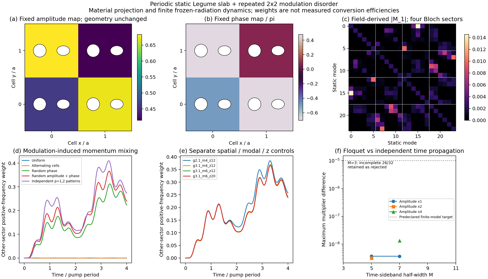

# 周期静态背景上的调制无序：首轮实际结果

**已接通一般周期调制输入、实际 Legume 多 k 场投影与既有动态后端。** 静态孔形、厚度与材料完全周期；随机性只存在于每个晶胞的调制幅度和相位。没有把原几何改成随机结构。

本轮是工具箱独立验证，不是某篇论文原图复现。有限2×2图案周期重复，不代表无限无序介质或无序集合统计。

## 实际输入与计算

沿用 a=1、εbulk=11.5、厚度0.42、圆孔/椭圆孔和上下空气。静态原胞的四个不等价Bloch波矢组成一个2×2调制超胞的完整动量陪集。Legume空间截止为gmax=2.1/3.1、八个参考导模族；选中每扇区4/6个真实模式。随机种子20261019，实际幅相数组保存在drive_patterns.npz/json。

固定驱动角频率 Ωa/c=0.1758195512，仅从第一档静态频率差选定，后续空间／模式加密均未重新调谐。初态为一个实际静态模式，演化4个调制周期。

| 驱动 | 其他k扇区正频权重峰值 | 末态权重 |
|---|---:|---:|
| Uniform | 2.702624e-33 | 2.67013e-33 |
| Alternating cells | 0.0007320511 | 0.0004421577 |
| Random phase | 0.3126287 | 0.2233437 |
| Random amplitude + phase | 0.36638 | 0.2393873 |
| Independent p=1,2 patterns | 0.4102703 | 0.273752 |

这些是裸静态正频坐标权重，**不是实测转换效率、概率或远场功率**。均匀调制的跨扇区值接近舍入误差，而随机相位／幅相显著耦合原先独立的k；各时间谐波还可采用不同空间图案。

## 时间后端与关闭调制控制

| Floquet半宽M | 与独立时间积分的一周期乘子最大差 | 状态 |
|---:|---:|---|
| 3 | — | 拒绝：模式集合不完整 |
| 5 | 3.71e-09 | 32个完整有限模型模式 |
| 7 | 3.7e-09 | 32个完整有限模型模式 |

预声明乘子误差目标1e−5。关闭调制后，最大其他扇区权重为0；被动能量最大相邻增量-0.000118。材料泵功与辐射耗散分开记录，没有重复加对角Q。

## 幅度提高的有限模型检查

| 幅度倍数 | 最大Δε/εbulk | 最低瞬时介电率 | 乘子对照 |
|---:|---:|---:|---|
| 2 | 11.88% | 10.1338 | M=5, 差3.19e-09 |
| 4 | 23.76% | 8.76768 | M=7, 差1.35e-08 |

幅度提高只检验同一有限材料／冻结辐射模型的组装与时间演化；不能据此认证真实强调制开放薄膜的辐射边带、阈值或统计无序行为。

## 空间和模式敏感性

| 配置 | 峰值其他扇区权重 | 末态权重 | 最大能量账残差 |
|---|---:|---:|---:|
| g2.1_m4_z12 | 0.3848164 | 0.2575405 | 3.89e-08 |
| g3.1_m4_z12 | 0.3696003 | 0.2435441 | 3.84e-08 |
| g3.1_m6_z12 | 0.36638 | 0.2393873 | 3.81e-08 |
| g3.1_m6_z20 | 0.36638 | 0.2393873 | 3.81e-08 |

[真实静态场身份与相邻敏感性](identity.json)记录模式匹配及5%目标的实际判定；不以一个峰值稳定代替全轨迹或完整空间收敛。

| 独立轴 | 其他扇区完整轨迹最大变化／细档峰值 | 5%目标 |
|---|---:|---|
| native_spatial_basis | 10.743% | 未达到 |
| retained_mode_window | 1.1346% | 达到 |
| modulation_projection_z_quadrature | 5.3481e-09% | 达到 |

静态H场在完整Fourier联集与含包层的共同正权度量中核验，模式匹配保持。空间截止变化下转移轨迹仍有约一成敏感性，本例支持调制诱导跨k耦合机制，不报告长期精确转移量已经收敛。

[独立全超胞实空间积分](independent_projection.json)抽查覆盖全部24模态的66个矩阵元素，直接重建实际Legume场并积分，不依赖生产的跨胞结构因子公式。

Floquet乘子检查使用16个静态模式／32个状态的代表模型；主要动态图使用24个静态模式／48个状态。两者不混作同一个谱验证。各配置辐射冻结参考频率固定为第一档数据的同一四个物理频率，避免把改变参考频率混进模态截断；初始不同参考的控制保留在history_variable_bath_reference。

## 开放性与尚未完成的范围

本轮动态接入现有每k共同频率的完整辐射Gram，采用明确的**冻结Markov近似**。这些窗口均为trial，不能将高k参考频率处零通道解释为所有动态边带都无辐射。例如两个高k扇区的光锥阈值约为2.897、2.982，所保留高频模式的+2边带已可能越过阈值，而参考频率处仍无传播通道。当前数据没有完整频变多k Green，也没有新随机驱动的直接Meep交叉验证；之前Γ同步弱调制约0.05%对照不能转移为本例的全波精度。

连续多q一般输入已经定义，但本轮实际Legume接入的是cell-wise有限周期图案；真正空间非公度、有限不重复调制斑块、逐周期时间随机和完整角谱仍未完成。本轮没有修改安装的Legume，也没有独立开发空间Maxwell求解器。

[使用入口](../../docs/modulation_disorder_usage.md) · 收紧后的baseline（历史材料 `../../literature/general_spatiotemporal_20261019/focused_baselines.md`；见[发行说明](../../../docs/RELEASE.md)） · [机器可读结果](summary.json)
