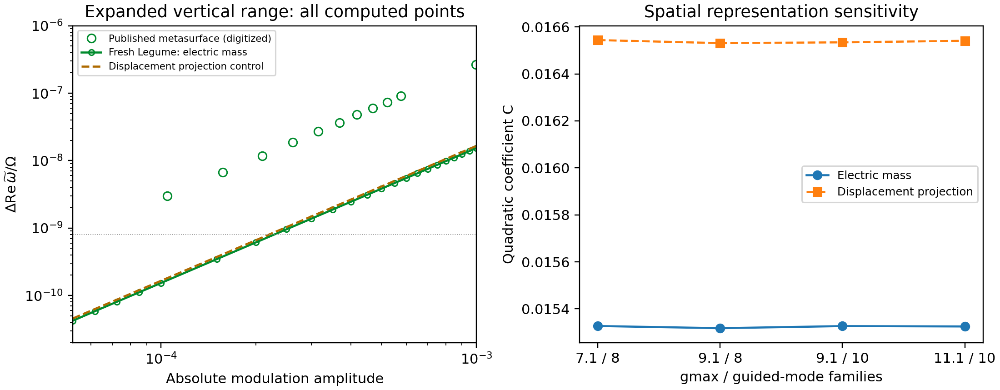

# LPR Fig.3 periodic metasurface: fresh Legume recomputation

2026-10-16. The original geometry and constant dielectric value are unchanged. No fitted amplitude, pole or field normalization is inserted. The old baseline files are preserved.

## Result

The squared-amplitude trend is reproduced (fitted exponent 1.999821), and the target field retains a central dark ring in the top view and two side-view lobes. The fresh 12-mode electric-mass coefficient is C = 0.015326549; the displacement-projection control gives C = 0.016534396. The published green-circle image gives approximately C = 0.272. Thus the coefficient remains 17.75 times (electric mass) or 16.45 times (displacement projection) smaller. The mismatch is not explained by this refresh.

**The paper-versus-reproduction view must show actual published Fig.3(a) and only the metasurface row of Fig.3(b).** Single nanorod, bowtie and slab (c,d) are different physical examples and are not included in this periodic-structure recomputation.

## What changed

The native eigenproblem is solved anew four times. The primary run uses gmax=9.1, 10 vertical guided families and 161 saved modes, of which 12 form the A2g subspace. The dynamic model selects this subspace before inversion of M(t), retains both frequency signs, and uses the complete constitutive time dependence. The inverse-dielectric projection is a separate control, not silently equated to the electric Galerkin model. No color/axis rescaling was applied to make the result overlap the paper.

## Targeted checks

| Native basis | C electric mass | C displacement |
|---|---:|---:|
| 7.1 / 8 families / 121 modes | 0.015326891 | 0.016543963 |
| 9.1 / 8 families / 161 modes | 0.015317593 | 0.016531051 |
| 9.1 / 10 families / 161 modes | 0.015326549 | 0.016534396 |
| 11.1 / 10 families / 161 modes | 0.015324947 | 0.016540912 |

- gmax 7.1 to 9.1 at 8 vertical families: E coefficient changes -0.0607%; target-field common-metric overlap² = 0.99979581.
- 8 to 10 vertical families at gmax 9.1: E coefficient changes 0.0585%; target-field common-metric overlap² = 0.99999846.
- gmax 9.1 to 11.1 at 10 vertical families: E coefficient changes -0.0105%; target-field common-metric overlap² = 0.99992424.
- Retaining 7 to 12 A2g modes changes C electric mass by -0.0214%.
- Temporal half-widths 1,2,3,5 agree at the requested amplitude scale; the maximum all-branch multiplier difference from independent physical-time integration is 1.19e-10.
- A fresh native material derivative agrees with the field overlap to 3.63e-09 relative error.
- Raw tiny eigenvalue differences versus the independent quadratic coefficient differ by up to 0.209% over the extended low-amplitude range, consistent with subtracting nearly equal double-precision eigenvalues. Main plotted points are the actual eigensolver values.

## Radiation and scope

The main candidate lies below the first diffraction threshold at Gamma. The ±3 carrier-sideband samples have only four zeroth-order air channels and A2g coupling is suppressed to numerical roundoff. The sampled real-frequency dissipative channels therefore do not explain a sixteenfold coefficient discrepancy. Higher-frequency virtual continuum contributions and their reactive self-energy are a different issue and remain outside this finite guided-mode calculation; these sideband samples do not establish that a full causal bath has no effect. The native on-shell linewidths of higher included modes are archived, but are not added again as a uniform damping term at the target sidebands.

The E/D finite-subspace coefficient spread is still 7.88%. Therefore stable gmax and temporal checks do not certify the complete open Maxwell projection. Exact QNM normalization and the author-selected mode identity remain unresolved. The published main article and SI do not provide the metasurface pole frequency, Bloch phase or normalized modal data. Square lattice, Gamma, air claddings and uniform rod modulation remain explicit assumptions.

## Field and figure data

- Primary raw curves: [custom_g9.1_v10_m161/frequency_shift.csv](custom_g9.1_v10_m161/frequency_shift.csv).
- Physical E fields: [custom_g9.1_v10_m161/target_fields.npz](custom_g9.1_v10_m161/target_fields.npz). E_xy has shape (3,161,161); E_xz has shape (3,101,161). Both use one common amplitude scale. Cylinder boundary: r/a=.375; centered z/a=±.0625. Actual x:z aspect is retained.
- Published field crop has no numerical field-of-view or scale; ours is explicitly x/a,y/a in [-.5,.5] and centered z/a in [-.25,.25]. Do not claim pixel-level field registration.
- The paper y-range omits 7 calculated low-amplitude points. All remain visible below in the separately labelled expanded-axis diagnostic.

Sources: formal caption（历史材料 `../../../../lpor_71318/literature/formal_fig3_extracted_caption.txt`；见[发行说明](../../../../docs/RELEASE.md)）, [source audit](../../../baselines/source_audit.md), published SI（历史材料 `../../../../lpor_71318/literature/published_supporting.pdf`；见[发行说明](../../../../docs/RELEASE.md)）.

Reproduce by running `sptc_toolbox/baselines/lpr_latest.py` for the four configurations in summary.json, then `sptc_toolbox/baselines/lpr_latest_summary.py`.
