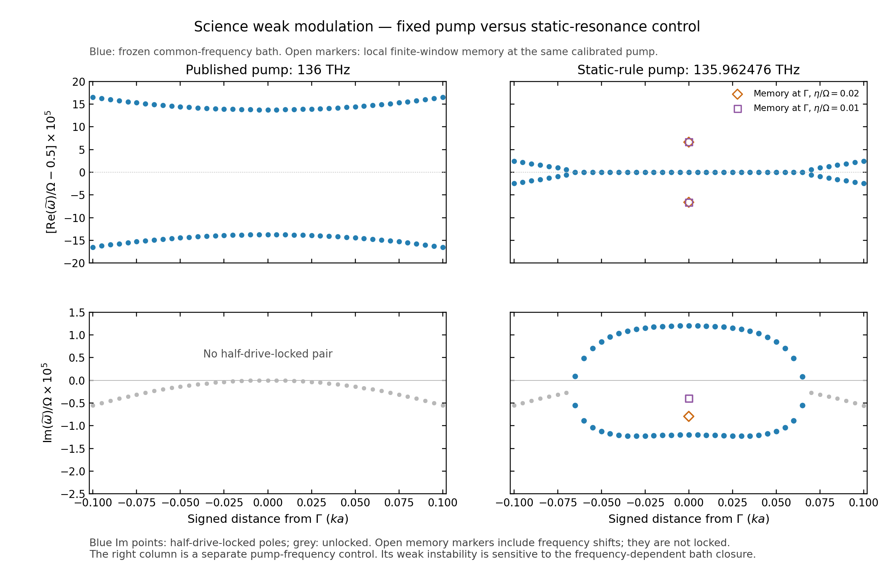

# 两篇论文：最新工具箱的新计算与原图对照

2026-10-16（Asia/Shanghai）。本轮重新运行 Legume 空间本征求解、导出真实场并计算调制投影，保留旧基线。主比较仍是 LPR DOI 10.1002/lpor.71318 Fig.3 周期阵列部分，以及 Science Advances DOI 10.1126/sciadv.aed4055 Fig.4。这里的结果不再只是旧缓存和旧物理模型的接口回归。

**结果：LPR 的平方律与环状／双瓣场形保留，频移系数仍未对应；Science 的局部参量放大得到支持，但固定论文泵频的弱窄隙和完整全路径增长仍未复现。** 按本模型静态共振规则选泵后，Science 出现窄锁频区；这组改变泵频的辅助结果与原参数比较分开展示。

## LPR：Fig.3(a,b) 周期阵列

正式原图与本次LPR计算（历史材料 `lpr_paper_comparison.png`；见[发行说明](../../../docs/RELEASE.md)）

对照 PDF（历史材料 `lpr_paper_comparison.pdf`；见[发行说明](../../../docs/RELEASE.md)） · 可编辑计算图 SVG（历史材料 `lpr_paper_comparison.svg`；见[发行说明](../../../docs/RELEASE.md)） · [全部频移点的扩展坐标图](lpr_full_range.png) · [数值报告](lpr/report.md)

左边为正式原图，右边为本次计算。绿色空心圆、log–log坐标、归一化频移和总电场幅值沿用论文定义。右边低幅度结果超出论文纵轴下界，图中明确计数；扩展坐标图保留所有实际计算值。场图保持真实几何比例，两截面共用一次最大值归一化，没有把场强替换成幅值或拉伸圆柱。

实际新算四档空间设置，主要配置为 gmax=9.1、10 个垂直导模族、161 个输出静态模，保留其中 12 个 A2g 模。材料保持原文常数 ε=16；半径150 nm、厚度50 nm、周期400 nm，Ω=10¹⁴ rad/s，绝对介电正弦幅度，无 DC。

| 比较量 | 本次新结果 |
|---|---:|
| 平方律指数 | 约2.000 |
| 多模电场质量矩阵系数 C | 0.01532655 |
| 多模逆介电投影控制 C | 0.01653440 |
| 论文绿色点的图读 C | 约0.272，非作者原始数据 |
| 论文／本次 C | 约17.75倍／16.45倍 |
| gmax 9.1→11.1、垂直族固定时 C 的变化 | −0.01045%（电场投影） |
| 垂直族8→10、gmax固定时 C 的变化 | +0.05846%（电场投影） |

本轮的空间加密和多模扩展没有消除量级差异。两种有限投影自身仍相差约7.88%，所以不能据单一收敛序列声称空间表示完全正确。系数由独立二阶消元取得，并用完整正负频 Floquet 解验证；最低幅度点有约0.106%的相消敏感性，不将其末位当高精度数据。

已实际重新评价目标的 ±3 边带辐射通道：所选 Γ A2g 模在这些频率的耗散通道被对称性压制。该事实不提供更高频连续谱的虚跃迁频移，也不确认严格 QNM 归一化。方晶格、Γ、空气及最低 A2g 候选仍是明确假设，论文没有公布绿色曲线目标模式的唯一复频率／Bloch设置；不能由场形相似确认是同一作者模式。

本次没有重算 Fig.3 的孤立 nanorod、bowtie 以及另一均匀薄膜的(c,d)，它们保留在原图中供定位，不标作本次结果。

## Science Advances：Fig.4(B,D,E,F)

正式原图与本次Science计算（历史材料 `science_paper_comparison.png`；见[发行说明](../../../docs/RELEASE.md)）

对照 PDF（历史材料 `science_paper_comparison.pdf`；见[发行说明](../../../docs/RELEASE.md)） · 可编辑计算图 SVG（历史材料 `science_paper_comparison.svg`；见[发行说明](../../../docs/RELEASE.md)） · [超出原图坐标的完整数值视图](science_full_range.png) · [数值报告](science_adv/report.md)

主路径49点，另有33个较宽近Γ采样点和41个窄区加密点；均由实际空间求解获得。Γ左侧沿 M–Γ 对角，右侧沿 Γ–X 轴向独立计算，没有将一侧镜像成另一侧。主要空间为 gmax=6.1、xy-even 导模索引上限24、48个输出静态模。实际调制和共同辐射矩阵检查支持的相容模态进入动态计算；不按辐射小或曲线好看来选模。

主比较保留论文 fixed pump：弱调制 m=10⁻⁴、136 THz；强调制 m=.03、134 THz；DC项和余弦项均保留。由于作者 Ge 的 ε∞ 和 Lorentz 参数未提供，本轮仍明确采用常数 ε=16 材料控制，不能把它称为论文原始色散 Ge 模型。主图使用共同实频评价的辐射冻结近似；新频变记忆模型的局部结果单独报告。

- **B 静态谱**：Γ两个母模约67.9845、69.7495 THz。完整路径的平坦色散与模式身份尚未对应论文；蓝点为候选父子空间，身份不充分处用空心点，不强行连接。
- **D/E 弱调制**：固定136 THz的结果没有出现可信半泵锁频窄隙。没有把全部衰减率或一个任意最大值放进论文只展示带隙模的E面板。
- **F 强调制**：最大局部 Im(ω̃)/Ω≈0.0034874；34/49个路径点在选定模型的弱辐射范围内可计算，其中22个点有半泵锁频态，部分锁频态仍全部衰减。这不是论文所示的全路径增长。灰条是近似超范围；未插值填补。

较宽60–78 THz模态窗和63–72 THz主窗分开保留。前者引入部分强泄漏模式，当前原生扰动辐射描述不再充分；后者结果不能被称为已完成模态窗收敛。M点保持物理ε16、改变数值参考层为12/20/25，并对ref20独立空间加密后，强集体辐射限制仍存在；没有挑选看起来较平滑的参考来补线。

**Science C是孤立圆柱的旋转平均散射截面，未由本次周期薄膜路线重算；A是原论文示意。** 主对照专门对应B、D/E、F，没有用收敛图冒充缺失面板。D原文未给精确纵界和局部k跨度，因此本次明确标出实际使用范围；E/F遵循原图的虚部标度和半泵锁频筛选。

## 单独对照：使用静态共振规则选泵

论文弱调制泵频按含DC的Γ共振选择。应用同一静态规则到本次常数材料模型，泵频为135.962476 THz；这个值在动态扫描前确定，未根据动态曲线拟合，也没有逐k调谐。

在共同频率冻结浴下，41个真实窄区采样点中27点出现半泵锁频，覆盖已采样的 −.065≤signed ka≤.065，两侧±.070已计算为带外。峰值增长约1.2013×10⁻⁵，出现原图所对应的实部锁定和虚部分裂机制。但按当前角度映射，临界范围对应的全角宽约1.59–1.71°，仍不同于论文4°；这组图属于改变泵频后的机制对照，不是固定136 THz的定量复现。图中的空心标记另示Γ处频变浴控制，它没有保留该窄工作点的锁频增长，因此不能将蓝色冻结浴曲线称为已通过开放模型变化检查的最终弱隙。

## 新频率相关辐射在这篇中的实际检验

本轮用当前 `build_slab_memory`、实际 ±k 原生场映射、跨衍射阈值积分和 Schur–Floquet 极点求解，计算Γ、近Γ和X局部控制；没有另叠加原生 Q。原始记录见 [频变辐射结果](science_adv/memory/summary.json)。

Γ和近Γ的强调制局部增长在所检查的频变模型中保留。Γ在45–105 THz有限谱窗、η=.02Ω下，积分16→32阶的最大增长为0.003483482041→0.003483482054；与共同频率冻结结果接近。该模型的独立辅助态时间积分也核对了相应Floquet极点。

这项结果不能外推为完整开放自能已确定：有限谱窗与展宽会引入反应性频移，Γ处把高频谱权重展宽到低频还会产生模型衰减；这不是已证实的真实Γ辐射损耗。对于同一静态校准泵，Γ频变浴在η=.02Ω、η=.01Ω和扩大谱窗下的已定位最大虚部分别约−7.95×10⁻⁶、−4.00×10⁻⁶、−1.35×10⁻⁵；相应实部离半泵约6.62×10⁻⁵、6.67×10⁻⁵、1.33×10⁻⁴，大于冻结浴增益尺度。减小展宽降低了模型衰减，却没有消除反应性失谐。因此该窄工作点对所选开放模型不稳健；也不能反过来把其中一个有限谱窗当成真实Ge体系的唯一答案。

X在部分阈值频段的原生弱辐射密度超适用范围，其数值可解记录保留为诊断，不能据此断言真实增长消失。详见[局部频变辐射报告](science_adv/memory/report.md)及敏感性记录。

## 本轮验证与复运行

LPR包括独立原生材料微扰、模态窗、空间截止／垂直族分别加密、实际辐射采样和原始时间积分；Science包括物理场身份检查、完整非线性材料／辐射禁戒交叉块、时间谐波加密、独立时间积分及局部频变浴控制。主路径N3→N4的极点变化约6×10⁻¹⁴、时间积分乘子误差约3.3×10⁻¹²，只验证对应有限模型，不能证明未知作者材料或完整连续谱。

已有主测试849项和辅助Nature Photonics模块70项，本轮合计919项通过。主测试记录（历史材料 `regression.xml`；见[发行说明](../../../docs/RELEASE.md)） · 辅助记录（历史材料 `auxiliary_regression.xml`；见[发行说明](../../../docs/RELEASE.md)）。测试计数不充当论文复现证据。

数值入口：[LPR重算脚本](../../baselines/lpr_latest.py)、[Science重算脚本](../../baselines/science_latest.py)、[局部频变辐射脚本](../../baselines/science_memory_controls.py)。绘图：[统一绘图源](../../scripts/plot_paper_refresh.py)。本地使用工作区 `.venv/Scripts/python.exe`，BLAS/OMP设为单线程；新参数使用新输出目录，避免覆盖本轮证据。

[原图与SI核验](sources/source_report.md) · [逐面板物理量契约](sources/figure_contract.json) · [LPR原始数据摘要](lpr/summary.json) · [Science原始数据摘要](science_adv/summary.json) · [绘图与文件审核](verification.json)
