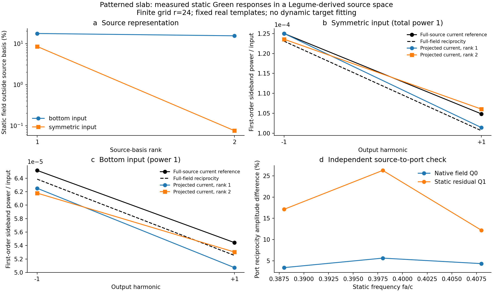

# 真实二维图案的静态 Green 输入与 Floquet 受迫散射

本轮已把真实图案的静态入射场、极化源响应和出射接入同一 Floquet 后端，并用实际计算区分了源空间遗漏与静态参考的数值误差。**这是 Legume 原生模场＋静态背景增广＋Meep 静态 Green 响应的混合验证；不是纯 Legume 完整散射，也不是完整开放 QNM 求解器认证。**

沿用上一轮的[统一 Green 接口](../green_response_20261016/report.md)。本轮没有改动安装的 Legume，也没有拟合动态侧带的振幅、相位、共振位置或材料参数。两个论文基线的旧结果完整保留。

## 实际增加了什么

新增 [projected_green.py](../../projected_green.py)：以共同的空间基底、坐标、积分权重和端口规范接收静态响应，并求解时间调制后的有限源空间方程。每个频率的完整入射场 E0、静态散射 S0、极化响应 F 和极化到出射 T 来自同一个静态 Maxwell 问题。结构响应固定后，更换入射振幅只需改变源向量；不能为不同激励任意重新拟合内部反馈或出射系数。

对约定 exp(−iωt)，模板电流为 J=−iωQ，故 F=ω²GQ 已含输出频率因子。令 Q†WQ=I，得到

\[
R_l=Q^\dagger W F_l,\quad b_l=Q^\dagger W E_{0,l},\quad
M_p=Q^\dagger W\Delta\epsilon_p Q,
\]
\[
a_l=b_ls_l+R_l\sum_m M_{l-m}a_m,\quad
E_l=E_{0,l}s_l+F_l\sum_m M_{l-m}a_m,
\]
\[
y_l=S_{0,l}s_l+T_l\sum_m M_{l-m}a_m.
\]

这里采用体积 L2 正交化，不能称为 QNM 归一化。重建保留完整静态背景，但有限 Q 之外的调制极化仍会遗漏；接口显式报告该遗漏。它是源密度残差，不是散射误差上界。

R 可逆时，A=R⁻¹、B=Ab、C=TA、D=S0−Cb 接入已有统一 ABCD 求解器；D 的补偿避免静态背景双计数。直接源空间方程不要求 R 可逆。实际 rank 2 的两条求解路径复散射相差 2.53×10⁻¹⁶，这是代数实现检查，不是 Maxwell 物理收敛证明。使用方法见[接口文档](../../docs/projected_green_usage.md)，物理依据见[独立审查](review.md)。

## 固定结构和实际计算

方晶格周期 a；ε=11.5、厚度 0.42a 的薄膜，圆孔中心 (−0.22a,0)、半径 0.12a，椭圆孔中心 (0.22a,0)、半轴 (0.12a,0.09a)。上下空气，Γ 点、x 偏振、端口 z=±0.7a。载频 fa/c=0.398，调制频率 fΩa/c=0.01，在介质区域施加绝对余弦 δε 幅度 0.01，Fourier 系数为 0.005。

Q0 来自实际 Legume gmax=6.1、八个垂直导模族的模式 5；Q1 来自未调制同相双侧入射场在 Q0 外的主要实残差。**Q1 是静态散射场增广，不是第二个 Legume 本征模。** 两列共同固定，均为实函数。Meep 在 fa/c=0.388、0.398、0.408 对两列分别计算，形成六次实际静态模板响应，并保存 t=900、1200 两个时间切片。

## 背景增广的物理证据

同相双侧激励总输入功率为 1；保持同一静态数据，仅比较保留一列与两列的差别。

| 观测量 | 一列 | 两列 |
|---|---:|---:|
| 载频源空间残差 | 8.505% | 0.07588% |
| 同一互易算子内，下侧带纯投影复振幅差 | 0.703% | 0.02677% |
| 同一互易算子内，上侧带纯投影复振幅差 | 2.027% | 0.02551% |
| 三频重复转换的动态极化遗漏 | 8.505% | 0.07661% |

两列同相弱转换相对完整极化电流参考，下／上侧带复振幅差为 **1.675%／1.447%**，功率差约 **−1.14%／+1.14%**。参考为相同 r=24 的旧完整电流计算；同相双侧结果由真实 z 镜面对称及线性叠加得到，并非新做一次独立双侧 FDTD。

这些结果支持“静态背景也会被调制，源空间增广可减少遗漏”。不同检查不能混称：纯投影差在同一互易输出算子内比较；1.5%–1.7%则比较模板直接电流输出与完整电流参考，包含静态采样误差。它们**没有消除历史纯 Legume 单侧动态效率约14%–17%的差异**，因为本轮模型和激励都不同。

单侧入射含当前两个偶对称模板没有覆盖的反对称分量，两列模型下／上侧带复振幅仍相差 **19.05%／20.31%**。总侧带功率接近不能代替相干远场正确性。详见[实际混合实验](hybrid/report.md)。

## 静态参考的数值收敛

独立控制保持 r=32、物理几何、载频、源位置和端口不变。一次连续 CW 计算比较 t=900、1200、1500、1800；每次同步 E/H 后恢复磁场再继续推进，没有为比较做最佳相位或幅度对齐。

| 时间 a/c | R+T | 场相对前次变化 | 复散射相对前次变化 |
|---:|---:|---:|---:|
| 900 | 0.993709 | — | — |
| 1200 | 1.002371 | 1.1523% | 1.5355% |
| 1500 | 1.001550 | 0.2506% | 0.3339% |
| 1800 | 1.000837 | 0.05491% | 0.07224% |

t=900 相对 t=1800 的全场差为 1.3946%、复散射差为 1.8567%，说明旧参考存在可测启动瞬态，不能归咎于 Floquet 理论错误。最后两点变化已较小，但时间控制不等于空间网格收敛。此处 r=32 的单侧静态控制也不能直接替换上节 r=24 的同相动态参考。

PML 对照及完整数值见[静态参考报告](static_reference/report.md)和[机器可读记录](static_reference/summary.json)。该对照将 PML 从 0.65a 加厚至 0.90a，同时固定内边界 z=±1.75a，避免把空气缓冲层变化混入 PML 轴。

在共同的 t=1800，厚／薄 PML 的全场相对差为 **0.0002062%**、高 ε 调制区域场差为 **0.0002063%**、复散射差为 **0.0002237%**；厚 PML 的 R+T=1.000834538。这排除了当前载频参考中 PML 厚度为百分之几差异的主要来源，但不等于对所有模板源、侧带或网格作了验证。

## 尚未关闭的问题及其类别

| 问题 | 本轮证据与判断 | 对应处理方向 |
|---|---|---|
| 参考等待时间 | t=900→1800 有约1%级场变化；最后两点变化显著缩小 | 数值问题；检查同一网格的等待时间 |
| 参考 PML 厚度 | 同时刻全场和复散射变化约百万分之二 | 当前载频参考中影响较小；不是空间网格收敛证明 |
| 有限源空间遗漏 | 同相背景增广后残差明显降低；单侧反对称分量仍缺失 | 表示问题；增加实际会被激发和调制的静态场方向 |
| 源回调是否注入错误 | 正确 Yee 坐标、源体边缘权重下，实际源数组与预期一致 | 已排除本轮这一具体实现错误 |
| 源功与出射能流配对 | R 转置互易差约2.7%–3.1%；能流恒等式残差仍达3.1%–43.2% | 离散源提升、场投影、本构界面和静态数值误差尚未分清 |
| 三边带截断 | 只采了三个实频，请求 M=2 明确拒绝缺失频率 | 尚无时间谐波收敛或因果稳定性结论 |

源初始化审计用官方 Meep v1.35 源码和独立常数、x+iy、z 源探针，确认 get_source 的数组索引不等于共同中心场坐标。修正分量的半网格偏移后，内部误差约 8×10⁻¹⁶／3×10⁻¹⁵；加入独立源体边缘权重探针后，完整注入数组与预期一致。原始逐数组比较的36%–60%差异是坐标误读，不能称为电流注入错误。见[源审计](hybrid/source_audit/README.md)。

这并未证明中心场投影与 Yee 电流注入互为离散伴随。模板到端口的互易检查，Q0 仍差3.4%–5.6%，Q1 差12%–26%；T†T=(ω/2)ImR 的相对残差在三个频率分别为43.2%、3.11%、27.7%。本轮没有对称化 R、裁掉负本征值或缩放 T 去隐藏差异，也没有把全部残差单独归因于采样。

模板自身的等待时间敏感性也未全部消除：fa/c=0.388 的 Q1 在 t=900→1200 时，调制区域内场仍变化18.54%，端口输出仅变化1.29%。因此弱侧带输出较稳定不能证明内部 Green 反馈已稳定；r=32 入射平面波的时间控制也不能代替这个 r=24 极化源的控制。

旧 r=24、t=900 静态 S0 的同相总输出已约1.04277，偏差远大于10⁻⁴量级侧带功率，因此本轮**不能用总输出大于1声称泵浦净放大或认证绝对效率**。下一步应使同一离散 Maxwell 模型的注入、观测、功率与互易度量一致，再对剩余误差进行针对性网格／等待时间控制；加密 Floquet 谐波不能修复这些空间输入问题。

## 回归和可复查文件

- 完整软件回归：1025项通过、0失败（历史材料 `regression.xml`；见[发行说明](../../../docs/RELEASE.md)），含15项新测试。新测试覆盖独立均匀 Maxwell Green、空间增广、复杂换基协变性、张量源遗漏及直接／ABCD一致性。测试计数不是物理完成度。
- [论文接口回归](paper_regression/summary.json)：4组LPR、22个Science点，保留3个原有拒绝。它重算历史有限模型的接口路径，不是本轮重新求解两篇论文全部空间模式或重绘论文图。
- 设计与范围（历史材料 `../../docs/patterned_green_design.md`；见[发行说明](../../../docs/RELEASE.md)）、[使用文档](../../docs/projected_green_usage.md)、[基底来源](basis/summary.json)、[混合计算数据](hybrid/summary.json)。
- [归档清单](validation_manifest.json)：源码、数据、图片与测试记录的 SHA256；中断的静态参考也保留，重启重复点不计作独立验证。

当前能力适合固定源空间下的弱转换机制分析和缺失路径诊断。任意入射、斜入射多衍射级、强泵完整效率及动态 BIC 仍需各自的通道／源空间与收敛证据，不由本轮混合算例自动覆盖。
