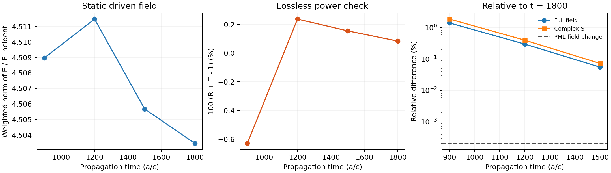

# Independent static carrier reference: time and open-boundary controls

This experiment isolates convergence of the independent Meep reference before attributing differences to the Legume modal/Green representation. It does not replace Legume as the spatial foundation and does not rerun the two paper baselines or the dynamic sideband efficiencies.

The physical structure is unchanged: square period a, epsilon 11.5, slab thickness 0.42a, circular air hole at (-0.22a,0) of radius 0.12a, elliptical air hole at (0.22a,0) with axes 0.12a and 0.09a, air claddings, normal Ex incidence at fa/c=0.398. Source is z=-1.2a and port reference planes are z=+-0.7a. Resolution is fixed at 32 pixels/a.

## Time control

All checkpoints in r32_pml065_restart come from one continued CW simulation. E/H are synchronized while sampling; magnetic fields are restored before propagation continues. Fields retain the common source phase and are divided by the matched empty-cell incoming E, without any phase alignment or amplitude fitting. The regular-grid E export includes all three Cartesian components and quadrature weights.

| Time (a/c) | R+T | Full-field change from prior | Complex S change from prior | Full-field difference from final |
|---:|---:|---:|---:|---:|
| 900 | 0.993709183 | — | — | 1.39462% |
| 1200 | 1.002370850 | 1.15231% | 1.53551% | 0.29724% |
| 1500 | 1.001550084 | 0.25064% | 0.33391% | 0.05491% |
| 1800 | 1.000837067 | 0.05491% | 0.07224% | 0.00000% |

Empty-cell t=150 to 200 complex-port change is 0.01969%. This is small but not assumed identically zero. Continuum air E/H port decomposition applied to the Yee grid retains finite-discretization error; exact R+T=1 is not imposed.

The earlier r32_pml065 run was interrupted after t=1200 by a session reset; it is preserved. The restart reproduces its t=900 and t=1200 data and then continues. No duplicate records are counted as independent physical validation.

## PML-only control

PML thickness changes from 0.65a to 0.90a, increasing cell height from 4.8a to 5.3a and keeping the requested PML inner edge at 1.75a. Resolution, geometry, source, reference planes, normalization method and comparison time (1800a/c) are fixed.

- Full physical-volume E change: 0.000206%.
- E change inside the modulated high-epsilon region: 0.000206%.
- Complex reflected/transmitted amplitude vector change: 0.000224%.
- Thick-PML R+T: 1.000834538.

## Interpretation and remaining scope

- The t=900 reference contains observable startup transients; its finite-time error should not be assigned to a theoretical Floquet defect.
- Time/PML stability is not spatial convergence. The existing resolution-24/32 carrier and sideband differences remain an independent grid sensitivity; no absolute efficiency accuracy is certified here.
- Convergence of the independent carrier cannot establish completeness of a finite Legume modal basis, background response, source lift or observation map. Those are separate representation questions.
- The previous 14–17% dynamic-efficiency difference is retained as a historical comparison, not revised from this static-only experiment.

Data: summary.json, r32_pml065_restart/carrier_t*.npz, r32_pml090/carrier_t*.npz. Rebuild with `python analyze.py`. Run generator: sptc_toolbox/scripts/meep_static_response.py in the WSL Meep environment.
