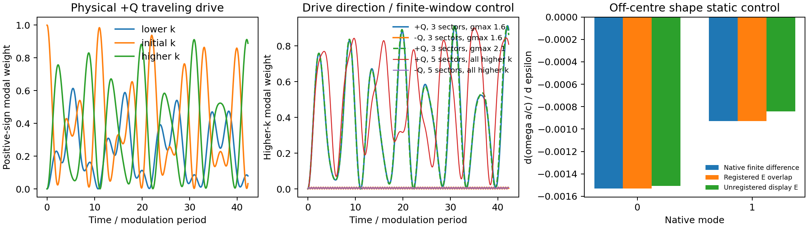

# 已有能力接入实际二维薄膜：本轮结果

2026-10-15。Legume继续提供静态几何、模式、场和辐射数据。新增可运行接口将冻结近似试算、实际边带功率评估、频率相关记忆后端和动态模态扩窗接到二维圆孔／椭圆孔薄膜；另将W1专用行波思路提取为通用二维材料投影。没有修改已安装Legume，未以论文数值为拟合目标。

## 已完成的实际连接

| 工作 | 实际完成 | 结果范围 |
|---|---|---|
| 近似适用性 | 同一局部入口支持strict、trial、assess；原7个k、泵关／泵开共14次试算，实际独立-k模式支持双符号边带 | 原5个宽频双模点现在可以返回明确近似谱和逐分支影响，而不只给统一拒绝；strict旧判定保留 |
| 频率相关开放动力学 | 同一个二维薄膜Γ双模、原生场调制、完整共同通道谱及实测共轭映射→含记忆态Floquet→独立原始ODE | 真正重新求模式和复谱；目前是指定有限窗／展宽近似，限定Γ且避开积分窗内衍射阈值 |
| 动态模态扩窗 | 相同实际二维薄膜，固定驱动／初态／辐射参考，20周期动态，按遗漏驱动加入完整簇 | 2→4→6模后所需观测量稳定，无需强制耗尽8模外窗；该点是弱调制轻微衰减，不包装成强增长 |
| 二维行波材料 | 非中心Circle/Ellipse/Poly实际结构，斜向Q=(pi/5,pi/5)，真实跨k字段、质量矩阵与完整正负频动力学 | ±Q方向控制保持明显差异；有限动量窗口影响具体长时转移量，未宣称转换效率收敛或完成开放行波辐射 |

## 1. 从经验拒绝变成可评估的近似

旧common-frequency冻结浴8%频宽规则保持为strict默认。显式trial只放开该经验门槛，单位、真实基底、正定材料、弱辐射范围等仍检查。
assess对已经计算的每个非零速度边带重新评价实际完整辐射Gram；负频由独立-k实际H场映射提供，不用正频绝对值替代。

在原结构k2–k4，试算谱和双符号功率均可获得，调制幅度.08时固定场损耗修正相对原净功率最大约7.8%、12.4%、10.1%，所检分支保留符号。k5有真实通道开启，一些分支的损耗修正约等于原净功率，说明冻结近似确实会影响这个工作点；不能仅根据“试算成功”将它列为物理已通过。
k6静态窗无辐射，冻结分支近中性；新增判定不把1e-17量级虚部当真实增益。动态边带仍全部逐项检查，原净功率接近零时不报误导性的比值或符号。

这里返回的是固定本征态上的实轴功率诊断，没有修改原极点。记录同时给泵功、损耗、绝对改变量、净余量及未解决项。无关配置错误不会被吞掉并伪装成“物理数据缺失”。

[完整14例结果](assessment/report.md) · [分支数据](assessment/summary.json)

## 2. 频率相关辐射已经真正改变求得的谱

二维薄膜Γ点modes[2,3]，两个孔中绝对介电调制幅度.3、相位差pi/2，驱动固定为较高原生静态频率的两倍。新memory入口由同一材料投影生成动力学，未另加冻结Q。

| 模型 | 固定驱动点最大增长 Imω/Ω |
|---|---:|
| 冻结共同辐射 | +3.8641e-5 |
| 有限窗记忆基准 | +1.5236e-5 |
| 增加谱积分点 | +1.5733e-5 |
| 改变数值展宽 | +1.2771e-5 |
| 扩大谱窗 | −1.2248e-8 |

这个工作点接近窄参量不稳定区，指定谱窗产生的反应性频移足以改变固定点的增长符号。独立、相同驱动网格扫描显示各模型仍有放大区，峰值约3.864／3.724／3.373×10^-5，位置相差约10^-4相对驱动量。
**因此新增能力已经可以研究辐射反馈的影响；此例支持机制，但不能指定哪个有限谱窗给出唯一真实阈值。**固定点差异没有被重调谐覆盖。

全部36个有限状态（含辅助态）与独立原始ODE一周期乘子差8.59e-10；时间谐波3→4增长变化5.91e-16。无调制控制保持被动。数值求解这一个指定模型的误差小，并不能替代谱窗所代表的物理近似。

实际频变谱与独立驱动扫描（历史材料 `memory/comparison.png`；见[发行说明](../../../docs/RELEASE.md)）

[详细报告](memory/report.md) · [模型参数与全部有限谱记录](memory/summary.json)

## 3. 模态扩窗按实际动态停止

同一二维薄膜另选原弱调制参数.08，固定物理初态和驱动，演化20周期。公共入口`study_slab_dynamic_window`实际选出[2,3]→[2,3,4,5]→[2,3,4,5,7,8]。

2→4模最大复场差约初态范数的0.146%，4→6模约5.98e-10；额外完整8模仅作诊断，与6模最大差7.04e-10。达到本次观测量要求后停止，没有为了外残差形式上为零而继续扩到全部外窗。
独立原始二阶ODE与生成元积分相差1.06e-8。全过程保留非零共同通道辐射，所用冻结窗近似明确标trial。

该接口只适用于声明的同一有限模型、初态、时间和观测量。当前原生inverse-dielectric路线先空间求逆再投影，模态主块相等已直接核验；不能把这个性质套用到“电场模态质量矩阵求逆后再截断”的另一条路线。

[动态扩窗报告及图](modal/report.md) · [逐步选择和实际观测量](modal/summary.json)

## 4. 二维行波：方向机制与窗口敏感性同时保留

新接口支持任意二维共周期调制向量、原生区域几何和真实k+pQ模式。独立形状积分、动量选择、静态微扰和完整正负频动态均已检查。
实际五动量扇区例中，正Q向高k转移的最大正频模态权重约0.9005，反Q约0.00928；空间gmax1.6→2.1仍保留方向差异。
三扇区扩成五扇区后，新增更高k模态承担显著权重，因此三扇区某个目标上的0.912最大值不能当作收敛的效率。接口报告扇区边缘，未用人工周期连接隐藏遗漏。
所有选中模式原生辐射率实测为零；该例验证通用二维行波材料部分。逐扇区原生辐射数据可导出，动态开放行波和真实输出端口仍需另接。

[接口与图谱说明](traveling/README.md) · [数据](traveling/summary.json)

## 5. 一项由实际接入暴露的场坐标问题

非中心结构的直接空间积分与原生静态导数最初出现1.62%和9.32%差异。真实形状平移对照确认，原生abs截断材料矩阵的坐标约定不能直接与显示函数的正指数场图混用。
新行波接口明确注册physical G=−native G、physical k=−native k及向量分量变换，静态导数与独立原生有限差分相对差降至1.50e-9。
原生E/H相对时间相位还由独立curl方程核对并转换到工具箱exp(−iωt)约定。原始坐标接口保留兼容，物理输出显式选择新图谱；没有静默改写历史论文图。
这是会影响几何位置、传播方向或物理场解释的接口问题，与追求更多频率小数位不同。

## 使用与验证

[本地API使用说明](../../docs/physics_pipeline_usage.md)列出统一局部求解、动态扩窗和行波材料入口。
完整回归及源码／数据哈希见同目录`validation_manifest.json`；结果标明有限近似，不宣称完整QNM、任意色散材料或真实散射端口已经完成。

最终完整回归 **851项通过**，见测试记录（历史材料 `regression.xml`；见[发行说明](../../../docs/RELEASE.md)）。LPR四组与Science22个点又通过原ModePackage路径重算，保持原有限模型结果及3处历史拒绝，见[论文基线接口回归](paper_regression/summary.json)。
真实字段的独立curl符号控制见[field_chart_checks.json](field_chart_checks.json)。这些验证分别说明有限模型数值一致性与接口正确性，不替代上文所列物理近似范围。
