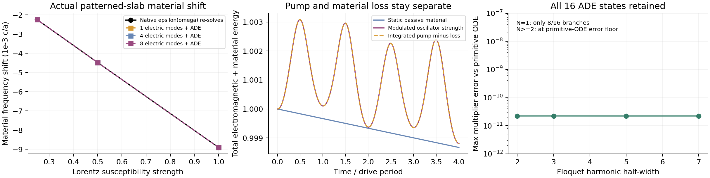

# Native patterned-slab dispersion and material modulation

Status: NATIVE_PATTERNED_SLAB_MATERIAL_MEMORY_VERIFIED. This is an actual Legume Circle/Ellipse slab material adapter.

The native dielectric is epsilon_inf. Physical-region electric overlaps give G=integral_region E_i*E_j; L=(wp/Omega)*sqrt(G). Epsilon_inf=I in native energy-normalized coordinates; curl=-i*diag(omega_native/Omega). Physical susceptibilities add once. No material contribution is also inserted as a native static frequency shift.

The state is (d,h,P,J): d=e+LP is a projected electric displacement, h is the native H coefficient, and LP is projected polarization. Physical E/H reuse the audited field chart. d is not mislabeled as a pointwise native D expansion.

| Material strength | Native self-consistent pole | 8-mode ADE pole | Difference / material shift |
|---|---:|---:|---:|
| 1.0 | 2.2075232747 | 2.2075215825 | 0.019% |
| 0.5 | 2.2119490510 | 2.2119486216 | 0.010% |
| 0.25 | 2.2141820420 | 2.2141819339 | 0.005% |

Independent finite-space dielectric-polynomial pole error: 1.91e-14 c/a. Dynamic energy balance error: 5.23e-09 for unit initial energy.

A lossless static material is independently checked by repeatedly running native Legume with epsilon(omega), holding its guided reference fixed and tracking H-field identity. This is different from merely checking the ADE matrix against itself.

Sinusoidally modulated oscillator strength is solved with the existing full signed ADE-Floquet backend. Independent primitive D/B/P/J equations supply monodromy and energy controls. Material poles are retained rather than substituting epsilon at one chosen frequency.

Public usage (frequencies are angular omega*a/c):

```python
from sptc_toolbox.slab_dispersion import RegionLorentzMaterial, SlabDispersiveModel
from sptc_toolbox.slab_projection import project_slab, SlabRegion
projection = project_slab(gme, modes, [SlabRegion(0, kind="background")])
material = RegionLorentzMaterial(0, plasma_frequency=.8, resonance_frequency=3.4, damping=.02)
model = SlabDispersiveModel(projection, [material], drive=2.2,
    baseline_interpretation="high_frequency_permittivity")
# Existing solve_dispersive_floquet(model) now includes actual patterned-region memory.
```

Scope: finite native electric Galerkin projection, material memory/absorption and physical region modulation. Native spatial convergence and outgoing radiative self-energy are separate; this result does not claim a full open dispersive QNM backend.



Reproduce locally: `.venv/Scripts/python.exe sptc_toolbox/scripts/validate_slab_dispersion.py`.
