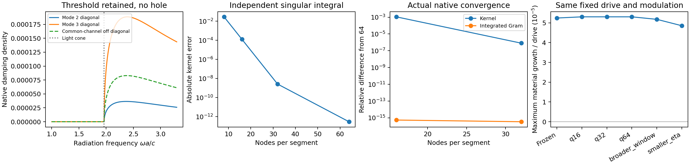
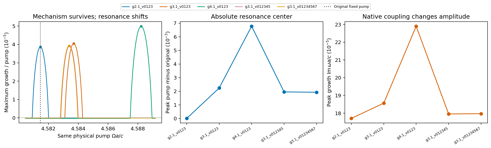
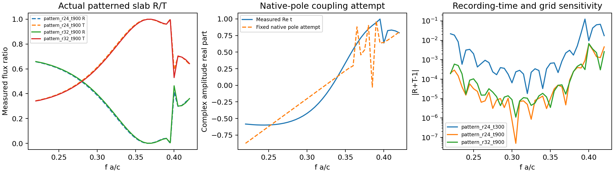

# 剩余问题的本轮实际处理

2026-10-15。上一轮列出的空间／模态／动量截断、W1远尾、非Γ及阈值辐射、开放行波、实际材料色散和物理端口均已进行实际实现或受控尝试。Legume仍为空间模态底座；Meep仅用于独立静态物理散射参考。原参数、旧失败和论文差异没有被拟合或覆盖。

**本轮解决了一批具体接口限制，也明确发现若干真实的长期动态敏感性。没有把“尝试过”写成“所有量已经收敛”。**

| 问题 | 本轮做了什么 | 当前判断 |
|---|---|---|
| 非Γ频率相关辐射 | 实际±k模式映射接入公共memory入口 | 已接通，避免错误的同k共轭约束 |
| 衍射阈值 | 分段正权重平方／正弦平方变量代换；完整跨过真实0→4通道开启 | 不再挖除阈值邻域；实际积分加密稳定，有限谱尾／展宽仍是近似 |
| 行波动量窗口 | 原模型3→5→7→9→10个唯一扇区，保持驱动与初态 | 两模/扇区下9→10动态差已降至1.24e-4；未认证所有空间sewing或所有模态窗 |
| 开放行波 | 实际非零逐扇区共同通道Gram接入完整正负频材料动力学 | 已有可运行Markov近似和泵损控制；不是频率相关开放行波自能 |
| 实际色散材料 | 原生图案薄膜区域E重叠→Lorentz/Drude ADE→材料调制 | 已接通并通过独立静态原生重算／原始ODE；尚未与辐射记忆联合 |
| 空间收敛 | 同一二维结构独立加密平面波和导模族，固定驱动及共同驱动扫描 | 6→8导模族趋稳；平面波截止仍影响放大峰位置和强度，机制保持 |
| 长时模态收敛 | 实际行波每扇区2→4→6模，同一42周期过程 | 长时逐扇区权重仍明显改变；早期总方向转移较稳，不能称长期定量已完成 |
| W1 RMS远尾 | 完整原始线场重建，再作独立的光滑初始包络控制 | 简单包络未消除周期敏感性；原RMS问题仍保留 |
| 物理R/T端口 | 实际Meep复S、参考面、通量校准；均匀薄膜Fresnel对照和固定原生极点连接尝试 | 静态参考已获得；极点连接尝试留出误差大，动态转换效率尚未接通 |

## 非Γ与衍射阈值：具体限制已解除

公共`solve_slab_local(..., radiation_backend='memory')`现在可接显式`minus_gme/minus_kind/minus_modes`，并用`threshold_handling='resolve'`穿过积分窗内衍射阈值。默认reject保留历史行为。

实际圆孔／椭圆孔薄膜k=(1.9634954,0)、两模位于光锥两侧，完整谱窗[1,3.3]。每段积分16→32→64点时，相对kernel差由1.11e-3降至8.07e-7，选定材料极点差降至7.87e-12/Ω。32点共68个状态的全部Floquet乘子与独立原始ODE差8.45e-10。

同一固定驱动下最大增长：冻结5.2456e-5、积分基准5.3057e-5、扩大谱窗5.1788e-5、展宽减半4.8557e-5，单位均为Ω。这个点的增长机制保持，且积分离散误差已小于模型选择的影响。
谱窗外数据仍未知，有限展宽会平滑光锥边缘；这些不能通过增加积分点自动消除。

[报告](memory/report.md) · [数据](memory/summary.json)

## 行波窗口：动量方面改善，长时模态方面仍敏感

原斜向Q=(pi/5,pi/5)在方晶格中只生成10个原胞不等价动量扇区，继续增加第11个会重复计数。新轨道接口识别这一点，首尾耦合由真实场积分计算，没有手填连接。
每扇区两模时，9和10扇区在统一标签上的最大half-L1权重差为1.24e-4；方向反转对照仍显著，+Q的高标签总权重峰0.8721，−Q为0.00927。空间加密保留这一方向判断且H场身份已核对。

但是每扇区4→6模时，42周期内最大单扇区差仍达0.652。前两个周期高标签总权重差仅6.67e-5，说明当前结果适合研究早期方向选择，尚不适合精确预测长期的每个扇区占据。完整动量轨道中的坐标切口权重也不能误称为遗漏空间泄漏。

新增开放Markov路线用每扇区一个共同实频复通道样本建立完整Γ；不同不等价动量的静态端口分块。实际非零浴关泵控制中，能量降至18.1%，能量预算误差2.83e-8，与独立矩阵指数末态差7.75e-8。辐射开关对本例轨迹的影响约0.004，小于长时模态窗口影响。
此处材料保留正负频分支，但浴仍是正实频冻结近似；全频出射及动态共同辐射不能由这次能量平衡自动推出。

[窗口与方向图](traveling/traveling_window_open.png) · [模态和被动性图](traveling/modal_and_passivity_controls.png) · [完整报告](traveling/report.md)

## 空间截止：机制不是消失，但峰中心和强度尚未稳定

同一物理结构、泵幅.3和相位差pi/2，用同一646点驱动网格比较五种空间配置。原固定驱动点全部保留，所有配置都出现参量放大区。

- 垂直导模族6→8，峰值物理增长变化约0.093%，这一轴趋稳。
- gmax3.1→4.1，峰值物理增长仍变23.36%，峰中心变化0.004533 a/c。它不是只发生无关紧要的整体频移。
- 原g2.1的窄放大工作点在加密后变成衰减，主要体现共振区移开；不应据此认定参量机制失效，也不能把原工作点标成空间可靠。

各峰点通过直接原生K(t)的独立ODE核验，乘子差不超过6.55e-12。时间求解不是当前误差来源，但原生有限空间截断仍需围绕所需峰值或工作点继续检查。

[固定点报告](spatial/report.md) · [扫描报告](spatial/drive_scan.md) · 扫描数据（历史材料 `spatial/drive_scan.json`；见[发行说明](../../../docs/RELEASE.md)）

## 材料色散：从实际空间场进入ADE，而非任意矩阵示例

新`RegionLorentzMaterial/SlabDispersiveModel`把实际区域E重叠分解为空间极化耦合。原生介电率明确作为epsilon_inf，物理Lorentz／Drude项只加一次，保留全部D/B/P/J变量。
在圆孔／椭圆孔薄膜中，8模ADE与重新运行Legume的epsilon(omega)自洽材料频移相差0.019%；减弱材料强度后误差进一步下降。动态振子强度调制的16态Floquet与原始ODE乘子差2.2e-11，泵功／材料吸收能量控制通过。
这是实际图案几何的材料记忆与吸收接入，尚未与开放辐射自能组合；不把材料damping冒充辐射线宽。

[材料报告与使用方法](dispersion/report.md) · [验证图](dispersion/dispersion_validation.png)

## W1远尾：已尝试简单修正，仍未解决原始RMS

本轮重新计算原缓存完整周期线强度，并逐点核对旧值。另把同一线性动态轨迹按光滑cos²动量包络加权，作为不同初始激励的独立控制。
原始K16/32/64末态RMS为8.4955/8.6188/9.3232a；新激励为12.3630/12.5228/12.9247a，仍有周期敏感性，且初态宽度已从2.106a变成9.455a。
**不能用换初态掩盖原问题，这次简单包络尝试没有解决原RMS。**主峰拖曳结论仍有既有证据支持；具体完整二阶矩继续保留未收敛范围，尾部来源尚未独立归因。

[完整诊断](w1_tail/report.md) · [控制图](w1_tail/tail_control.png)

## 物理端口：静态参考已建立，动态连接尝试失败已保留

同一二维薄膜用Meep独立计算两端口、法向x偏振复S。先以空单胞归一入射振幅，另用均匀薄膜Fresnel复振幅检查端口与传播相位，分辨率16→24→32最大误差从0.0629降到0.0132。
图案结构把记录时长从300增到900后，最大|R+T−1|降至约0.0069；通量与复振幅换算最大差约0.0010。共振附近的复S对网格和记录时长仍有约0.08的最大变化，未宣称高精度收敛。

随后尝试用固定Legume复极点、线性平滑余项和复留数重建S，交错频点留出相对误差约132%。这份连接不能用于动态效率。没有移动极点或拟合论文曲线来掩盖失败，也没有把total S当direct background与同一模式重复叠加。
新增`StaticPortReference`可以保存真实参考面与flux-amplitude规范，提供静态S／功率比较。要得到Legume-Floquet的真实R/T和边带转换，仍需与模态场一致的输入／输出耦合及背景分离；该项本轮没有完成。

[端口报告](ports/report.md) · [完整静态参考及失败诊断](ports/summary.json)

## 验证与使用

[新增接口用法](../../docs/remaining_limits_usage.md) · 完整测试（历史材料 `regression.xml`；见[发行说明](../../../docs/RELEASE.md)） · [历史论文基线接口回归](paper_regression/summary.json) · [源码／数据验证清单](validation_manifest.json)

最终完整回归875项通过；原LPR四组、Science22点继续保持同一有限模型结果及3处历史拒绝。测试用于核对实现和相应控制，不把上面的模型近似或长时间敏感性改写成全面收敛。
