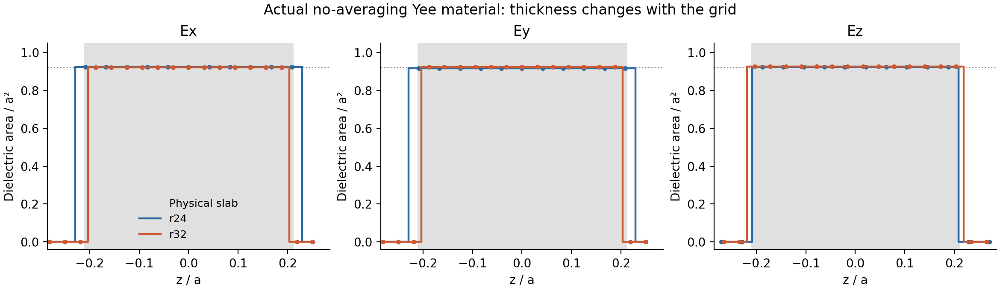

# 无平均 Yee 材料的空间敏感性审计

本审计脚本读取既有真实 r24/r32 材料/场数据，并以相同 Legume 模态在实际分量坐标上重新求值；没有重新拟合材料、频率或输出。后文独立衰减谱来自另外完成的真实 Maxwell 脉冲运行，来源与数值范围分别保存。

**已经证明的是：关闭亚像素平均后，两张网格实际编码的切向材料厚度差别很大。尚未仅凭此诊断证明某个共振移动，更没有把 56 倍侧带输出定量归因于某一个极点。**

物理厚度为 0.42，解析介质面填充率为 0.920831865，单位胞内介质体积为 0.386749383。

| 网格 | 分量 | 高介质 z 层数 | 等效厚度 | 介质体积 | 体积相对误差 |
|---|---|---:|---:|---:|---:|
| r24 | Ex | 11 | 0.45833333 | 0.42332176 | +9.456% |
| r24 | Ey | 11 | 0.45833333 | 0.42013889 | +8.633% |
| r24 | Ez | 10 | 0.41666667 | 0.38483796 | -0.494% |
| r32 | Ex | 13 | 0.40625000 | 0.37451172 | -3.164% |
| r32 | Ey | 13 | 0.40625000 | 0.37530518 | -2.959% |
| r32 | Ez | 14 | 0.43750000 | 0.40502930 | +4.727% |

每个分量位于不同 Yee 坐标，因此不能把三种体积直接解释为一个共点的各向异性材料张量。它们反映的是分量交错网格对同一物理边界的不同采样。直接按各自坐标重新计算解析几何掩模，与保存的高介质节点逐项完全一致；不存在把不同分量 z 位置错对齐的比较。

切向 Ex/Ey 的等效厚度从 11/24=0.458333 变成 13/32=0.406250；与目标 0.42 的偏差分别约 +9.13% 与 −3.27%。与此同时 Ez 采样厚度向相反方向变化。面内填充率仅有较小变化，主要的几何诊断信号来自 z 向层数。

| 网格 | 调制区场平方范数 | 单 Legume 种子包含的源范数比例 | 精确重算种子与原种子重叠 | 静态出射功率 |
|---|---:|---:|---:|---:|
| r24 | 0.637702213 | 50.70321% | 0.999416061 | 1.000013842 |
| r32 | 26.1852676 | 97.73849% | 0.999976205 | 0.999979576 |

这里的范数在有限源窗口内采用实际分量坐标和 dv，只用于比较输入的调制极化源；不是严格能量归一化，也不是 QNM 度量。两网格的完整载波由各自 Maxwell 方程求出，不能把上述变化一概解释为模式频移。

Meep 官方 [Subpixel Smoothing](https://meep.readthedocs.io/en/latest/Subpixel_Smoothing/) 的 “What Happens When Subpixel Smoothing is Disabled?” 节明确说明：每个电场分量在各自 Yee 坐标按点赋予标量介电常数；界面与网格相对位置改变会产生阶梯伪影和计算结果突变。本文保存的 官方文本（历史材料 `../../../literature/targeted_resolution/official/meep_subpixel.txt`；见[发行说明](../../../../docs/RELEASE.md)） 同时说明，不连续界面会把典型二阶误差降为一阶，原生各向异性亚像素平均是相应的成熟处理方法。

修复方向是恢复原生平滑材料算子，并让调制极化使用该离散算子相对于真实材料参数的导数，连同分量插值一起处理。仅将旧标量 mask 搬到平滑静态场上不构成一致修复。几何审计与后文独立极点证据分别保存；实际动态输出的空间敏感性仍须单独检查。

初始化测得的实际 z 单元长度分别为 r24: 4.79166667, r32: 4.81250000；输入要求的长度均为 4.8，PML 厚度均为 0.65。这里记录了网格取整，没有据此判定 PML 误差主导。

## 独立衰减谱补充证据

另外完成的脉冲运行固定真实几何和 x 偏振、z 偶/y 偶激励，对两个空间探针、两个衰减时间窗分别做 Harminv。每个探针/时间窗选振幅最大的已解析极点，下表以四次估计的中位数报告频率，极差直接衡量本次探针/窗口一致性；没有为匹配连续波响应重新拟合参数。弱次极点仍保留在原始数据中。

| 材料表示 | 网格 | 主极点频率 fa/c | 四次估计频率极差 | 衰减率绝对值 | 载波失谐/衰减率 |
|---|---|---:|---:|---:|---:|
| 逐点阶梯 | r24 | 0.3900935097 | 3.41e-09 | 0.00077312492 | +10.2267 |
| 逐点阶梯 | r32 | 0.3984537085 | 2.27e-09 | 0.00074505992 | -0.6090 |
| 原生亚像素平均 | r24 | 0.3972433162 | 3.46e-08 | 0.00080422356 | +0.9409 |
| 原生亚像素平均 | r32 | 0.3975870636 | 2.59e-09 | 0.00081136714 | +0.5089 |

无平均时 r24→r32 的主极点移动为 **0.00836020**，平均后为 **0.00034375**，本次两网格移动量缩小约 **24.32 倍**。无平均 r24 的固定载波距主极点约十个衰减率，而 r32 已处于一个衰减率以内。这给出了静态载波场敏感性的独立频谱证据。

该证据支持“阶梯表示改变共振位置，固定载波因而对网格敏感”的机制，但没有单凭一个极点把 41 倍内部源范数或 56 倍侧带输出定量解释完。侧带 Green 响应、背景干涉及耦合分布也参与输出。两个网格的平滑结果更接近，也不等于固定驱动转换效率已经空间收敛。这里没有把衰减信号的主峰对应替代为严格跨网格全场模式身份认证。

原始脉冲记录：

- [noavg r24](../static/pulse_noavg_r24/summary.json)
- [noavg r32](../static/pulse_noavg_r32/summary.json)
- [smooth r24](../static/pulse_smooth_r24/summary.json)
- [smooth r32](../static/pulse_smooth_r32/summary.json)
