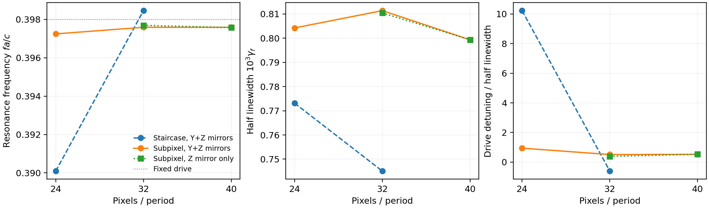

# 固定驱动空间敏感性：界面表示、共振与材料算子修复

本轮针对上一轮标量无平滑模型r24→r32侧带功率大幅变化开展修复。物理薄膜、孔形、ε=11.5、厚度0.42a、载频fa/c=0.398、调制频率0.01和介电余弦幅度0.01保持不变，未用频率平移、材料调参或出射幅相拟合消除差异。Legume仍提供实际空间模式，Meep用于独立完整静态与转换参考。

## 问题发生在静态界面与驱动场

直接检查上轮保存的原生Yee材料，发现关闭亚像素平均后，切向Ex/Ey看到的介质厚度在r24为11/24=0.458333a，r32为13/32=0.40625a；物理厚度是0.42a。Ez分量的采样层数变化方向又不同。按每个分量的真实坐标检查，材料数组与解析几何掩模逐项一致，因此这不是一次简单的网格坐标错配。

这正是无平滑的阶梯界面误差：加密网格会让材料边界跨过不同的分量格点。各分量的介质体积相对目标有明显变化；详细层剖面见[几何审计](geometry/report.md)。Meep官方文档也指出，关闭平滑后这种跳变会造成不规则收敛；本轮复用了其原生亚像素平滑能力，没有重写空间Maxwell求解器。

同单位入射下，调制区载波场强积分从r24的0.637702变为r32的26.185268，即41.0619倍。巨大变化在时间Floquet组装之前已经出现。静态总出射功率约为1不能证明共振内部场收敛；相同Legume场的直接Fourier重采也未显示能解释此变化的种子身份错误。

## 独立静态极点给出的机制证据

对同一物理结构使用Gaussian脉冲、两个非节点探针和两个源后时间窗，独立提取主要可激发共振。没有拿历史转换曲线拟合极点或移动固定驱动。

| 空间表示 | 分辨率 | 共振频率fa/c | 半线宽 | 固定驱动失谐／半线宽 |
|---|---:|---:|---:|---:|
| 无平滑阶梯 | 24 | 0.39009351 | 0.00077312 | +10.23 |
| 无平滑阶梯 | 32 | 0.39845371 | 0.00074506 | −0.61 |
| 原生平滑张量 | 24 | 0.39724332 | 0.00080422 | +0.94 |
| 原生平滑张量 | 32 | 0.39758706 | 0.00081137 | +0.51 |
| 原生平滑张量 | 40 | 0.39758347 | 0.00079932 | +0.52 |

无平滑的两网格共振移动0.0083602，约11个半线宽。恢复平滑后，r24→r32频移缩小24.32倍；r32→r40只移动约3.6×10⁻⁶，即0.0045个半线宽，半线宽变化约1.5%。这支持阶梯界面通过共振失谐影响固定驱动响应的机制，但没有仅凭一个极点就声称定量解释全部侧带功率比。模态空间身份和全部背景路径不能由单峰拟合代替。

上表平滑极点控制采用原生Y/Z对称边界；主效率数据采用Z镜像、完整Y方向，二者原始边界声明分别保存。主效率路径随后也独立做了相同脉冲检验：r32频率为0.39768737，r40为0.39757625，移动约0.0001111，即约0.14个半线宽。因此**不能用另一数值分支的0.0045个半线宽宣称主效率路径完全收敛**。它仍较原阶梯界面约11个半线宽的跳变明显改善。[原始极点与窗口检查](static/pole_report.md)。

## 真正修复的是完整材料算子

原生平滑生成的材料不是三个共点标量，包含交错电场分量之间的四点插值。仅开启平滑、继续用锐介质掩膜δεE，仍会混用两个不同离散模型。

新增 [`YeeMaterialDerivative`](../../yee_material.py) 保留实际Meep本构映射E=KD及其全部原生stencil。对bulk ε参数λ，独立初始化K(λ±δ)并计算

\[
\epsilon'=-K^{-1}K'K^{-1},\qquad
P=\epsilon'E=-K^{-1}K'D.
\]

采用稀疏求解而非显式稠密逆矩阵。每个频率的极化电流仍使用J_l=−iκ_lP_l、κ_l=2sin(ω_lΔt/2)/Δt，且只乘一次调制Fourier系数0.005。

实际r24/r32/r40的第一、第二步Maxwell更新满足E=KD，残差约10⁻¹⁷；真正稳态r32偶／奇场也分别满足该式到约10⁻¹⁶。从E或D生成的极化一致。材料差分δ=.01减半到.005，对实际r32极化改变约5.6×10⁻⁷，且独立有限材料对照的余项按二阶缩小。

如果仍错误地使用锐mask×E，r32偶／奇极化源范数分别相差约17.1%／14.7%。**这些是源密度误差，不是出射功率误差，与历史14%–17%的数字巧合不能建立因果关系。** 材料导数、原生坐标、源规范、稳态误差及空间收敛分别记录于[材料桥接报告](material/report.md)。

## 通用后端与实际源空间

新增 `ProjectedOperatorModulation` 接受真实非局域材料算子，对静态基底和完整重建场分别施加该算子，计算耦合及遗漏极化。它不把交错分量假作共点张量，也不重复乘输出频率因子；矩阵无关实算子通过显式实／虚部分得到复线性延拓。直接LS与通用ABCD路径都检查材料算子身份。

所有声明格点及stencil外侧网格使用正体积权重，避免极化漏到零权区域后被误报为零残差。原生对称边界若包含冗余ghost点，则使用明确的独立自由度抽取／重建及诱导度量；不能直接反演完整导出数组。

实际Legume种子与平滑静态场接入此接口后的验证见[真实材料投影](projection/r32/report.md)。仅让基底覆盖E并不保证覆盖ε′E；本轮可由未调制静态材料作用生成补充极化方向，独立检查其表示残差。包含静态P列后得到的极小残差是源空间覆盖证据，不能当作所有动态Green响应或效率已经验证。

在r32/r40真实平滑数据中，五列静态场基底虽能准确表示输入E，但ε′E源残差仍约59%–76%。加入由静态材料作用生成的极化列后，九列空间可将这组静态源表示到舍入误差；这不使用动态出射目标。通用接口与独立从D得到的极化相差约1.5×10⁻¹⁶，复酉换基协变性约10⁻¹⁴。[r40接口实算](projection/r40/report.md)。

主效率参考直接注入完整ε′E，并未用上述训练源空间残差替代真实散射，也没有为九列基底额外计算完整三频Green数据集。本轮已验证材料适配能力与源空间规则；独立完整电流的空间敏感性由后续实际完成的两网格效率对照给出，尚不能称为新的张量全模态Floquet效率复现。

## 修复后的固定驱动效率

采用主路径Z镜像、完整Y方向的平滑张量模型，在r32/r40分别求完整载波场和材料导数极化，独立求解每个偶、奇侧带电流，再相干合成单位底侧入射。所有原始极化响应按单位bulk介电参数给出，实际余弦幅度0.01对应Fourier系数0.005，仅乘一次。

| 网格 | 下侧带功率／入射功率 | 上侧带功率／入射功率 |
|---|---:|---:|
| 修复后r32 | 1.19069776×10⁻⁴ | 1.21744172×10⁻⁴ |
| 修复后r40 | 1.09329596×10⁻⁴ | 1.07794171×10⁻⁴ |
| r32→r40相对变化 | **−8.18%** | **−11.46%** |

相比前轮无平滑r24→r32的3.586倍／56.386倍变化，界面表示和材料耦合修复显著改善了固定驱动结果。这里同时使用了更细的网格和正确平滑，不能将全部改善比例单独归于一个开关；静态同网格平滑对照、材料算子检验及完整源电流共同支持这条修复路线。

**仍不能声称绝对效率完全空间收敛。** 两网格出射复向量差为12.63%／13.69%，上下x通道相位仍变化约0.10–0.136rad。主路径共振移约0.14个半线宽，与剩余固定驱动敏感性相容，但没有把所有变化拟合成单极点模型。

r40偶侧带最后两个检查点的复输出变化约0.17%／0.14%；源功与出射功率差分别约0.52%／0.024%。奇侧带独立频域求解成功，源功残差约10⁻⁹。r32偶侧带的时间变化约0.15%／0.13%；下侧另有未达声明容差的CW尝试，其输出与独立FDTD功率差约0.07%，仅作为数值敏感性对照而未改写失败状态。时间求解敏感性显著小于本例网格差异。

r40奇电流参考预先使用t1500的载波极化，继续至t2000后该极化变化0.01348%；实际采用的源文件与后续控制分别保留，没有用t2000文件替换已经运行的输入。源密度变化本身不是出射误差上界。

[完整功率、复振幅、时间窗与源哈希](static/weak_summary.json)以及[对照报告](static/weak_report.md)可复查各项结果。本轮采用完整极化电流的弱转换参考，没有再求九列张量基底的所有三频Green响应，不能将此图冒称新的完整模态Floquet效率复现。

## 修复后的使用范围

工具箱已新增真正的非局域材料算子接口、实际张量导数与原生坐标桥接，并将新参考流程默认设为原生平滑及已验证的主边界路径。无平滑路线仍保留为离散闭环诊断，不能再把它的内部一致性当作高折射率曲面薄膜绝对效率的默认精度。

当前结果支持在明确网格敏感性下研究弱转换机制；若研究需要百分之几的绝对效率、窄线宽阈值或依赖精确相位的辐射抵消，现有约一成的空间敏感性仍需针对性细化。无需把所有现象都阻塞在统一的绝对频率阈值上，但也不能隐藏会影响具体结论的偏差。

## 保留的失败与边界

早期Y/Z双镜像的全导出数组包含独立格点和冗余镜像点。第一步特定源下的材料恒等式看似通过，但第二步和实际场暴露出冗余坐标直接求逆的问题。引入原生owner坐标后同一组场的材料恒等式恢复，原失败记录保留。主效率路径采用完整Y方向，避免把未完全验证的镜像映射混入结果。

部分平滑CW尝试未达要求；Y/Z r24长时数据也未稳态，未被采用为效率参考。其异常原因不从单次输出推断，更不称为物理参数放大。主参考依靠实际检查点变化、材料恒等式和源功／出射检验；线性求解或时间推进成功不自动意味着空间收敛。

本轮材料适配限于无色散、实数bulk介电参数；移动界面、材料增益或动态色散有各自构成关系。有限幅材料导数也不自动成为任意强调制模型。

软件回归为850项工具箱＋191项历史求解器，合计1041项通过；最后实镜像输入检查后53项相关测试通过。两篇论文的4组LPR、22个Science有限模型接口回归保留3个历史拒绝；本轮没有改变其论文复现结果或将测试计数当作物理认证。

全部图、原始数据、被排除尝试及测试记录的哈希见[归档清单](validation_manifest.json)。
