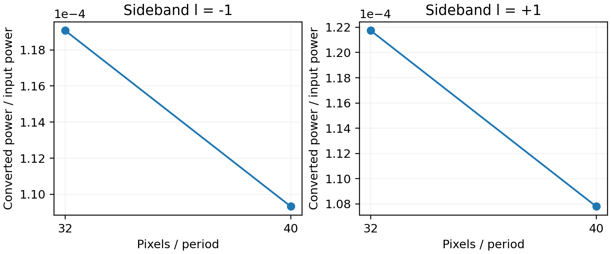

# Fixed-drive tensor-current conversion

Same geometry, carrier .398, modulation .01, cosine epsilon amplitude .01; independent full-current reference, no modal reduction or finite-amplitude Floquet claim

The unit-power bottom channel is formed from independently normalized even and odd unit-power parity channels. Each raw response is per unit bulk-epsilon Fourier component. The physical cosine amplitude .01 is applied as .005 exactly once.

| r | sideband | power / input | total power including cross polarization |
|---:|---:|---:|---:|
| 32 | -1 | 0.000119069776 | 0.00011906978 |
| 32 | +1 | 0.000121744172 | 0.000121744175 |
| 40 | -1 | 0.000109329596 | 0.000109329596 |
| 40 | +1 | 0.000107794171 | 0.000107794171 |

32→40 relative power changes: -8.180%, -11.458%.
32→40 complex vector differences, normalized to r40: 12.633%, 13.695%.

The reference uses native subpixel material tensors with Z mirror only. Its own pulse control shows a remaining r32→r40 resonance shift of approximately 0.14 half linewidth; the much smaller shift in the separate Y+Z numerical branch is not used to certify this calculation. The converted powers and complex channel vectors therefore retain their measured spatial sensitivity.

Full time-window changes, source work versus outgoing power, exact polarization source provenance, and the unsuccessful-CW versus independent-FDTD control are retained in [weak_summary.json](weak_summary.json). Finite-amplitude Floquet feedback and complete modal Green sampling are not computed by this static first-order reference.
