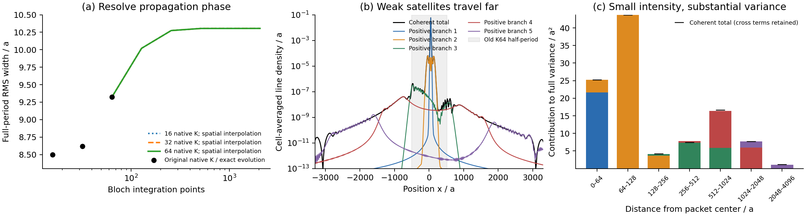
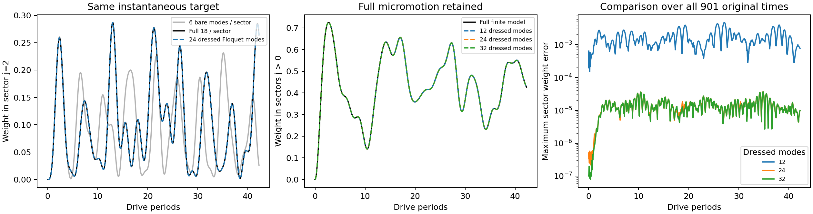
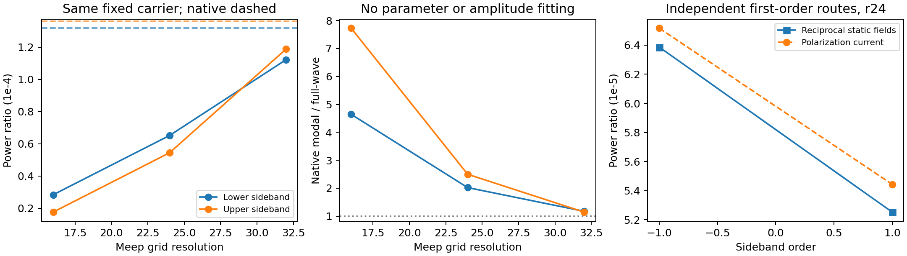

# 本轮定向处理：三项差异都有了更明确的解决路线

2026-10-16。本轮继续处理动态转换效率、长期转移、W1完整RMS。先查现有证据与具体方程，再核验公开原文和官方文档，最后做实际计算。Legume仍为空间基础；Meep提供独立物理散射参考，没有用论文或参考输出拟合主模型。

| 问题 | 本轮实质进展 | 保留的边界 |
|---|---|---|
| W1完整RMS远尾 | 找到原有限域的相干折回；精确移动坐标＋经留出检查的空间数据插值，得到约10.3046a，末次积分加密只变0.00466% | 仍为原七扇区有限模型、指定驱动和时刻；小接缝二阶矩项可量化，不宣称无限域严格完备 |
| 长期逐扇区转移 | 完整保留当前原生空间，再用24个实际Floquet态及微运动降阶，原42周期逐扇区轨迹误差约3e-5 | 固定gmax与导模族仍有限；全10扇区此项辐射为Markov，不能替代全部频变浴空间验证 |
| 动态侧带效率 | 更细全波参考把原生模型差异从2–2.5倍缩至14%–17%；互易静态场积分与极化电流法在实际结构相互支持 | r24→32参考本身仍变化明显；绝对效率、完整模态激励相位及背景转换尚未最终定量收敛 |

## W1：不是删掉远尾，而是把原模型传播到足够大的域

原K64周期长1024a、半长512a，少量已激发的Floquet分支在目标时刻能传播到1600–3100a。它们线强度虽小，对完整二阶矩却重要。
当前行波质量矩阵满足精确的扇区选择规则，因此可以变换到常系数14维生成元，保留正负频；独立原始时变Maxwell积分核验了这一点。

只对协变定相后的缓变空间矩阵、物理场映射和原初态作插值，随后逐新k计算真实长时相位。没有插值已经振荡的末态，没有换初态或裁尾。
K32空间样本预测独立K64原生末态物理场的误差3.11e-6；把1088积分点的大域复场按原周期相干折回，恢复旧K64复场至4.47e-11。

完整RMS由原9.3236a提高到10.3046a；1024→2048积分点变化0.00466%。原16/32/64三套独立空间样本给出的密集积分结果一致到约5.4e-5a。
残余接缝造成的方差增长仅当前总方差约1e-4量级，并由端点跳变独立预测，未拟合抹掉。主要有限域问题已获得可用解决；不继续为形式上的无限域二阶矩追求无限加密。

[W1完整报告](w1/report.md) · [实际证据](w1/summary.json)

## 长期转移：遗漏的共振伙伴与累计相位都有实际证据

在原gmax1.6、两导模族空间中，每扇区总共只有18个原生自由度。本轮保留全部18×10×2=360维，建立没有内部静态模态遗漏的有限参考。
原4→6、6→8、8→10模时，新模式实际承载20%–39%的正频权重；较高模态即使占据小，也会改变准频率，至t=900累计约1.47–2.31rad相位。相同E/H初态控制只改变逐扇区权重2.68e-5，不能解释旧0.65量级差异。

改进方法是先获得完整有限模型的一周期传播，再按真实初态激发的Floquet态降阶，保留周期内运动U(tau)。24个动态模式在原901个时刻恢复逐扇区轨迹，最大差3.68e-5；有实际非零共同辐射的Markov模型为3.16e-5。没有改为时间平均或只比较总方向。
开放控制的累计辐射工作为初始能量的34.5%，不是无损模型换名字。新传播实现只解质量矩阵作用而不构造完整逆，使大窗口实算可承受。

[长期完整报告](longtime/report.md) · [开放控制图](longtime/dressed_resolution_markov.png)

## 散射：窄载频场比宽频S平均误差更关键

此前static S采样步长0.005，约为模式半宽的6.66倍；实际动态载频0.398没有被采样。故宽频复S误差2.49%不能当作该窄工作点的内部场校准。
实际同载频的参考网格16→24→32，原生端口预测模态强度／参考场投影强度由7.60→2.515→1.245；场形状重叠平方达到0.981。这个诊断没有回填模型振幅或相位。

| 侧带功率／入射功率 | 全波网格24 | 全波网格32 | 固定原生端口预测 |
|---|---:|---:|---:|
| −1 | 6.5159e-5 | 1.1221e-4 | 1.3174e-4 |
| +1 | 5.4433e-5 | 1.1878e-4 | 1.3598e-4 |

原生预测没改参数，相对r32差异为17.4%和14.5%。当前证据支持弱频率转换机制，但不能把r32当作绝对真值；窄共振位置和局部场随网格变化仍需保留。

在线核验的QCMT原文和互易性方法指出，完整弱转换可以由两组静态散射态计算，自动包括背景与模式交叉项。新增`ScatteringFields/first_order_conversion`用无共轭体积分和正确输出频率因子，已与均匀薄膜完整Floquet边界解核验。
实际图案结构r24中，互易积分与直接极化电流法的复振幅相对差4.09%／4.37%，功率差约2%／3.5%。两条独立一级方法相互支持；界面亚像素张量平滑与sharp掩膜、空间积分等近似仍保留。

[端口详细报告](ports/report.md) · [载频内部场诊断](port_diagnostics/summary.json) · [互易数据](ports/reciprocity_summary.json)

## 借鉴了哪些已有方法

- Marzari–Vanderbilt关于Bloch态k正则性与位置二阶矩的关系；本项目另外推导并验证精确周期像折回及跳变远尾项。来源与定位（历史材料 `../../literature/targeted_resolution/w1_sources/README.md`；见[发行说明](../../../docs/RELEASE.md)）
- Eckardt–Anisimovas的Floquet展开和微运动／准频率误差区分。本例处于差频共振，采用数值精确周期映射，没有生搬高频截断公式。来源与定位（历史材料 `../../literature/targeted_resolution/longtime_sources/README.md`；见[发行说明](../../../docs/RELEASE.md)）
- Zhang–Miller公开QCMT全文关于频率相关端口、直接Born项与无共轭体积投影，结合Lorentz reciprocity建立弱侧带接口。原文及核验（历史材料 `../../literature/targeted_resolution/ports/README.md`；见[发行说明](../../../docs/RELEASE.md)）
- Meep官方关于亚像素各向异性平滑、界面场精度和输出插值的说明，用于解释独立参考的数值范围，而非默认参考更正确。在线来源记录（历史材料 `../../literature/targeted_resolution/official/manifest.json`；见[发行说明](../../../docs/RELEASE.md)）

这些文献为具体实现提供方法，不是对我们所有开放SPTC能力的自动认证。完整空间、强材料对辐射通道的改变、强调制散射仍分别保留适用范围。

[新增接口用法](../../docs/targeted_resolution_usage.md) · 完整回归（历史材料 `regression.xml`；见[发行说明](../../../docs/RELEASE.md)） · [历史论文基线回归](paper_regression/summary.json) · [源码与数据清单](validation_manifest.json)

最终完整回归919项通过，新增23项包含移动坐标／周期像、质量矩阵向量求解、保留微运动的非厄米降阶及弱转换互易控制。原LPR四组和Science22点重算保持旧有限模型结果，3处历史拒绝保留。
