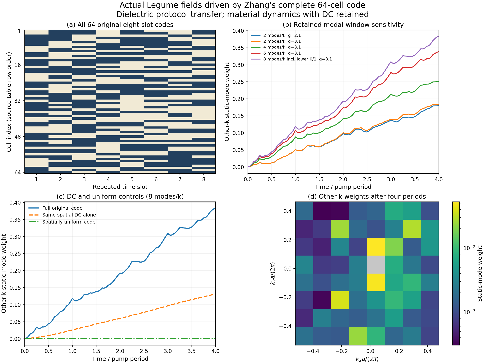

# Zhang2018：固定空间随机时序的基准测试

本次选用 **Zhang et al., Space-time-coding digital metasurfaces**, Nature
Communications 9,4334 (2018)，[DOI](https://doi.org/10.1038/s41467-018-06802-0)。
原论文规则阵列上的64个单元各有不同的八段时序，并且每个物理时间周期原样重复；
确实对应“空间随机性由驱动引入”。原平台是金属/PIN微波超表面，因此本轮把原始
反射协议对照与实际Legume介质平台测试分别列出，不混称同一全波复现。

结论：完整随机周期码已在实际二维周期介质薄膜的64个Bloch扇区跑通；独立空间
和时间控制支持投影与Floquet组装。**同时暴露了重要的保留模态窗口敏感性，
不能把当前跨动量转移量视为已收敛的定量预测。**

## 论文原图对照

原文与反射协议重算（历史材料 `paper_protocol/paper_vs_protocol.png`；见[发行说明](../../../docs/RELEASE.md)）

左侧为正式SI Fig.1b/c；右侧用Fig.1f全部64×8位串重算+2阶反射幅相。
幅度图案逐格对应。相位仍有约π的未解释整体差异，保留原始状态/时间约定，
没有补相位或调参。7个零幅格的相位未定义，显示灰色。独立时间积分对闭式
Fourier系数最大差1.87×10⁻⁷。详见[协议报告](paper_protocol/report.md)。

这张图是原文理想反射编码模型的对照；真正的Legume计算如下。

## 完整64单元的实际Legume计算



静态几何沿用已建立的周期薄膜：a=1、厚度0.42、背景ε=11.5，上下空气；每个
原胞含一个圆孔和一个椭圆孔，所有晶胞完全相同。原码映射为
`δε_bulk=0.5(1−2bit)`，即背景ε在11和12之间切换，孔始终ε=1；Ωa/c固定为0.18，
未根据输出调谐。完整8×8图案在空间上周期重复，区别于论文的有限金属阵列。

64个原始时序全部保留，没有重新生成随机数、删DC或去均值。48个单元具有非零
时间均值，因此调制开启后的平均算符已经带空间非均匀性。原表x向右、y向下的
索引映射明确保存，工具箱的`exp(−ipΩt)`与原文的`exp(+imΩt)`以p=−m对应。

每个Bloch扇区实际求静态场，材料重叠来自这些场；没有复制Γ点场覆盖整个空间。
各八时段直接构造M_s，使用D/H形式的精确矩阵指数按时间排序连乘，保留材料
切换处D、B连续条件。最大窗口512个静态模式／1024个D/H状态。

| 窗口/空间截止 | 静态模态数 | 四周期末其他k权重 | 同窗口DC-only权重 |
|---|---:|---:|---:|
| 2 modes/k, g=2.1 | 128 | 0.179556 | 0.120278 |
| 2 modes/k, g=3.1 | 128 | 0.184292 | 0.119941 |
| 4 modes/k, g=3.1 | 256 | 0.250761 | 0.129389 |
| 6 modes/k, g=3.1 | 384 | 0.338072 | 0.130268 |
| 8 modes/k incl. lower 0/1, g=3.1 | 512 | 0.382902 | 0.131288 |

这里的量是裸静态正频坐标权重，**不是外部功率、转换效率或概率**。DC-only是一条
独立相干演化；完整曲线减DC曲线也不能解释为AC效率。所有胞统一驱动的跨k值
约10⁻³¹，关闭调制为0。随机码引入跨k混合的机制稳定存在。

本轮完整64胞演化隔离材料算符，未加入辐射浴。矩阵指数得到精确分段有限模型
的Floquet周期算符；这不等于已经验证512模态的截断谐波本征谱。

## 真正独立的检查

1. 全64胞逐点重建E场、矩形减孔的独立实空间积分，对DC、p1、p2各抽查10个
   矩阵元，最大相对L2差 3.66e-11。
   参考没有调用生产的空间Fourier掩膜或胞间结构因子。
2. 独立构造实际2×2几何并求Legume超胞模态，与原胞四k路线对照。在gmax=4.1，
   最低H场重叠平方 0.999175，调制矩阵差
   0.2709%。这是另一个空间本征求解和实空间投影。
3. 同一小有限模型，生产Floquet对独立同带宽ODE的一周期乘子差
   7.4e-07；对原始八段精确传播差
   9.45e-05。独立ODE对原始阶梯也有近似相同差异，
   当前主要时间残差来自阶梯波的Fourier尾，不能据此归因于组装错误。

小控制使用原表左上2×2四格、δε幅度0.2、Ωa/c=0.1758195512，检查8个静态模式／
16个物理状态。它与完整64胞主算是不同数据集，不能混称同一个完整谱验证。
详见[独立超胞报告](supercell/report.md)、[全胞积分](realspace_checks.json)。

## 这次具体发现了什么限制

**原生空间截止与保留模态数是不同问题。** 在每k两模窗口，gmax 2.1→3.1后，
全轨迹最大差除以细档峰值为 4.744%；
所有64扇区的场身份都检查过，最小子空间重叠平方
0.988594。

但扩大每k窗口后，变化显著：

| 窗口变化 | 全轨迹最大差/后一档峰值 | 预先5%目标 |
|---|---:|---|
| 2 → 4 modes/k | 29.126% | 未达到 |
| 4 → 6 modes/k | 25.826% | 未达到 |
| 6 → 8 modes/k | 11.738% | 未达到 |

窗口顺序先为native[2,3]、[2…5]、[2…7]，最后恢复原先遗漏的低模0/1，即
[2…7,0,1]。初态始终同一个native2，旧场、频率和材料块在扩展矩阵中的子块
保持一致，不能把变化归咎于偷偷换初态或模态相位。本轮据此保留“定量转移仍
受模态窗口影响”的结论，没有通过更改误差阈值宣称通过。

独立2×2空间路线的真实静态频率下一周期乘子差仍有
0.11954，长期相位尚未空间收敛。
相同ω辅助对照只用于定位材料投影影响，不替换真实数据。精确阶梯对照的1e−5
乘子目标也未达到；同带宽ODE比较则已达到这个目标。详见原始判据和每档结果。

本轮支持固定随机周期驱动、跨动量材料投影与有限模型后端；没有把原文反射
相位直接当介电率，也没有宣称原金属阵列的远场、完整开放随机散射或无限无序
统计已复现。对宽时间谱驱动，后续定量研究首先需要依据实际耦合扩展模态窗口。

## 来源和本地复算

原始论文与SI已保存，完整编码沿用逐格核实的源JSON。新增全文候选筛选见
检索报告（历史材料 `../../literature/modulation_disorder_baseline_20261019/search/screened_candidates.md`；见[发行说明](../../../docs/RELEASE.md)）；
Zhu候选因静态结构无序及一次时间畴壁被排除。未核实到可直接原样Legume复现
的开放介质薄膜随机驱动论文，属于有界搜索结论，不能作为不存在或新颖性证明。
本次使用AI辅助检索、源码编写和数据分析，所有图由保存的数值/原始论文生成。

从项目根目录运行：

```powershell
.venv/Scripts/python.exe sptc_toolbox/scripts/plot_zhang2018_protocol_reference.py
.venv/Scripts/python.exe sptc_toolbox/scripts/run_zhang2018_legume_protocol.py
.venv/Scripts/python.exe sptc_toolbox/scripts/run_zhang2018_legume_protocol.py --gmax 3.1
.venv/Scripts/python.exe sptc_toolbox/scripts/run_zhang2018_legume_protocol.py --gmax 3.1 --modes 4
.venv/Scripts/python.exe sptc_toolbox/scripts/run_zhang2018_legume_protocol.py --gmax 3.1 --modes 6
.venv/Scripts/python.exe sptc_toolbox/scripts/run_zhang2018_legume_protocol.py --gmax 3.1 --modes 6 --include-low
.venv/Scripts/python.exe sptc_toolbox/scripts/check_zhang2018_full64_identity.py
.venv/Scripts/python.exe sptc_toolbox/scripts/check_zhang2018_realspace.py
.venv/Scripts/python.exe sptc_toolbox/scripts/validate_zhang2018_supercell.py
.venv/Scripts/python.exe sptc_toolbox/scripts/report_zhang2018_legume_protocol.py
```

[数据指纹](manifest.json) · 完整64胞图PDF（历史材料 `legume_full64.pdf`；见[发行说明](../../../docs/RELEASE.md)） · 设计和判据（历史材料 `../../docs/zhang2018_disorder_baseline_design.md`；见[发行说明](../../../docs/RELEASE.md)）
