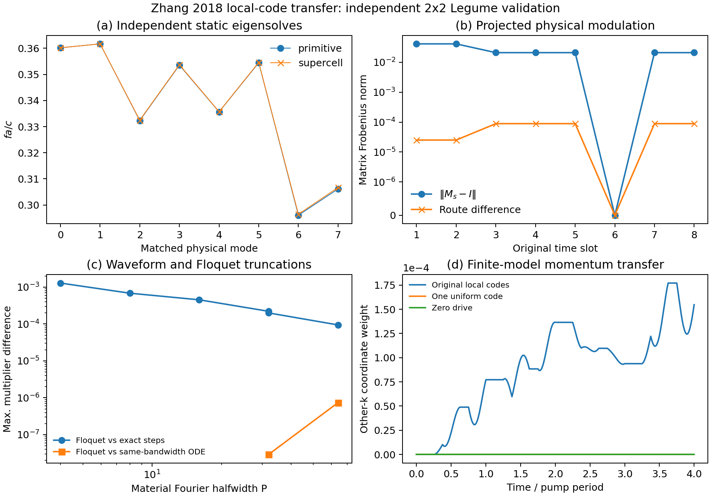

# Zhang 2018 原始局部时序：独立超胞与 Floquet 验证

采用正式 SI Fig.1f 左上 2×2 四格的完整八位码，映射为 ε=11.5+0.2(1−2bit)。静态几何为周期介质穿孔薄膜，四格图案在空间超胞与时间周期上重复。这是论文时序协议迁移；原金属/PIN 超表面的原样复现另属范围。

## 独立空间求解

路线 A：原胞四个 Bloch k；路线 B：实际构造 2×2 几何，在超胞 K 求一次 Legume。两条路线的 H 场在含包层的共同正权度量、全部 Fourier 支持联集上对齐；调制矩阵 B 直接在四个物理胞积分 E 场，不调用生产的胞间结构因子。

| gmax | 最小 H 场重叠平方 | 整体调制矩阵差 | 最大静态频移 fa/c | 真实频率下一周期乘子差 |
|---:|---:|---:|---:|---:|
| 2.1 | 0.99393617 | 0.5582% | 0.000637095 | 0.14271 |
| 3.1 | 0.99752444 | 0.7014% | 0.000988578 | 0.217332 |
| 4.1 | 0.99917535 | 0.2709% | 0.00054249 | 0.119541 |

独立实空间积分从 (xy32,z16) 到 (xy48,z24)，胞重叠矩阵相对变化 6.26e-15。

g4.1 的材料投影差约 0.27%，支持胞间相位、归一化与区域耦合的一致性。相同数字 gmax 在原胞／超胞中截断的 Fourier 支持不同；本轮不宣布长期相位已经空间收敛。真实频率的一周期乘子差仍为 0.1195；仅用于定位的同 ω 辅助对照为 1.49×10⁻⁴，未用于替换真实结果。

## 独立时间参考

每时段直接构造 M_s，精确计算 exp(A_s T/8)，按原代码顺序连乘。它保留各胞非零 DC、瞬时切换及材料时间导数，不使用生产的时间 Fourier 系数。另用独立 ODE 对同一有限 Fourier 波形检查生产 Floquet，从而区分波形尾与边带截断。

| 材料 Fourier P | Floquet M | Floquet 对八段精确积 | Floquet 对同 P 的 ODE |
|---:|---:|---:|---:|
| 4 | 8 | 0.00128944 | — |
| 8 | 12 | 0.000685014 | — |
| 16 | 20 | 0.000453354 | — |
| 32 | 28 | 0.000221073 | — |
| 32 | 40 | 0.000199875 | 2.91325e-08 |
| 64 | 56 | 9.44634e-05 | 7.40057e-07 |

全部配置保留 16 个独立物理模态。P64/M56 的同波形 ODE 差为 7.40×10⁻⁷，而 ODE 对精确阶梯的差为 9.37×10⁻⁵；因此当前主要时间差异可由有限波形带宽解释，不能归因于 Floquet 组装错误。

第六时段的该有限子空间调制矩阵为舍入零，单独相对误差无意义，JSON 用 null 并保留绝对误差。

## 动态机制与边界

四周期内，原局部代码的其他 k 正频坐标权重峰值为 0.000177085；同一代码所有胞同步时为 1.52e-63，关闭驱动为 0。

这里是裸静态正频坐标权重，不是出射转换效率；所选八模只用于接口与短时机制检查。本独立对照隔离无损材料投影，未加入冻结辐射，也未求完整开放 Floquet 散射。随机样品只含原表四格，不外推为原全阵列或无序统计。

重跑：`.venv/Scripts/python.exe -u sptc_toolbox/scripts/validate_zhang2018_supercell.py`。重画：`.venv/Scripts/python.exe sptc_toolbox/results/zhang2018_disorder_baseline_20261019/supercell/render_report.py`。

[机器结果](summary.json) · [原始局部协议](protocol.json) · [积分加密](independent_quadrature_refinement.json)
