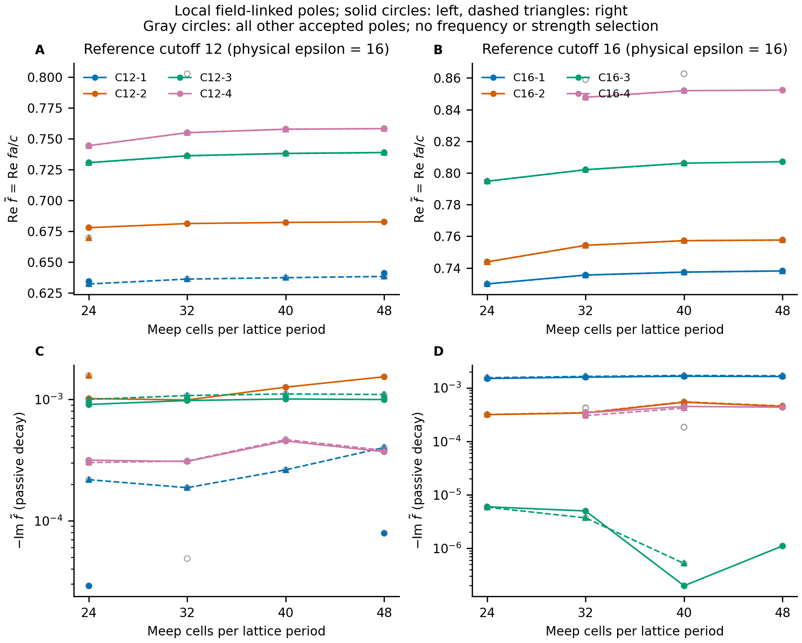
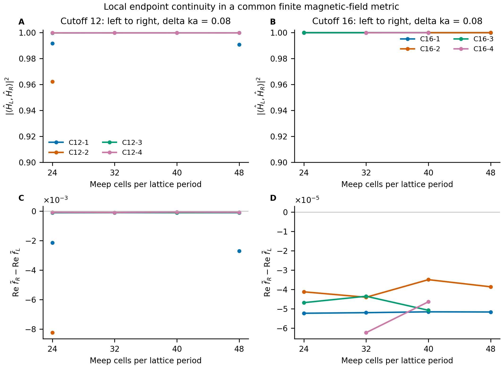
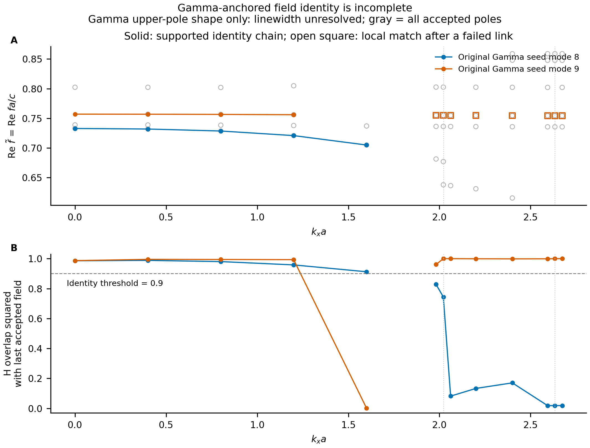

# Meep 对参考导模截止的独立静态核查

日期：2026-10-14。

**结论：独立 Meep 场匹配支持若干可观测静态模式在两个数值参考截止附近局部连续；当前证据不等于原 Γ 双母模的全路径身份、不等于 Legume 基底问题已修复，也不等于开放 Floquet 求解器认证。**

## 物理结构、数值参考与单位

结构始终为方晶格空气中圆柱，`r/a=0.3125`、`h/a=0.4445234708392603`、物理 `epsilon=16`、`a=3296 nm`。这里保留常数介电率模型，不宣称已还原论文材料色散。Meep 使用实际介电结构和上下 PML，不使用均匀参考层。

Legume 的 `epsilon_ref=12/16` 只改空间展开参考薄膜，不改物理材料。该参考薄膜 TE2 导模在 `G=(-2*pi,0)` 的截止满足 `g_cut=2*pi/[h*sqrt(epsilon_ref-1)]`；对应 `kx*a=2.021426874891992` 和 `2.633633423391492`。Meep 在每个数值位置两侧 `±0.04` 计算，低分辨率还含中点。该截止不是实际空气衍射通道的 Rayleigh 阈值。

表中频率为循环频率 `f_tilde=f*a/c`，Meep 的 Bloch 输入为 `kx*a/(2*pi)`，Legume 为 `kx*a`。时间约定是 `exp(-i*2*pi*f_tilde*t*c/a)`，被动衰减要求 `Im(f_tilde)<0`；`f_THz=f_tilde*299792458/(3296*1000)`。若衰减收敛，`Q=Re(f_tilde)/[-2*Im(f_tilde)]`，本轮不以未收敛衰减提供精确 Q。

## 公共场度量与极点证据

两后端均比较完整三分量周期包络 H，使用 12×12 个单胞中心 xy 点；z 在 `[-0.7,-h/2]`、`[-h/2,h/2]`、`[h/2,0.7]` 三段各取 4 个 Gauss 节点。每个分量乘 `sqrt(dx*dy*dz)`，归一化后计算复内积模方；两态则比较最小主角重叠平方。Legume 原始层坐标 `[0,h]` 先平移至 Meep 的 `[-h/2,h/2]`。Legume Fourier 场本来就是周期部分；Meep 全 Bloch 场除以 `exp(i*kx*x)`，不得再额外移相。

该有限域 H 内积在同一物理坐标与笛卡尔分量中比较形状，不是开放 QNM 的能量、左右本征矢双正交或 residue 度量。固定 12×12×12 采样和 |z|≤0.7 的度量尚未独立细化，因此接近 1 的重叠只在此度量内成立。镜面对称为 y 镜面矢量奇、z 镜面矢量偶；H 是轴矢量。一般 kx 上 x 镜面会改变 k，不能当同 k 奇偶。

只使用 `summary_v2.json` 与 `modal_fields_v2.npz`。三探针、两时间窗给出极点候选；联合复指数最小二乘恢复各极点空间 H，要求被动衰减、逐窗多探针重现、场重现、可接受秩/条件数与逐窗信号残差比。正衰减项可作为污染拟合的 nuisance，但不认证为物理增益。两窗场拟合共享候选池，不能把重现性说成两次完全独立求解。未接受或未观测到的模式不能当作不存在。

## 局部模式图与网格变化

下表所有标签来自 accepted poles 的公共场图：每条边只按场重叠一对一分配，要求重叠平方 >0.9、两个方向相对次优候选的分数间隔均 ≥0.08。图中展示至少跨 3 个分辨率、含截止左右两侧且无同算例身份冲突的所有连通分量；没有按频率接近、幅度大小或“最强两峰”选取。`C12-*`、`C16-*` 只是局部标签，两组之间也不自动等价。

| 局部标签 | r48 左频率 / 衰减 | r48 右频率 / 衰减 | r40→48 最大 abs(Δf) | r48 左→右 H 重叠平方 |
|---|---|---|---:|---:|
| C12-1 | 0.64108619 / -7.9012195e-05 | 0.63838971 / -0.0004012541 | 0.00102 | 0.99067807 |
| C12-2 | 0.68261267 / -0.0015366166 | 无 accepted 证据 | 0.000482 | — |
| C12-3 | 0.73879903 / -0.00099708947 | 0.73869008 / -0.0010969398 | 0.00075 | 0.99969217 |
| C12-4 | 0.75816215 / -0.00036986305 | 0.75808081 / -0.00038044248 | 0.000467 | 0.99967138 |
| C16-1 | 0.73815169 / -0.0016297759 | 0.73809999 / -0.0016844176 | 0.000748 | 0.99978721 |
| C16-2 | 0.75767226 / -0.00044979755 | 0.7576336 / -0.00045852683 | 0.00041 | 0.99982544 |
| C16-3 | 0.80716479 / -1.1045538e-06 | 无 accepted 证据 | 0.000971 | — |
| C16-4 | 0.85236808 / -0.00043458331 | 无 accepted 证据 | 0.00036 | — |

分辨率增加 24→32→40→48 后，主要局部场通常保持高重叠，但频率仍有系统变化；部分衰减变化更明显。高场重叠是身份稳定证据，不能取代频率及辐射损耗的网格收敛。当前数据不支持精确绝对频率、Q 或高 Q 极限。

图中灰色点为其余所有 accepted poles。线段仅连接场匹配接受的点，模式可见性缺失不填补成零模；频率图未画统计误差棒，因为这些是确定性离散与有限时间提取，网格序列也不是独立统计重复。

## 源与开放边界对照

| 基线 / 对照 | 相比基线改动 | accepted 场匹配数 | 最大 abs(Δf)（场接受者） | 最低 H 重叠平方（场接受者） |
|---|---|---:|---:|---:|
| ref12_center_r32_early | warmup: 12.0→2.0, window: 100.0→30.0 | 0 | — | — |
| ref12_left_r32_early | warmup: 12.0→2.0, window: 100.0→30.0 | 0 | — | — |
| ref12_left_r40_boundary | padding: 1.0→1.5, pml: 0.5→0.8 | 3 | 0.000538 | 0.999759 |
| ref12_left_r40_source | source_variant: 0→1 | 3 | 6.92e-06 | 0.999999 |
| ref12_right_r32_early | warmup: 12.0→2.0, window: 100.0→30.0 | 0 | — | — |
| ref16_center_r32_early | warmup: 12.0→2.0, window: 100.0→30.0 | 0 | — | — |
| ref16_left_r32_early | warmup: 12.0→2.0, window: 100.0→30.0 | 0 | — | — |
| ref16_right_r32_early | warmup: 12.0→2.0, window: 100.0→30.0 | 0 | — | — |
| ref16_right_r40_boundary | padding: 1.0→1.5, pml: 0.5→0.8 | 4 | 1.39e-05 | 0.999994 |
| ref16_right_r40_source | source_variant: 0→1 | 4 | 3.48e-05 | 0.999971 |

下表进一步列出在截止左右两侧均有完整 r24/32/40/48 场连接的局部分量。这个完整性条件与原 Γ 母模身份不同；其它模式的控制敏感性仍保留在上表和 JSON。

| 对照 | 局部场标签 | 频差（对照−基线） | H 重叠平方 | 衰减差（对照−基线） |
|---|---|---:|---:|---:|
| ref12_left_r40_boundary | C12-3 | -3.0541e-06 | 0.999999722 | 2.2174e-07 |
| ref12_left_r40_boundary | C12-4 | 2.0297e-07 | 0.999999966 | -3.9977e-07 |
| ref12_left_r40_source | C12-3 | 4.0878e-07 | 0.999999964 | -6.0443e-09 |
| ref12_left_r40_source | C12-4 | 1.0464e-06 | 0.999999980 | 1.1736e-07 |
| ref16_right_r40_boundary | C16-1 | -2.1623e-08 | 0.999999919 | 5.9107e-08 |
| ref16_right_r40_boundary | C16-2 | 1.3713e-08 | 1.000000000 | 9.3483e-09 |
| ref16_right_r40_source | C16-1 | 7.7201e-09 | 0.999999979 | -1.763e-09 |
| ref16_right_r40_source | C16-2 | -8.0661e-09 | 0.999999532 | 2.8723e-08 |

若 padding 与 PML 厚度同时变化，此处只把它当作合并边界对照，不分别归因。多个探针与同一次激励的两时间窗不等价于独立源变化；源对照还需按同一场身份检查模式是否重现。

9 个 r32 早窗对照使用 warmup=2、window=30，均未得到跨两窗多探针持续极点；本轮保留为提取失败，不把缺失模式替换成其它可见峰。宽源/长窗及窄源对照的失败原因同样保留，不能将提取不足称为空间物理不连续。

## 有限 Q 原生频域求解的有界尝试

独立 native `solve_eigfreq` 在 cutoff16 左侧 `kx*a=2.5936334233914913`、r24、相同物理结构及对称下，以 `0.667-0.009i` 为初值尝试补充低 Q 模式证据。结果为 **`FAILED_INNER_CW_CONVERGENCE`**：内层 CW 共报告 5 次收敛失败，最后完成的外层相对频移为 0.021231（目标 1e-7），于 102.23 秒终止，未启动第二次试验。

未得到可接受极点或场；迭代中的频率估计不进入本报告的物理曲线。此失败说明本次算法配置和预算未收敛，不能证明低支不存在，也不能补成低支身份认证。完整日志、停止原因与判定在 `results/meep_cutoff_eigfreq/summary.json` 和该目录的 `report.md`。

## Γ 种子、全局身份与 Legume 对照

Γ 跟踪状态：`CANDIDATE_PATH_WITH_EXPLICIT_IDENTITY_GATES`。

| kx*a | Meep 算例 | 候选频率 | 最小主角重叠平方 | 从原 Γ 种子身份有效 |
|---:|---|---|---:|---|
| 0.000000 | gamma_r32_narrow | 0.7327478, 0.7569364 | 0.989262 | True |
| 0.400000 | path0.4_r32_narrow | 0.7318153, 0.7568199 | 0.987951 | True |
| 0.800000 | path0.8_r32_narrow | 0.7284532, 0.7564806 | 0.979893 | True |
| 1.200000 | path1.2_r32_narrow | 0.7207071, 0.7559501 | 0.957523 | True |
| 1.600000 | path1.6_r32_narrow | 0.7048173, 0.7369265 | 0.001246 | False |
| 1.800000 | path1.8_r32_early | INSUFFICIENT_ACCEPTED_POLES | — | False |
| 1.981427 | ref12_left_r32 | 0.6812141, 0.7548686 | 0.578486 | False |
| 2.021427 | ref12_center_r32 | 0.6768440, 0.7548226 | 0.485622 | False |
| 2.061427 | ref12_right_r32 | 0.6362319, 0.7547776 | 0.119304 | False |
| 2.200000 | path2.2_r32 | 0.6309512, 0.7546310 | 0.159699 | False |
| 2.400000 | path2.4_r32 | 0.6153809, 0.7544503 | 0.173349 | False |
| 2.593633 | ref16_left_r32 | 0.7355451, 0.7543150 | 0.024059 | False |
| 2.633633 | ref16_center_r32 | 0.7355180, 0.7542921 | 0.024308 | False |
| 2.673633 | ref16_right_r32 | 0.7354930, 0.7542709 | 0.024532 | False |

Γ 点若某极点除微小正拟合 linewidth 外所有场身份条件均通过，只在 `IDENTITY_ONLY_DECAY_UNRESOLVED` 标签下用于形状连接；不放宽 passive pole acceptance，也不认证 gain、Q 或精确 BIC。上表的通过状态指该有限 H 度量中的形状身份。任何失败边后，二维候选链的身份标志保持 false；不能以之后局部重叠重新认证已断开的链。

单模单独追踪可区分“某一支缺失”与两态全部失去身份。未接受的匹配不更新最后可靠场；以下仅显示达到场匹配门槛的频率，空白表示缺失或拒绝。

| kx*a | lower 场匹配频率 / H² / 累积身份 | upper 场匹配频率 / H² / 累积身份 |
|---:|---|---|
| 0.000000 | 0.7327478 / 0.985957 / True | 0.7569364 / 0.986601 / True |
| 0.400000 | 0.7318153 / 0.988410 / True | 0.7568199 / 0.995313 / True |
| 0.800000 | 0.7284532 / 0.980358 / True | 0.7564806 / 0.994591 / True |
| 1.200000 | 0.7207071 / 0.958179 / True | 0.7559501 / 0.993363 / True |
| 1.600000 | 0.7048173 / 0.912430 / True | —（FIELD_MATCH_REJECTED） |
| 1.800000 | —（NO_ACCEPTED_MATCH） | —（NO_ACCEPTED_MATCH） |
| 1.981427 | —（FIELD_MATCH_REJECTED） | 0.7548686 / 0.960833 / False |
| 2.021427 | —（FIELD_MATCH_REJECTED） | 0.7548226 / 0.999909 / False |
| 2.061427 | —（FIELD_MATCH_REJECTED） | 0.7547776 / 0.999914 / False |
| 2.200000 | —（FIELD_MATCH_REJECTED） | 0.7546310 / 0.999085 / False |
| 2.400000 | —（FIELD_MATCH_REJECTED） | 0.7544503 / 0.998451 / False |
| 2.593633 | —（FIELD_MATCH_REJECTED） | 0.7543150 / 0.998808 / False |
| 2.633633 | —（FIELD_MATCH_REJECTED） | 0.7542921 / 0.999954 / False |
| 2.673633 | —（FIELD_MATCH_REJECTED） | 0.7542709 / 0.999955 / False |

Γ 至 kx*a≈1.2 的双平面有形状连接证据，低频种子可单独连接到 kx*a=1.6；较高 k 的低频候选提取及中间 upper 窗口场证据仍有限。截止附近约 0.736/0.754（r32）的两条可见支不能自动称作原 Γ 两母模；第三条模式会进入同一频窗，只有场身份才能区分。

旧 Legume Γ-connected 路径在若干中间边已经拒绝身份延续，故不能用其远离 Γ 的标签作为 Meep 已认证锚点。新的身份核查只从原 Γ 两态物理 H 平面出发，并在任何失败边后保留失败状态；候选路径不是已通过路径。

同 k 原生 Legume 使用固定物理几何、gmax=5.1、xy-even 导模 index<24、60 个本征态，在参考 epsilon=12 和 16 下分别求解。公共场与全部输出态比较，并枚举 accepted Meep 双极点的最优原生二维子空间。部分单模/两态重叠仍显著低于 0.9，最佳原生匹配甚至落到其他频段，因此不能宣称 Meep 与旧双母模已定量一致。精确参考截止单点可能奇异，结论重点依据左右两侧。

## 能力映射、限制与保留证据

| Toolbox 能力 | 本轮新增证据 | 本轮未认证 |
|---|---|---|
| 静态开放空间参考 | 与 Legume 无参考层依赖的 Meep 局部 poles / H；相同物理几何、单位、对称、坐标 | 全 BZ 目标身份；空间基底完整性修复；严格 QNM/residue 归一化 |
| 极点与场提取 | 多窗、多探针、联合多指数场恢复、被动性检查；合成审计另见 meep_modal_fit_review.md | 源不可见或快速衰减全部模式；任意近简并极点；高 Q 的精确衰减 |
| 数值参考截止诊断 | 可观测 Meep 模在同一数值位置两侧局部场连续，支持参考表示问题而非凭空物理跳变 | 证明所有物理模均连续；证明库 bug；靠换参考 epsilon 根治问题 |
| Floquet / 时调 / 开放非厄米接口 | 本轮无新的动态认证 | 边带 outgoing、自能频散、共通道干涉、材料色散/吸收/增益、正确左右模态度量 |

主要剩余限制：① Meep 网格频率/衰减未达到声明容差；② 共同 H 采样/积分域未独立细化；③ 有限激励、频窗及时间长度会遗漏极点；④ 局部场连接与原 Γ 全局身份是不同门槛；⑤ 静态场结果不能认证动态开放 Floquet 物理。未解释的定量差异保持为未解决，不拟合掉，也不在证据不足时归咎于论文或后端。

原始 Meep v1/v2、ringdown、窗口和每极点拒绝原因均保留在 `results/meep_cutoff/`。本报告数据来源为 `results/cutoff_comparison/campaign_comparison.json`、`local_field_tracks.json`、`meep_pairwise/*.json`、`same_k/*/summary.json`、`gamma_seed_tracking.json`（若存在）。`local_field_tracks.json` 保存 v2 摘要 SHA256；同 k 对比还保存原始场、分配分数及候选子空间。

再生成：先运行 `scripts/compare_cutoff_backends.py --campaign toolbox_experiments/results/meep_cutoff --require-v2`；若 Γ 路径已完成，加 `--gamma-track toolbox_experiments/results/meep_cutoff`；随后运行 `scripts/report_cutoff_comparison.py`。本轮保留既有 Legume 证据，不修改安装库，不创建 Colab。
