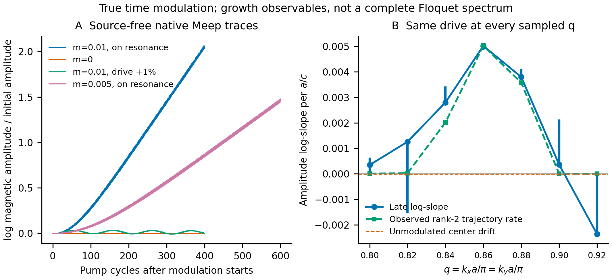
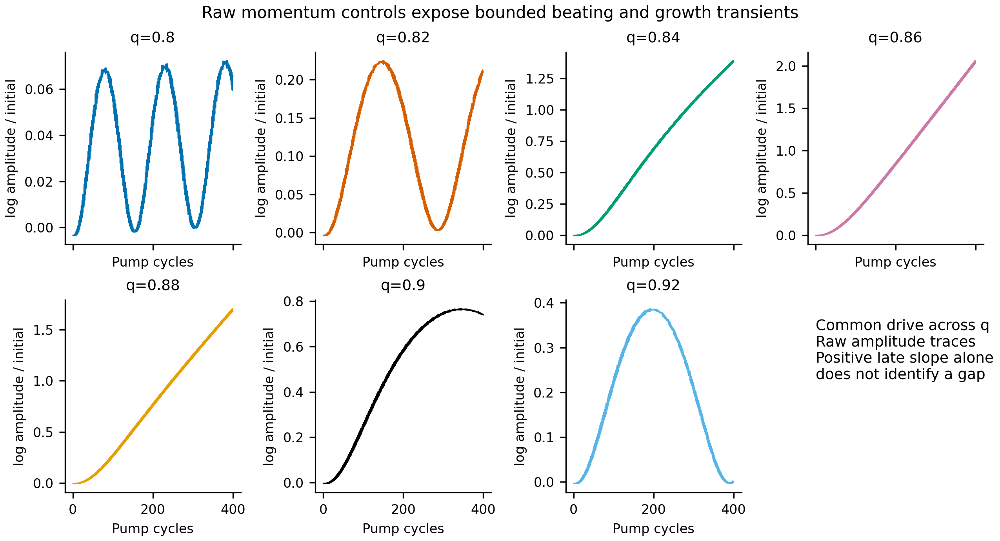
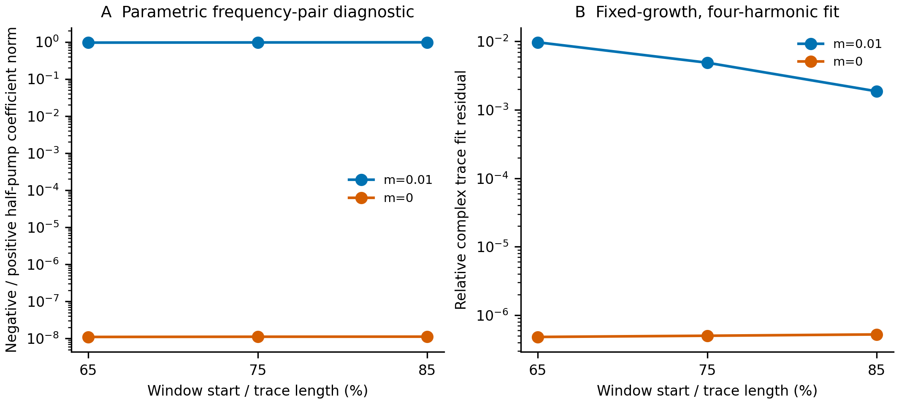
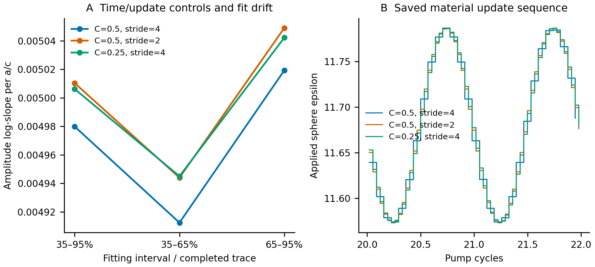
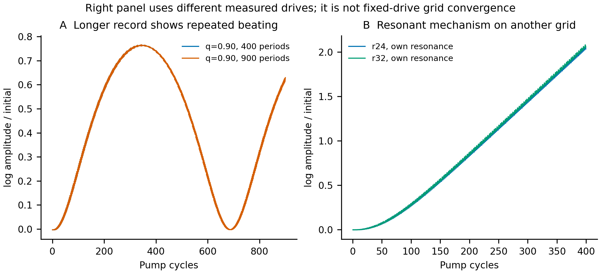

# Nature Photonics 01563：真实时变 Meep 动态对照

**真实时变 Meep 已观察到与静态预测相符的参量放大：关闭调制或失谐 1% 时持续增长消失，调制幅度减半时增长率约减半，明显增长集中在共振附近的 q 区域，并出现正负半泵频率伴模。** 有限 q 采样及探针时序尚不构成完整 Floquet 能带或精确动量带隙。

中心 m=0.01、r24、stride4 算例的磁场振幅代理量增大约 **7.56 倍**：分母取 pump 第 10–20 周期内周期振幅的中位数，分子取记录最后 10 周期内的中位数。这个比值说明实际时序放大量，不是对任意初始相位或所有空间点的统一增益。

## 物理模型与离散约定

球半径 R=210.6 nm、周期 a=631.8 nm、r/a=1/3、空气背景、ε₀=11.68；球内 ε(t)=11.68+10.68 m ramp(t) cos(2π f_drive t+phase)。m=0.01 时绝对 ε 振幅为 0.1068。xy 使用 Bloch 条件，kx a=ky a=qπ，上下空气/PML；本轮为 native voxel 球，`eps_averaging=False`。这与旧 r32 subpixel 静态阵列的界面离散不同，不能拿其增长参考直接当同模型定量误差。

长度单位 a、时间单位 a/c、循环频率 f a/c；振幅 exp(λt) 的循环频率虚部为 λ/(2π)。初始源是 Hz 脉冲；源消失后先记录静态极点，再开始 10 周期平滑调制。pump 驱动来自一次中心静态校准，q 扫描所有点使用同一个 f_drive，不逐 q 调谐。

r24 主扫描固定 f_drive=0.825527188667，半泵对应 195.858519 THz。这个工作点来自 native voxel 静态模式，旧 subpixel r32 的约 193.48 THz 则是另一离散表示，二者分别记录。

Meep 使用 public `set_materials` 重建球内系数；材料在若干 Maxwell 时间步之间 sample-and-hold，更新时间用区间中点规则。该更新不是连续时间精确接口，因此需要 stride 与 Courant 对照。保存的 D/B 重设变化检查只确认此接口没有重置 D/B，不能单独认证能量交换或更新收敛。

## 完成状态与观测量

本报告已读取 12 / 12 个基础计划动态算例，另有 2 个补充算例记录；所有 incomplete、pending 和 pilot 状态在 `results/dynamic/summary.json` 保留。

每个样本保存三个探针的 Hx/Hy/Hz，按调制周期平均 sum|H|²，再取其平方根作为磁场振幅代理量。**它不是全空间磁场范数，也不是电磁总能量。** λ 来自 log(振幅) 对物理 Meep 时间的拟合。主表用后段 65%–95%，同时保留 35%–65%、35%–95% 和 log 拟合残差。窗口差不是统计置信区间；未出现稳定后段趋势时不能把局部正斜率叫作 Floquet 增益。

| 算例 | 状态 | q / m | 后段 λ | 三窗 λ 范围 | log 拟合 RMS | 完成周期 |
|---|---|---|---:|---:|---:|---:|
| center_m001_r24_s4 | COMPLETED_DIRECT_MEEP_DYNAMIC_PROBE | 0.86 / 0.01 | 0.0050192417 | 0.000107 | 0.01724 | 400.00 |
| center_zero_r24_s4 | COMPLETED_DIRECT_MEEP_DYNAMIC_PROBE | 0.86 / 0 | -1.1182835e-05 | 2.17e-11 | 5.586e-08 | 400.00 |
| center_m001_r24_s2 | COMPLETED_DIRECT_MEEP_DYNAMIC_PROBE | 0.86 / 0.01 | 0.0050489829 | 0.000105 | 0.01724 | 400.00 |
| center_m001_r24_halfdt_s4 | COMPLETED_DIRECT_MEEP_DYNAMIC_PROBE | 0.86 / 0.01 | 0.0050421793 | 9.72e-05 | 0.0148 | 400.00 |
| center_m001_detuned_r24 | COMPLETED_DIRECT_MEEP_DYNAMIC_PROBE | 0.86 / 0.01 | 4.9705016e-05 | 0.000153 | 0.01355 | 400.01 |
| center_m0005_r24 | COMPLETED_DIRECT_MEEP_DYNAMIC_PROBE | 0.86 / 0.005 | 0.0024875375 | 0.000132 | 0.01714 | 600.00 |
| q0.8_m001_r24_s4 | COMPLETED_DIRECT_MEEP_DYNAMIC_PROBE | 0.8 / 0.01 | 0.00034564333 | 0.000514 | 0.01854 | 400.00 |
| q0.82_m001_r24_s4 | COMPLETED_DIRECT_MEEP_DYNAMIC_PROBE | 0.82 / 0.01 | 0.0012579221 | 0.00275 | 0.02113 | 400.00 |
| q0.84_m001_r24_s4 | COMPLETED_DIRECT_MEEP_DYNAMIC_PROBE | 0.84 / 0.01 | 0.0028005254 | 0.000586 | 0.009595 | 400.00 |
| q0.88_m001_r24_s4 | COMPLETED_DIRECT_MEEP_DYNAMIC_PROBE | 0.88 / 0.01 | 0.0037972085 | 0.000262 | 0.01348 | 400.00 |
| q0.9_m001_r24_s4 | COMPLETED_DIRECT_MEEP_DYNAMIC_PROBE | 0.9 / 0.01 | 0.00036189764 | 0.00172 | 0.009408 | 400.00 |
| q0.92_m001_r24_s4 | COMPLETED_DIRECT_MEEP_DYNAMIC_PROBE | 0.92 / 0.01 | -0.0023652241 | 0.0023 | 0.00966 | 400.00 |

七个 q 样本只描述已采样点的增长趋势，不能直接给出精确带隙边界。特别是失谐或带外 trace 的拍频可能产生有限窗口正负斜率；需要与无调制漂移、拟合窗口稳定性和更长时序一起解释。q=0.82 的前段斜率约 −0.00150、后段约 +0.00126，整段为负，属于明显窗口反号现象，不能仅依据 late 正斜率把它归入放大带。q=0.80 也有明显振荡和窗口变化；q=0.84 的正斜率随窗口降低，需作为边缘暂态观察保留。

q=0.90 的 400 周期 trace 已出现向下转折；q=0.92 近似完成一段拍频回落。中心 q=0.86 与近邻 q=0.84/0.88 的持续上升趋势应与这些有限窗口假阳性分开。主增长图竖线表示三个拟合窗口的斜率范围，不是统计误差棒，也不能作为稳定性证书。

## 有限轨迹的双分量诊断

独立审查者把保存的复 H 用 cubic 插值取到相同 pump 相位，再做固定 rank=2 的 delay-matrix 诊断。30–380 周期、相位 0.25/0.5、delay 24/32 的四组输出全部保留。它可区分观察到的增长/衰减组合与稳定拍频，但 rank=2 是有限数据假设；材料 sample-and-hold 序列也不严格与 pump 周期公度，因此不是完整或已收敛 Floquet 谱。

| q / 算例 | 较大指数的四组范围 / Meep 时间 | 最大 rank-2 残差 |
|---|---:|---:|
| 0.8 | 9.298064e-06 至 1.293601e-05 | 0.0006235 |
| 0.82 | 2.191003e-05 至 2.477552e-05 | 0.0004415 |
| 0.84 | 0.00200709 至 0.002021086 | 0.0002455 |
| 0.86 | 0.00502295 至 0.005024319 | 6.195e-05 |
| 0.88 | 0.003572043 至 0.003574657 | 4.169e-05 |
| 0.9 | 5.983596e-08 至 2.069808e-06 | 4.607e-05 |
| 0.92 | 1.468334e-06 至 2.815719e-06 | 4.748e-05 |

q=0.84、0.86、0.88 的观察指数在相位/delay 对照下保持明显正值；q=0.80、0.82、0.90、0.92 只剩约 10⁻⁶–2.5×10⁻⁵ 的未决漂移，不能把它认证为弱增益。m=0 的主要分量恢复约 −1.118×10⁻⁵；其强制 rank-2 的另一分量缺乏可识别性，不列为物理衰减支。

该离线流程先通过已知 ±0.005 增长对与双稳定频率拍频的合成测试，失败的 linear 插值试验也被保留。完整奇异值比、残差、参数、原始文件哈希见 `results/dynamic/offline_strobe_diagnostic.json`，解释见 `docs/direct_dynamic_review.md`。

## 正负伴频的独立时序诊断

对后段复 H 先去除已测 exp(λt)，然后只线性拟合 exp(−i n π f_drive t)，n=±1、±3；另保留 n=±1 和 n=±1、±3、±5 对照。λ 不在此阶段重新优化。取各频率在九个探针通道的系数二范数，比较 −f_drive/2 与 +f_drive/2；这些是有限探针系数，不是 QNM 范数或能量占比。残差过大时不能解释为简单参量对。

| 算例 | 窗口 | 负/正半泵频系数范数比 | 四谐波复 H 残差 |
|---|---|---:|---:|
| center_m001_r24_s4 | [0.65, 0.95] | 0.95450724 | 0.00971296 |
| center_m001_r24_s4 | [0.75, 0.95] | 0.96589118 | 0.00488804 |
| center_m001_r24_s4 | [0.85, 0.95] | 0.97402108 | 0.00186555 |
| center_zero_r24_s4 | [0.65, 0.95] | 1.0962064e-08 | 4.79805e-07 |
| center_zero_r24_s4 | [0.75, 0.95] | 1.1104231e-08 | 4.99712e-07 |
| center_zero_r24_s4 | [0.85, 0.95] | 1.116767e-08 | 5.22146e-07 |
| center_m001_r24_s2 | [0.65, 0.95] | 0.95546128 | 0.00956028 |
| center_m001_r24_s2 | [0.75, 0.95] | 0.96667799 | 0.00480213 |
| center_m001_r24_s2 | [0.85, 0.95] | 0.97466964 | 0.00182966 |
| center_m0005_r24 | [0.65, 0.95] | 0.89053312 | 0.0181204 |
| center_m0005_r24 | [0.75, 0.95] | 0.9103781 | 0.00986017 |
| center_m0005_r24 | [0.85, 0.95] | 0.92600438 | 0.00405942 |

## 时间步、材料更新与静态参考

| 算例 | dt | 材料更新间隔 | 每 pump 周期更新数 | 最大 D/B reset 相对变化 |
|---|---:|---:|---:|---:|
| center_m001_r24_s4 | 0.020833333 | 0.083333333 | 14.536 | 0 |
| center_m001_r24_s2 | 0.020833333 | 0.041666667 | 29.072 | 0 |
| center_m001_r24_halfdt_s4 | 0.010416667 | 0.041666667 | 29.072 | 0 |

stride=4→2 在相同 Maxwell dt 下细化材料更新；Courant=0.5→0.25、stride=4 同时细化 Maxwell dt，并与原 stride=2 具有相同材料更新间隔。中心二者有助于区分更新误差和 Maxwell 时间离散，但并不构成空间 r24→更细网格的收敛。

同 voxel 静态参考来源：`results/dynamic_static_calibration/summary.json`；f₀=0.412763594311、df/dε=-0.0151167297729。来源说明：Native same-voxel static epsilon perturbation: two source-free windows, three probes; full raw records in source file。此斜率来自静态微扰，不使用动态结果拟合。

| 同模型中心算例 | 真实 Meep 后段 λ | 静态校准无损单模 λ | 相对差 | 相对 m=0 漂移的增长增量 |
|---|---:|---:|---:|---:|
| center_m001_r24_s4 | 0.0050192417 | 0.0050719878 | -1.040% | 0.0050304246 |
| center_m001_r24_s2 | 0.0050489829 | 0.0050719878 | -0.454% | 0.0050601658 |
| center_m0005_r24 | 0.0024875375 | 0.0025359973 | -1.911% | 0.0024987203 |
| center_m001_detuned_r24 | 4.9705016e-05 | 1.425875e-18 | 参考近零，比例无意义 | 6.0887851e-05 |

m=0 的微小衰减按同运行条件数值漂移处理，不当作物理损耗或 Q。表中差分增量用于比较调制前后变化；“无损理论 λ 加上实测 m=0 漂移”也可作基线修正量，但这不把数值漂移升级为材料耗散模型。Courant 不同的算例不会直接套用 Courant=0.5 的静态载频校准。

## 补充时长或空间网格机制对照

| 补充算例 | 状态 | r / q / drive | 后段 λ | 三窗 λ 范围 | 完成周期 |
|---|---|---|---:|---:|---:|
| center_m001_r32_retuned | COMPLETED_DIRECT_MEEP_DYNAMIC_PROBE | 32 / 0.86 / 0.8190179113 | 0.0050159002 | 9.474e-05 | 400.00 |
| q0.9_m001_r24_long | COMPLETED_DIRECT_MEEP_DYNAMIC_PROBE | 24 / 0.9 / 0.8255271887 | 0.0010289314 | 0.002499 | 900.03 |

r32 算例根据它自己的静态载频重新设定 drive，该算例检验“不同 voxel 网格在各自共振处是否仍有参量增长”，不等于相同 drive 下的空间网格收敛。r24 的 df/dε 不作为 r32 定量增长系数。r32 后段 λ≈0.00501590、r24 stride4≈0.00501924，支持这一离散模型的共振放大机制在两个网格下重现；二者接近不用于宣称同一物理问题已经空间收敛。

长时间 q=0.90 算例保持原来的 fixed drive，900 周期曲线显示拍频回落和恢复。独立 rank-2 诊断在 400–850 周期的两个相位下，较大指数约为 1.20×10⁻⁶–1.23×10⁻⁶，处于未决漂移尺度，未观察到与中心约 0.005 同量级的持续不稳定增长；不能用其某个晚窗的正斜率确定带隙。

## 结论的范围

动态增长不能仅由一条上升曲线证明；需共同检查无调制、减半调制幅度、1% 调制失谐、固定 drive 的 q 变化，以及 stride/时间步细化。表中仍未完成者不补值，失败者不隐藏。即使这些控制支持参量放大，也不能由有限探针振幅推出完整 Floquet 带谱、精确 bandgap 边界、所有旁带通道或 QNM 度量。

本轮工作点按本 voxel 离散的静态载频选定，未调材料或动态参数去拟合论文固定 196 THz。论文报告的 6.59% 宽度、约 350 倍增强以及 Fig. 5 辐射场景仍是不同验证目标；此处不得据趋势近似宣布它们已复现。

全部输入摘要/原始 NPZ 的 SHA256、独立重算后段斜率、完成状态和静态校准来源保存在 `results/dynamic/summary.json`。生成入口为 `python summarize_dynamic.py`；同网格静态校准可通过 `--calibration path/to/calibration.json` 明确加入。该脚本不启动任何 Meep 求解。

验证记录：本轮完整回归 **425 项通过**，14 条警告来自已有依赖弃用提示；原始记录为 `results/dynamic/regression.xml`。报告自身的振幅/能量因子和正负伴频合成检查另有 4 项通过，保存在 `results/dynamic/summary_tests.xml`。这些测试与真实物理控制共同支持当前结论，各自不替代尚缺的空间收敛或完整开放 Floquet 验证。
