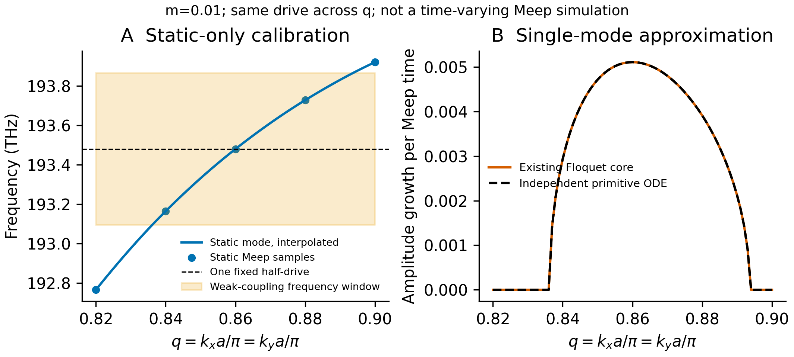

# 静态校准单模 Floquet 机制对照

日期：2026-10-14。此文件对应 `modal_dynamic_reference.py`，结果在 `results/modal_dynamic_reference/`。它复用已有 Meep **静态**频率、场身份及介电率微扰，再比较现有 Floquet 核心与独立二阶 ODE；没有运行时变 Meep，也没有使用动态增长率拟合任何输入。

## 模型和可核查输入

球阵列保持论文参数：球半径 R=210.6 nm、a=3R=631.8 nm、空气背景、球内 ε=1+χ₀=11.68，χ₀=10.68。论文的调制是 χ(t)=χ₀[1+m cos(Ωt)]；因此 m=0.01 对应 **绝对 ε 振幅 Δε=χ₀m=0.1068**，不是 0.1168。空间路径用 q=kₓa/π=kᵧa/π。

频率 f 为循环量 f a/c；Meep 时间为 tc/a。时间约定为 exp(−i2πft)，因此 Im f>0 表示振幅增长，直接时序指数是 λ=2π Im f，能量指数则为 2λ。

| 静态输入，r32、q=0.86 | ε | f a/c |
|---|---:|---:|
| 负扰动 χ₀(1−m/2) | 11.6266 | 0.408566689390565 |
| 基线 | 11.68 | 0.407752047173510 |
| 正扰动 χ₀(1+m/2) | 11.7334 | 0.406941773970240 |

两个扰动与基线的公共 H 场重叠平方分别为 0.9999980003、0.9999980569，支持微扰前后同模。q=0.82、0.84、0.86、0.88、0.90 相邻静态场重叠平方均 ≥0.99896。输入原始摘要和场文件 SHA256 存于结果 JSON。

中心差分得到

`s = df/dε = [f(11.7334)−f(11.6266)]/0.1068 = −0.0152145638607`。

两侧单边导数的相对差异为 0.5378%。这不是导数误差的严格界，也不是空间网格收敛证明；结果仍来自已有 r32 的静态数据。

声明的单模近似为

`x_tt + [(2πf₀)² + 2(2πf₀)(2πs)Δε cos(2πf_drive t)] x = 0`。

这是对瞬时模态刚度的一阶 ε 展开，使用固定单模空间形状。它没有多模耦合、材料色散、变化的空间基底、开放边带或辐射自能。静态束缚模拟合的微小正负虚部只作为数值未分辨量保留，**不输入为材料增益或损耗**。

API `modal_prediction(carrier, sensitivity, drive, epsilon_amplitude, ...)` 接受独立静态测得的载频和灵敏度，`drive` 必须明确传入。CLI 若覆盖 carrier/sensitivity，必须提供 `--override-provenance`；只产生该单点参考，不把其它 q 的色散凭空平移到新网格。一个网格中所有 q 必须使用同一个 f_drive，不能逐 q 调谐来制造宽带隙。

## 中心增长率与固定频率扫描

本轮取 **f_drive=2f(q=0.86)=0.815504094347**，整个 q 扫描保持该值。中心载频为 193.480514 THz、调制频率为 386.961027 THz；论文 Fig. 4 的 196 THz 是不同工作点，当前偏移为 −2.519486 THz。这是计算所得共振附近重新选定工作点的机制对照，不是固定 196 THz 的论文数值复现。

弱调制共振近似给出

`g = |s Δε|/2 = 0.000812457710163`，

`λ = 2πg = π|s Δε| = 0.00510482234720` 每 Meep 时间。

这里的 1/2 因子不能遗漏：ε 调制引起的频率摆幅是 |sΔε|，参量增长的循环频率虚部只有其一半。振幅 e-fold 时间约为 195.893 a/c，即约 412.8 fs；每调制周期的振幅对数增量约 0.00625971。

| 中心结果 | Im f a/c | 振幅增长 λ / Meep 时间 |
|---|---:|---:|
| 一阶弱调制公式 | 0.000812457710163 | 0.00510482234720 |
| 现有 Floquet 核心，N=3 | 0.000812456198171 | 0.00510481284708 |
| 独立物理时间 ODE | 0.000812456197921 | 0.00510481284550 |

在局部 q 范围内，对已测静态 f(q) 使用 PCHIP 插值，固定中心 s，独立 ODE 的单周期矩阵迹 crossing `trace(U)=−2` 给出这个**有限振子模型**的不稳定区 q≈[0.836149636, 0.893674459]。相对中心宽度约 6.689%。这依赖局部插值、固定灵敏度和单模近似，不是求得的 Maxwell 动量带隙边界；它与论文 6.59% 数字接近，不能作为定量吻合证书，也不提供约 350 倍增强的验证。

## 数值交叉检查和适用范围

独立 ODE 直接在物理 Meep 时间积分二阶振子，不调用 Floquet 模型矩阵或 Fourier 系数组装；现有求解器以 τ=2πf_drive t 处理周期 Fourier 矩阵。两者比较单周期乘子，避免 Floquet gauge 分支歧义。

- 中心乘子最大差为 1.94×10⁻¹²；整个 81 点插值扫描最大差约为 3.22×10⁻¹¹。
- N=3 与 N=5 的中心增长差约 1.1×10⁻¹⁷；N=2 未通过边界谐波/物理代表元选择门，保留 `TRUNCATION_REJECTED`，没有放宽门槛来接受它。
- 时间 Fourier 采样 64/128/256 的中心增长差约 10⁻¹⁶；单周期行列式接近 1，符合无耗散实系数二阶振子的 Liouville 约束。
- 9 项测试通过：零调制解析振子、Mathieu 弱调制因子、共振/失谐/不同振幅下独立 ODE 对照、调制符号与相位不变性、固定 drive 失谐抑制、非正瞬时刚度拒绝。

这些检查验证的是声明的单模有限模型和单位换算。真实时变 Meep 还需要独立验证 ε 更新、球界面/网格时间离散、无调制和失谐控制、源后增长测量、模式身份、泵功与离散稳定性。任何真实动态增长率与此模型的差异应如实保留，不据此调 s 或逐 q 调 Ω。

运行入口：`python modal_dynamic_reference.py`；测试：`python -m pytest test_modal_dynamic_reference.py -q`。完整结果、收敛拒绝记录、来源哈希和测试 XML 保存在 `results/modal_dynamic_reference/`。
