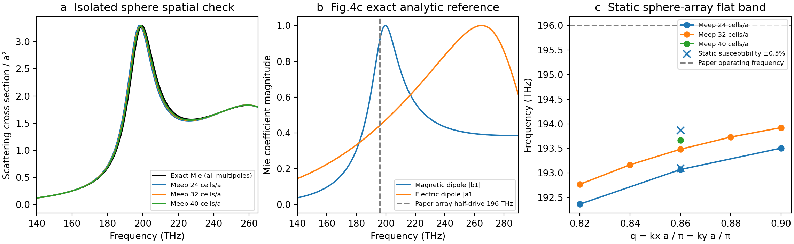

# Nature Photonics 01563：Meep首轮复现

本页保留首轮静态结果；后续真实时变计算见[动态机制报告](dynamic_report.md)。

**首轮Meep结果已支持论文机制的静态部分：球体共振、平坦能带，以及小幅材料变化在平带附近产生较大等效动量变化。动态放大尚待验证。**

按绝对频率偏移记录在案，不再仅为贴齐论文数字反复加密；仍保留辨别非物理增益、模式误配或代码错误所需的检查。

原文和官方25页SI均已核查，几何严格采用R=210.6 nm、a=631.8 nm、epsilon=11.68、空气环境。参数及图号对应见[source_audit.md](source_audit.md)。

## 已实际完成

| 单球散射配置 | 与全多极Mie解的谱相对L2误差 |
|---|---:|
| r=24, integrated source=False | 14.998% |
| r=24, integrated source=True | 5.739% |
| r=32, integrated source=False | 14.478% |
| r=32, integrated source=True | 3.567% |
| r=40, integrated source=True | 2.554% |

初版平面波源延伸进PML却未设is_integrated，误差约15%，已保留为失败对照。修复为积分源后误差下降，再用实际网格加密检查。解析参考另通过Rayleigh极限、无对比不可见性、光学定理及多极收敛4项测试。

| 球阵列算例 | 稳定实频/THz | 场/频率证据 |
|---|---:|---|
| results/array/q0.82_r24_eps11.68 | 192.362438 | 两窗场重叠1.000000000；衰减不认证 |
| results/array/q0.82_r32_eps11.68 | 192.765751 | 两窗场重叠1.000000000；衰减不认证 |
| results/array/q0.84_r32_eps11.68 | 193.164929 | 两窗场重叠1.000000000；衰减不认证 |
| results/array/q0.86_r24_eps11.68 | 193.067952 | 两窗场重叠1.000000000；衰减不认证 |
| results/array/q0.86_r32_eps11.6266 | 193.867066 | 两窗场重叠1.000000000；衰减不认证 |
| results/array/q0.86_r32_eps11.68 | 193.480514 | 两窗场重叠1.000000000；衰减不认证 |
| results/array/q0.86_r32_eps11.7334 | 193.096035 | 两窗场重叠1.000000000；衰减不认证 |
| results/array/q0.86_r40_eps11.68 | 193.667762 | 两窗场重叠1.000000000；衰减不认证 |
| results/array/q0.88_r32_eps11.68 | 193.728731 | 两窗场重叠1.000000000；衰减不认证 |
| results/array/q0.9_r24_eps11.68 | 193.502648 | 两窗场重叠1.000000000；衰减不认证 |
| results/array/q0.9_r32_eps11.68 | 193.921383 | 两窗场重叠1.000000000；衰减不认证 |
| results/array_boundary/q0.86_r32_eps11.68 | 193.481394 | 两窗场重叠1.000000000；衰减不认证 |
| results/nonresonant/q0.27_r32_eps11.68 | 未认证 | 极点/衰减/场重复条件未全部满足；不代表模式不存在 |
| results/nonresonant/q0.2818_r32_eps11.68 | 未认证 | 极点/衰减/场重复条件未全部满足；不代表模式不存在 |
| results/nonresonant/q0.29_r32_eps11.68 | 未认证 | 极点/衰减/场重复条件未全部满足；不代表模式不存在 |

当前模式位于空气光锥外，应是束缚模；拟合的微小正负虚部按数值误差处理，不作为增益或物理Q。只在多探针/两窗、场重复、足够小虚部和光线条件共同通过时报告实频证据。

## 静态敏感性与论文本意

在q=0.86、基线193.480514 THz附近，严格使用论文chi0(1±m/2)对应epsilon=11.6266/11.7334，同模场重叠分别0.99999800/0.99999806。
三点局部斜率和两静态频移给出等效动量宽度约6.206%。这只是计算所得工作点附近的线性化静态敏感性，不是固定196 THz的真实带隙边界，更不是增长率；不将它与论文6.59%做定量吻合声明。
把斜率采样步长由0.04减为0.02，估计变为6.361%，斜率相对变化2.49%。因此该数字仍是局部估计，不能充当收敛后的带隙宽度。

- results/array/q0.86_r24_eps11.68 相对r32基线：频差-0.412561 THz，场重叠0.99975355。
- results/array/q0.86_r40_eps11.68 相对r32基线：频差+0.187248 THz，场重叠0.99996493。
- results/array_boundary/q0.86_r32_eps11.68 相对r32基线：频差+0.000880 THz，场重叠0.99999997。

## 还不能声称完成的部分

论文Fig.4d–i的0.0183%、6.59%及约350倍带隙增强，Fig.5的开放辐射放大和Fig.4j/5e色散损耗曲线，均未在本轮直接计算。本文T-matrix采用lmax=1、N=1；Meep包含其网格可表示的多极响应。差异仍需独立加密及受控模型比较，不能直接归因于论文偶极近似。

非共振区q=0.27/0.2818/0.29也已实际试算（空气padding=3a、PML=1a），但未取得满足近无损束缚模条件的频率/衰减证据。基线未过后已停止其材料微扰，不能用这些峰计算0.0183%的窄带隙或350倍增强。近光线模式对开放边界与有限时间的敏感性需要单独检查，当前不擅自认定失配来源。

这篇的优势是明确的球几何和材料输入、有解析Mie参考，并且Fig.4主要目标在光锥外，可优先验证时变耦合而少受开放QNM提取干扰。Fig.5再用作辐射接口验证。Fig.3的LC面电流和体Lorentz共振频率调制需要不同本构协议，不能直接塞进同一个瞬时epsilon接口。

下一步优先接入时变调制，检验共振附近的动量带隙增强和动态增长趋势，不继续仅为消除静态频移加密。使用真实Meep时变更新还是Meep静态场加Floquet后端，需明确标注；现有均匀Meep测试不自动认证球界面subpixel材料更新。

运行脚本、原始时序、全部失败和来源哈希均保存在本目录，未修改Legume安装或旧文献基准，未创建Colab。
