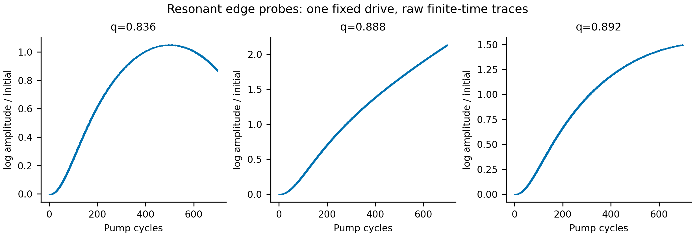
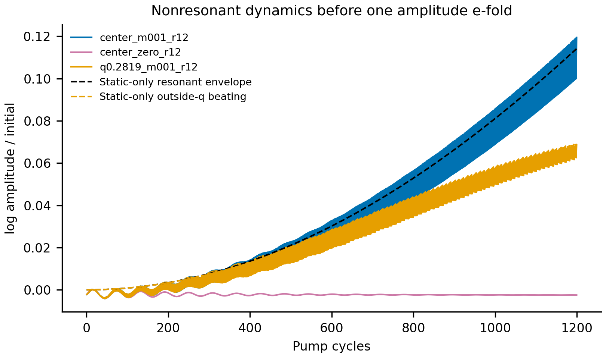
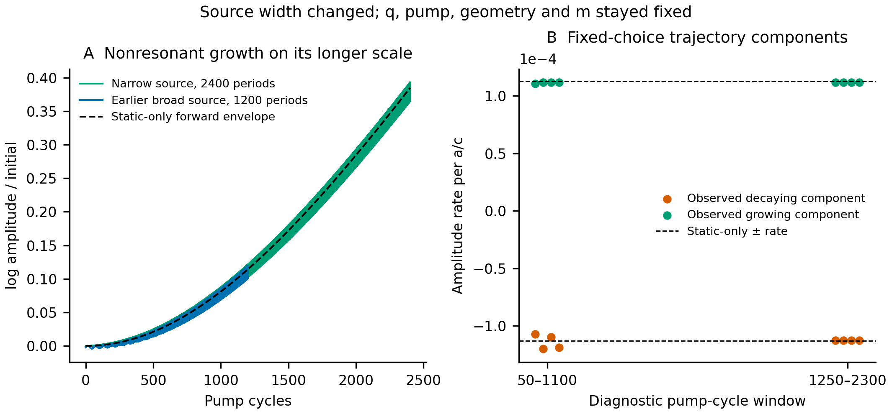

# 共振如何扩大动量带隙：Meep 与独立静态对照

**静态弱调制对照给出约 306 倍宽度增强，真实 Meep 时序支持相应强弱放大机制。** 共振区已获得明显参量放大和边界判别，非共振区获得长尾束缚模、窄带静态参考与弱增长时序；这不是直接测得 306 倍动态带宽，也不将混合后端比值称为精确动态复现。

物理结构统一为 R=210.6 nm、a=631.8 nm 的空气中硅球方阵，ε=11.68、χ₀=10.68、m=0.01。调制 ε(t)=11.68+0.1068 cos(Ωt)。共振与非共振工作区各选择一个固定 pump，并在各自 q 扫描保持不变；没有逐 q 重调谐。

## 同后端实际工作点的静态弱调制比较

| 情形 | 空间离散与开放域 | 半泵频率 | 相对静态带宽 |
|---|---|---:|---:|
| 共振 | Meep r24 voxel，padding=1、PML=0.5 | 195.858519 THz | 6.0541% |
| 非共振 | Meep r12 voxel，padding=20、PML=2 | 91.555276 THz | 0.019815% |

这两组静态弱调制估计的宽度比约为 **306 倍**，支持“共振使带隙扩大到数百倍量级”的趋势。它使用不同空间分辨率及不同开放域，且两侧均含有限差分/局部模型近似，不能当作同精度动态带隙的精确增强比。

非共振同模型导数 df/dε=-0.00033643982、df/dq=0.64347937；局部 Δq=Δε|df/dε|/|df/dq|=5.5839821e-05，相对宽度以 q₀=0.2818 归一化。弱耦合振幅指数 λ≈0.000112883，一个 e-fold 约需 3419 个 pump 周期。

共振处 |df/dε|=0.0151167，约为非共振处的 44.93 倍；平坦色散还让同样频率劈裂对应更大的动量区间。因此增强并非把 m 调大，而是材料微扰对共振的影响与较小色散斜率共同作用。宽度公式与相对 q 归一化也说明增长率增强比和动量带宽增强比不必相同。

共振带宽约 6.05% 来自七个实测静态点的 PCHIP 色散加中心 ε 导数，再求两个一阶静态对应系统与半泵交点；不是两个 ε 的整条空间色散都已直接求出。非共振估计使用同一 Meep 网格上的 ε±、q± 实际静态计算。两者都属于弱调制静态参考。

非共振进一步做了两次 **native Meep 静态对应系统验证**：ε=11.6266 的 q=0.281772018809，ε=11.7334 的 q=0.28182785863；二者与目标半泵实频残差均约 −5.5×10⁻⁹，公共 E/H 线场身份通过。候选位置由独立静态导数预估，再由新的原生求解核验，未按动态增长拟合。候选间距相对 q₀ 约 0.01981541%。这加强了静态对应带宽证据，但仍不是直接 Floquet gap，且没有声称无限精确根。原始依据在 `results/nonresonant_recovery/static_counterpart_roots.json`。

机制比较（历史材料 `results/gap_comparison/resonance_comparison.png`；见[发行说明](../../docs/RELEASE.md)）

## 非共振模式为什么需要更大的空气域

| 静态算例 | f a/c | 拟合衰减，未作 Q 认证 | 两窗 z 线场重叠平方 | 理论 / 拟合空气 κ |
|---|---:|---:|---:|---:|
| r12_pad12 | 0.1929501138 | -5.376e-06 | 1.00000000 | 0.31264 / 0.31303 |
| r12_pad20_pml2 | 0.1929488949 | -1.948e-08 | 1.00000000 | 0.31267 / 0.31207 |
| r12_pad20_pml2_epsminus | 0.1929669002 | -1.977e-08 | 1.00000000 | 0.31223 / 0.31163 |
| r12_pad20_pml2_epsplus | 0.1929309684 | -1.921e-08 | 1.00000000 | 0.31311 / 0.3125 |
| r12_pad20_pml2_qminus | 0.1923052143 | -2.135e-08 | 1.00000000 | 0.31056 / 0.30996 |
| r12_pad20_pml2_qplus | 0.1935921731 | -1.765e-08 | 1.00000000 | 0.31479 / 0.31417 |
| r12_pad6 | 0.1929923707 | -0.0002555 | 1.00000000 | 0.31161 / 0.31569 |

pad20 基线束缚模在 f≈0.19295，低于空气光线约 0.19926；空气尾部 κ≈0.3127/a，与提取场的指数衰减相符。长尾解释了为什么薄空气域容易污染基线。这里的公共 z 线场不是全空间残数度量；微小拟合衰减也不提供已收敛物理 Q。旧小空气域失败记录仍保留。

独立静态分支审查还要求空气尾部 κ 与解析值相差 <3%、尾部 log 拟合 RMS<0.005，唯一合格分支才进入导数计算。ε± 的公共 z 线 H 场重叠平方 >0.999999，q± 的 H 重叠平方 >0.999986；E 单独比较也通过。pad6→12→20 的目标拟合衰减量级由 2.56×10⁻⁴ 降至 5.38×10⁻⁶ 再至 1.95×10⁻⁸，支持其此前主要受截断边界污染；空间 r12 仍未独立加密。完整选择与哈希在 `results/nonresonant_recovery/summary.json`。

## 共振侧动态边界判别

所有新增边界点固定 f_drive=0.825527188667，与原 q 扫描完全一致。已有 q=0.84 的轨迹诊断有明显正指数；下表保留新增点的两种抽样相位和同一 50–650 周期时窗，避免依据晚窗 log 斜率单独划边。

| q | 状态 | 两相位观察到的较大指数 | rank-2 最大残差 |
|---:|---|---:|---:|
| 0.836 | COMPLETED_DIRECT_MEEP_DYNAMIC_PROBE | 1.16034e-06 至 3.45391e-06 | 0.0004082 |
| 0.888 | COMPLETED_DIRECT_MEEP_DYNAMIC_PROBE | 0.0017031 至 0.00170327 | 2.083e-05 |
| 0.892 | COMPLETED_DIRECT_MEEP_DYNAMIC_PROBE | -1.41918e-06 至 -2.10628e-07 | 2.743e-05 |

rank=2 是观察到的有限轨迹子空间假设，不是全部空间模式或旁带谱。当前 q=0.836 与 0.892 只有漂移尺度指数，q=0.840（已有）及 0.888 有明显增长证据，因此观察性的边界区间为左 [0.836,0.840]、右 [0.888,0.892]。按 q₀=0.86 换算，带宽范围约 **5.58%–6.51%**；这不是统计置信区间，也不排除更弱的未分辨效应。静态近似 6.05% 位于此范围内。

## 非共振真实动态与时间尺度

| 动态算例 | 完成状态 | 实际 pump 周期 | 后段 log 振幅斜率 | 振幅比：最后10周期 / 第10–20周期 |
|---|---|---:|---:|---:|
| center_m001_r12 | COMPLETED_DIRECT_MEEP_DYNAMIC_PROBE | 1200.01 | 5.63021e-05 | 1.11513 |
| center_m001_r12_narrow_long | COMPLETED_DIRECT_MEEP_DYNAMIC_PROBE | 2400.01 | 8.96654e-05 | 1.45864 |
| center_zero_r12 | COMPLETED_DIRECT_MEEP_DYNAMIC_PROBE | 1200.01 | -1.14554e-07 | 0.997545 |
| q0.2819_m001_r12 | COMPLETED_DIRECT_MEEP_DYNAMIC_PROBE | 1200.01 | 2.69005e-05 | 1.06749 |

在弱耦合非共振区，1200 周期可能仍短于一个 e-fold。初始单向模式通常包含增长与衰减 Floquet 分量，早期包络可能主要表现为双曲函数的二次起始；因此较小的有限窗斜率不能直接解释成不存在带隙或理论增长率错误。必须结合 m=0、失谐、静态预测时间尺度和可分辨的伴频/轨迹诊断，且不拟合静态导数来追动态曲线。

图中虚线只用静态导数给出 λ，并假设初始单向频率分量的弱耦合包络 `A(t)/A(0)=sqrt(cosh(2λt))`；未重新拟合 λ，也未精确模拟 ramp 或全部场分量，因此只能比较早期数量级与曲率，不能拿有限窗 log 斜率直接等同于渐近 λ。

进一步对固定 pump、q=0.2819 的带外控制作无动态拟合预测。令循环频率耦合 g=Δε|df/dε|/2、失谐 δ=f(q)−f_drive/2。若 |δ|>g，初始单向频率的弱模型给出

`A(t)=sqrt[1+2g²/(δ²−g²) sin²(2π sqrt(δ²−g²) t)]`。

这个包络有界，但其较长拍频的前段会持续上升。它与共振 `sqrt(cosh)` 的区别来自静态失谐，不需要用动态曲线拟合带宽。

| 非共振运行 | 静态预测 δ | 预测末端振幅 | 有界最大值 | 功率拍频周期 / pump周期 |
|---|---:|---:|---:|---:|
| center_m001_r12 | -1.94289e-16 | 1.12104 | 无界弱模型 | — |
| center_m001_r12_narrow_long | -1.94289e-16 | 1.46926 | 无界弱模型 | — |
| center_zero_r12 | -1.94289e-16 | 1 | 1（无调制） | — |
| q0.2819_m001_r12 | 6.43479e-05 | 1.07131 | 1.08124 | 3122.705 |

这些末端预测没有计入 ramp、残留其它静态模、数值漂移及接口更新误差，因而只用于前向机制检查，不作为时序拟合证书。
离线双分量审查固定 rank=2、cubic 插值以及预先声明的 phase/delay；已先用同采样间隔、约 ±0.00011 的慢增长合成数据检查识别能力。未通过奇异值分离或参数稳定门时保留拒绝，不扫 rank/相位追出一个接近理论的值。

| 非共振算例 | 双分量识别状态 | s₃/s₂ 范围 |
|---|---|---:|
| center_m001_r12 | REJECTED_AS_RESOLVED_TWO_MODE_GROWTH_ESTIMATE | 0.3429–0.8886 |
| center_zero_r12 | OBSERVED_PAIR_DIAGNOSTIC_ONLY | 0.01435–0.01511 |
| q0.2819_m001_r12 | REJECTED_AS_RESOLVED_TWO_MODE_GROWTH_ESTIMATE | 0.1119–0.1991 |
| center_m001_r12_narrow_long | OBSERVED_PAIR_DIAGNOSTIC_ONLY | 0.01613–0.04685 |
| center_m001_r12_narrow_long，1250–2300 周期 | OBSERVED_PAIR_DIAGNOSTIC_ONLY | 0.00196–0.003964 |

最初宽源 1200 周期 m=0.01 的两分量未能可靠分离，故其拟合率不作为已解析 Floquet 极点。较窄源与更长记录保留为单独算例，保持同 q、同 pump、同材料；改变源旨在减少额外模激励，不改变物理带隙来追结果。

**最后的窄源 2400 周期记录使非共振慢增长也得到可识别的动态证据。** 振幅代理量约为初始的 1.45864 倍；静态参数前向包络给出约 1.47 倍。预先固定的 1250–2300 周期窗口、相位 0.25/0.5、delay 64/96 下，观察到的增长分量为 1.11778×10⁻⁴–1.11788×10⁻⁴，衰减分量约 −1.12568×10⁻⁴ 至 −1.12550×10⁻⁴，接近静态预测 ±1.12883×10⁻⁴；s₃/s₂ 为 0.00196–0.00396，两分量比原宽源记录更可分辨。

这些固定选择下的近一致率支持真实缓慢参量增长，而后段 log 包络斜率 8.97×10⁻⁵ 仍受初始增长/衰减混合影响。这里没有把该轨迹子空间升级为完整 Floquet 模态谱，也没有直接扫描出非共振动态带隙的两条边。窄源同时缩小静态 Harminv 频窗，故“未再报告近光线杂峰”本身不证明该场分量已经完全消失；结论依靠时序分离与控制证据。

## 独立 MPB 与论文固定频率参考

MPB 是独立的静态周期 z 超胞参考，用于检查模式位置、长尾和两静态系统交点；不提供 Meep 开放衰减或时变动态结果。它的空间平均与 Meep voxel 不同，系数和宽度保持分别报告。

MPB r12、Lz=64，在论文固定半泵 91.5 THz 下实际重复求解三个静态系统交点：q−=0.281563380342、q₀=0.281590469538、q+=0.281617460129，相对宽度 **0.01920512%**。频率求根残差约 4×10⁻¹²，但 r12 空间尚未加密，因此小求根残差不等于空间误差也同样小。

该辅助结果与共振侧“论文固定 392 THz”的 Meep 一阶静态参考 6.86154% 相除约为 **357 倍**。这是 **混后端、不同空间离散、不同近似等级的静态弱调制比较**：非共振 MPB 实际求静态交点，共振 Meep 使用基线色散插值与单点 ε 导数。它交叉支持数百倍量级，不能称为直接 Meep 动态精确复现了论文约 350 倍。

该辅助结果已保存于 `results/mpb_nonresonant/static_gap_reference.json`（SHA256 82359b33856558fbe60065b36c66bbc2c1cca21699f4df3a5c4621c197d6e42d）。不以 MPB 数字替换 Meep 的 ε 导数。

论文固定频率还需单独比较：共振 pump=392 THz、非共振 pump=183 THz。当前共振 Meep 静态一阶参考在固定 392 THz 时得到约 6.862%，不同于本次真实动态 pump 的约 6.054%。选择其中更接近论文的值而不注明工作点，会混淆问题；本报告明确保留两者。

## 可复查范围

本报告只写新文件，历史 `dynamic_report.md` 和其原始 Meep 数据未改变。静态输入、所有已完成/未完成状态、独立参考、来源哈希和诊断保存在 `results/gap_comparison/comparison_summary.json`。原生 Meep 由主任务控制，此脚本仅离线读取、核算和作图。

验证：完整回归 **431 项通过**，14 条已有依赖弃用警告；原始 XML 在 `results/gap_comparison/regression.xml`。其中新增包络公式的 6 项检查直接对照独立两复幅 ODE，覆盖零调制、共振、失谐、阈值极限、失谐符号和有界拍频的有限窗上升。测试不替代空间收敛或完整 Floquet 谱验证。
