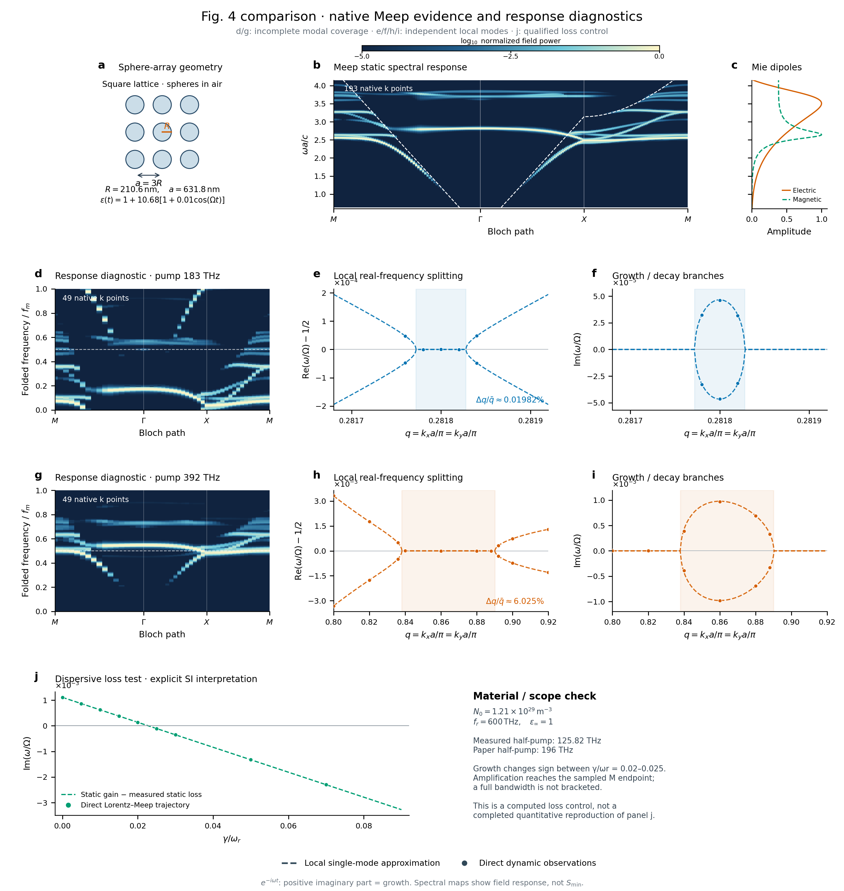

# Fig. 4 对照：d/g 响应诊断与 j 损耗核查

**b 已扩展到193个真实Meep采样点；d/g有两组49点真实时变响应，但分支覆盖不完整，
尚未复现论文d/g的模态谱。j已执行Lorentz–Meep损耗对照，原面板仍未完成。**

2026-10-14纠正：此前把d/g放进“复现图”的安排容易误导。检查原论文和零调制对照后，
已确认复数脉冲响应未覆盖独立负频伙伴；调制生成的负频旁带折叠回同一准频率，
不能算作另一条本征分支。现图改标为响应诊断。见[具体审计](dg_audit/report.md)。

随后本项目新增[真正的I−TG最小奇异值试算](smin_trial/README.md)，采用独立
Floquet–Mie/T-matrix路线，与下列Meep响应诊断分开保存。



[高清PNG](figure4_extended.png) · PDF（历史材料 `figure4_extended.pdf`；见[发行说明](../../../../docs/RELEASE.md)） ·
[可编辑SVG](figure4_extended.svg) · [d/g独立放大图](figure4_dg_detail.png)

## b：更密的实际空间采样

M–Γ–X–M由97点加密至193点，复用原97点并新算96点。原频率轴、空间离散、
时间窗、源和探针保持一致。数据见`static_band_map_193/`，全部旧列在新图每隔一列
逐值一致，不通过插值伪造分支。空间网格和频率分辨率没有因此提高。

## d/g：真实时间调制后的全路径响应，模态谱复现未完成

每张图沿M–Γ–X–M实际求解49点。物理球体R/a=1/3、epsilon0=11.68、m=0.01；
泵浦分别固定为论文的183与392 THz，不随k调谐。双偏心Hz/Ez脉冲、无镜面对称
约束，允许激发不同扇区的可见响应。源关闭后启动平滑调制，保存100个泵周期
的六分量复场和每次材料更新记录。r12原生网格化球体、padding3a/PML1a。

图中由**真正时变场的双符号FFT**按泵频率折叠，显示逐k归一化响应。该算法没有
求解Floquet本征条件、识别独立模式或恢复未被激发的负频伙伴。它不是
静态谱的复制，也不是论文T-matrix的最小奇异值S_min；源不可见模式、快泄漏
响应及有限窗频率分辨均影响线条强度。M点的m=0对照验证调制确实产生了负频
旁带；独立FFT与折叠守恒检查保存在`full_dynamic_maps/processing_checks.json`。

e/f/h/i沿用此前已验证的局部轨迹数据，工作点按各自测得载频设定，与d/g使用
论文固定泵频率的配置不同。它们是局部机制验证，不能当作d/g同一次运行的
直接放大截取。全路径100周期数据也不足以分辨非共振极窄带隙。

## j：执行了什么，为什么还不能声称完整复现

SI Eq. S32明确规定电子密度调制：

`P'' + gamma P' + omega_r² P = omega_p0² [1+m cos(Omega t)] E`，
`D=E+P`、`omega_p0²=N0 e²/(m_e epsilon0)`。

这里不能使用此前的`set_materials`瞬时epsilon更新，因为它会清除Meep的
P/P_prev记忆。新增本地、版本固定的C++适配器只原位更新现有Lorentz的sigma
驱动数组，保留原生空间求解、极化历史和D/B场；没有修改已安装Meep。
独立均匀ADE控制验证了逐步递推、正确更新时间、零调制恒等以及连续ODE
时间步收敛。源码与构建哈希见`native_build/`，测试见`results/lorentz_density_gate/`。

SI给出`N0=1.21×10^29 m^-3`和`omega_r=600 THz`，但角/循环频率写法未澄清。
用电子质量和电荷计算，两种解释在196 THz分别给出：

| 解释 | gamma=0 时的 epsilon |
|---|---:|
| omega_r=600×10^12 rad/s | −331.954 |
| f_r=600 THz，即omega_r=2pi×600×10^12 rad/s | 31.333 |

二者都不是前面无色散模型的11.68。本轮明确采用正介电的第二种解释，
不调整密度、质量、材料参数或gamma缩放来拟合论文。该结构实际测得的中心
约125.82 THz，因此另以该中心的两倍作为固定泵，检验色散材料的真实损耗趋势。

十个中心损耗算例使用gamma/omega_r从0到0.09，保留所有原始数据。
九个通过跨时窗/探针一致性检查：增长在0.02–0.025之间转为衰减，和独立
静态校准的增益减损耗预测一致。0.09的后段不再为单指数，未作为可靠点连线。
在gamma/omega_r=0和0.02时，实际q对照到M仍出现增长，当前没有夹住右侧边界。
因此原j中的放大动量宽度曲线保持未定，**没有用外推或任意截断画出第二根纵轴**。

另保留了论文392 THz驱动的试跑；其模式/增长提取没有通过一致性检查，不能据此
证明放大或证明不存在模式。材料单位、工作点和完整带宽的未决问题详见
[材料合同](../../docs/figure4j_material_contract.md)与
[损耗分析](lorentz_loss_analysis/report.md)。不把这些差异直接归咎于论文错误。

## 文件与再生成

完整时变原始场、双符号频谱及m=0对照：`full_dynamic_maps/`。
色散静态校准、真实动态损耗及q对照：`lorentz_calibration/`、`lorentz_dynamic/`、
`lorentz_qcontrols/`。旧25/97点图片分别保存在`history_25k/`、`history_97k/`。

```powershell
$env:OPENBLAS_NUM_THREADS='2'
.\.venv\Scripts\python.exe toolbox_experiments/nphoton_2024_01563/plot_figure4_extended.py
```

数据点分别代表有限时窗响应或通过检查的轨迹增长率；虚线单模/增益减损耗
对照都单独标明。没有把本图称为完整开放Floquet本征谱或已经完成原论文所有面板。
