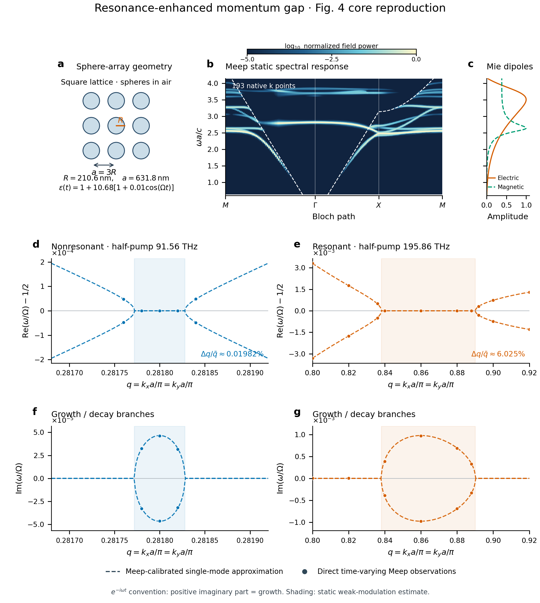

# Nature Photonics Fig. 4 核心面板复现图

**图已实际生成：静态谱采用193点Meep动量采样，局部复频数据点来自真实时变Meep，
虚线为独立静态校准的单模近似。** 保留原论文的信息安排，但不把不同计算方法的
观测量冒充为作者的T-matrix最小奇异值图。



[PNG高清图](figure4_reproduction.png) · 矢量PDF（历史材料 `figure4_reproduction.pdf`；见[发行说明](../../../../docs/RELEASE.md)） ·
[可编辑SVG](figure4_reproduction.svg) · [复频原始观测CSV](dispersion_observed.csv) ·
[单模近似CSV](dispersion_model.csv)

**b图细化版：** [独立高清PNG](figure4_b_detail.png) · PDF（历史材料 `figure4_b_detail.pdf`；见[发行说明](../../../../docs/RELEASE.md)） ·
[可编辑SVG](figure4_b_detail.svg)。原25点版本保存在
[history_25k](history_25k/figure4_reproduction.png)，97点版保存在
[history_97k](history_97k/figure4_reproduction.png)。本轮复用97点、补算96个原生Meep点；
没有沿k插值或拼接模式分支，其他面板沿用原数据。

25点／193点同色阶比较（历史材料 `figure4_b_refinement_comparison.png`；见[发行说明](../../../../docs/RELEASE.md)）可直接查看采样加密效果。

**新增d/g与j核查：** [扩展组图与说明](EXTENDED_README.md)。d/g各49个真实时变
全路径响应点，但缺失模态分支，原论文模态谱尚未复现；j已完成Lorentz损耗对照，
完整放大带宽与论文工作点仍未复现。

## 与论文面板的对应

| 本图 | 原论文 | 本轮内容与来源 |
|---|---|---|
| a | Fig.4a | 球阵列俯视示意；半径210.6 nm、周期631.8 nm、epsilon0=11.68、m=0.01 |
| b | Fig.4b | 原生Meep沿M–Γ–X–M的193个k点，无源场FFT响应；同时激发TE/TM可见模式 |
| c | Fig.4c | 同物理球体的精确解析Mie电/磁偶极系数幅值 |
| d、f | Fig.4e、f | 非共振区域的实频分裂与增长/衰减，半泵频率91.5553 THz |
| e、g | Fig.4h、i | 共振区域的实频分裂与增长/衰减，半泵频率195.8585 THz |

本核心七面板图不含原Fig.4d/g、j；新增结果见上述扩展组图，Fig.5未复现。
局部动态谱的实频轴减去了1/2，以清楚显示很窄的分裂。原文使用exp(+iωt)，
本图使用exp(−iωt)，所以本图正虚部表示增长，和原图增长虚部符号相反。

## 图注

**共振增强动量带隙的Meep复现。** a，硅样无色散球体在空气中的方阵，
epsilon(t)=1+10.68[1+0.01 cos(Ωt)]。b，同几何的原生Meep静态谱：
无z对称约束的偏心Hz/Ez脉冲同时激发两个对称扇区，源关闭后记录300 a/c，
对三个探针的六个复场分量使用Hann时间窗作正频FFT。每个k列独立归一化，
颜色是场响应强度而非S_min、态密度或本征模完备性；图中恰为193个实际k列，
未沿k插值。白虚线是最低空气光线。c，解析单球|a1|、|b1|，与b共用ωa/c纵轴。
d–g，非共振和共振区域的局部归一化复频。圆点来自固定相位/延迟的原生Meep
复场轨迹提取；两支分别测得，未强制正负对称。每个实部或虚部分量独立通过
重复性检查才绘制，因此一个圆点不等同于整对复频或完整模式已被联合认证；
未通过分量没有补零或由模型填补。短误差线仅是固定分析选择之间的范围，
不是统计置信区间。虚线来自仅用静态Meep频率及材料敏感性校准的单模Floquet
近似，独立时间积分验证其代数；它不是原生Meep全波本征谱。浅色阴影采用
弱调制静态对应系统的边界。带外接近零的已通过虚部估计仍可能处于数值漂移
尺度，不由此宣称弱增益。

静态全路径图使用r16、padding3a、PML1a的统一空间离散；近光线长尾模式在该
短域内可能不充分，谱线也受激励和探针可见性影响。局部动态图使用此前独立
验证的共振r24/padding1a/PML0.5a与非共振r12/padding20a/PML2a记录，不能将它们
当作和静态全谱相同的数值离散。泵浦频率分别在本模型测得的中心固定，未逐q
调谐，也未改动材料去贴论文的196/91.5 THz。

动量步长由每路径段8个区间经32个区间细化为64个区间；原25点对应新网格的
每第八列，前版97点对应每第二列。复用的原始场及频谱按哈希核对，数值逐位相同。
无源记录仍为300 a/c，独立频率分辨率
约0.003332 c/a，频率显示网格约0.0009766 c/a；零填充只增加显示采样。b图加密
改善的是动量方向的细节，不能据此声称空间网格、频率分辨率或Q值已收敛。

## 带宽定义

本图遵循论文的中点归一化：`200(q+−q−)/(q++q−)`，结果为非共振
**0.0198154%**、共振 **6.02515%**，静态近似增强约 **304倍**。
此前报告用固定载频中心q0归一化得到6.05408%和约306倍；差异来自分母定义，
不是改变原始数据。论文对应值为0.0183%、6.59%和约350倍。

这些是明确标注的弱调制静态带宽估计。直接时变数据支持相应的频率分裂、
参量增长/衰减和窄/宽动量范围趋势；不将静态近似比值包装成全波动态精确比值。

## 复查与再生成

生成源：[plot_figure4_reproduction.py](../../plot_figure4_reproduction.py)。
从项目根目录执行：

```powershell
$env:OPENBLAS_NUM_THREADS='2'
.\.venv\Scripts\python.exe toolbox_experiments/nphoton_2024_01563/figure4_dispersion_data.py
.\.venv\Scripts\python.exe toolbox_experiments/nphoton_2024_01563/plot_figure4_reproduction.py --band-map toolbox_experiments/nphoton_2024_01563/results/figure4/static_band_map_193
```

`dispersion_data.json`保存所有通过/拒绝分量、模型来源、raw复乘子和输入哈希；
`static_band_map/`保存原25点，`static_band_map_dense/`保存97点，`static_band_map_193/`
保存本轮193点及复用来源核查；新增四个非共振动态点
保存在`nonresonant_modes/`。`figure_manifest.json`逐面板记录实际绘制数据。

来源论文：X. Wang et al., *Expanding momentum bandgaps in photonic time crystals
through resonances*, Nature Photonics 19, 149–155 (2025),
[DOI:10.1038/s41566-024-01563-3](https://doi.org/10.1038/s41566-024-01563-3)。
图为本项目重新计算与绘制，未把论文图片作为新模拟结果。
