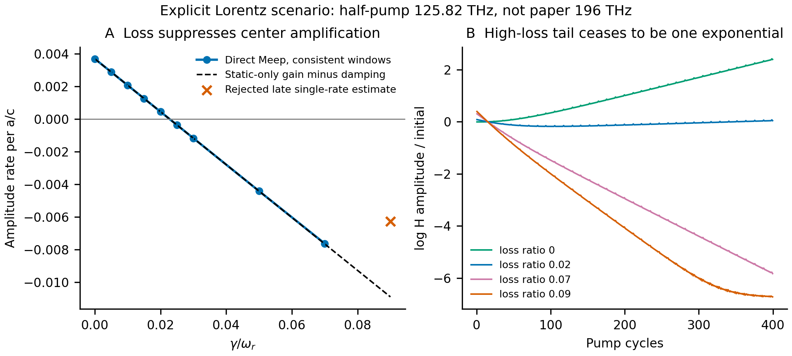

# Lorentz 损耗：保留极化记忆的 Meep 对照

**新增了保留极化记忆的真实 Meep 损耗曲线，但当前明确材料解释及工作频率不匹配原论文 j。** 随损耗增加，中心参量增长被压低，在 γ/ωr=0.02–0.025 之间改变符号；没有调整电子密度、有效质量、共振频率或阻尼去贴合论文。

实际本构为 `P̈+γṖ+ωr²P=ωp0²[1+m sin(Ωt)]E`、`D=E+P`。N₀=1.21×10²⁹ m⁻³、ε∞=1、600 THz 按循环共振频率解释，得到 sigma≈27.096。原生辅助极化状态在 sigma forcing 更新时保留，r16 voxel、Courant=0.25、m=0.01。中心载频约125.81977 THz，固定调制频率约251.63954 THz；它不能改标为论文196 THz半泵或392 THz调制。原材料单位/参数歧义见对应来源审查。

## 中心增长与独立静态预测

零损耗的独立静态 sigma 扰动给出 g=0.003696977065 每 a/c。每个损耗点再从调制前、两时间窗和三探针的唯一静态极点测 κ 和小失谐 δ，预测 `λ≈sqrt(max(g²−δ²,0))−κ`。这里 g 固定为静态值，不由动态曲线拟合；它仍是中心单模近似，不含已独立验证的全部旁带耦合和 q 变化。

| γ/ωr | 后段振幅率 λ | 三窗范围 | 静态预测 λ | 单率可画 |
|---:|---:|---:|---:|---|
| 0 | 0.0036972586 | 0.00365322 至 0.00369726 | 0.0036961835 | True |
| 0.005 | 0.0028864728 | 0.00284247 至 0.00288647 | 0.0028853761 | True |
| 0.01 | 0.0020756528 | 0.00203169 至 0.00207565 | 0.0020745673 | True |
| 0.015 | 0.0012648248 | 0.00122091 至 0.00126482 | 0.0012637577 | True |
| 0.02 | 0.00045399287 | 0.000410115 至 0.000453993 | 0.0004529469 | True |
| 0.025 | -0.00035684052 | -0.000400679 至 -0.000356841 | -0.00035786554 | True |
| 0.03 | -0.0011676742 | -0.00121148 至 -0.00116767 | -0.0011686802 | True |
| 0.05 | -0.0044109705 | -0.00445466 至 -0.00441097 | -0.0044119735 | True |
| 0.07 | -0.007628477 | -0.00769713 至 -0.00762848 | -0.0076553599 | True |
| 0.09 | -0.0062662552 | -0.0108503 至 -0.00626626 | -0.010898916 | False |

“率”是周期平均三探针 H 振幅代理量的有限窗 log 斜率，不是直接求得的完整 Floquet 复本征频率。图中的窗范围为数值敏感性范围，不是统计置信区间。可转换成同一 exp(−iωt) 约定下的等效 Im(f/fm)=λ/(2πfm)，但不能据此声称所有模态已解析。

实测符号夹区间为 [0.02,0.025]，仅作展示的线性零点约0.0227995；静态预测的插值零点约0.022793168。小数接近支持当前模型内的物理一致性，不是原论文材料精确复现。

## 高损耗后段为什么被拒绝

γ/ωr=0.09 的早窗率约−0.01085，而晚窗约−0.00627，log 拟合 RMS 增大，三个独立探针的晚段率也明显分散；它没有通过窗口和空间采样一致门。图中以叉号保留这一被拒绝的单率估计，不用它平滑接回损耗曲线。0.07 的三窗及探针仍一致，故保持接受。

绝对 H 振幅依赖源强。0.09 后段仍为约10⁻²量级，不能仅因它相对初值很小就认定达到浮点底噪；本轮没有独立 noise-only 记录来测定地板。模式竞争、残留背景或数值污染仍未区分。所有原始时序、初/末幅值、每窗每探针率与拒因保存在 summary.json，拒绝并不意味着该结构没有其它衰减模式。

## q 方向控制与宽度缺口

| q | γ/ωr | 后段 λ | 单率一致性 |
|---:|---:|---:|---|
| 0.66 | 0 | -0.0015707084 | False |
| 0.69 | 0 | 0.0020860044 | True |
| 0.74 | 0.02 | 0.00017043514 | True |
| 0.86 | 0.025 | -0.00035932794 | True |
| 0.8 | 0.02 | 0.00042400507 | True |
| 1 | 0 | 0.0037007793 | True |
| 1 | 0.02 | 0.00044767818 | True |

在 M 点 q=1，γ/ωr=0 和0.02 都仍有明显持续增长，说明沿当前 Γ–M 检查区间未夹住右侧边界；q=0.66 的时序又有明显窗口依赖，不能仅凭其晚段负斜率补出左侧边界。因此 **未获得完整放大区间**，`relative_full_width=null`，不绘制原论文 j 的完整宽度曲线。

低 q=0.1/0.2 的唯一可见静态峰约0.286，与中心候选支约0.265不同，中间 q=0.3–0.5 又没有可靠连接。任何跨此缺失区的插值宽度均无效，已全部丢弃；即使只限 q≥0.6，中央 g/κ 的常量近似也不提供已验证的完整宽度，因此没有保留误导性的 clipped-width 数字。

文件：`summary.json`、`center_loss.csv`、`center_loss_analysis.png/.pdf/.svg`。所有来源摘要、动态/静态原始 NPZ 均绑定 SHA256；分析器只读已有数据，不启动 Meep。`stable_center_rate_for_plot` 是有限单率可识别性标记，不是空间收敛或完整开放 Floquet 认证。
